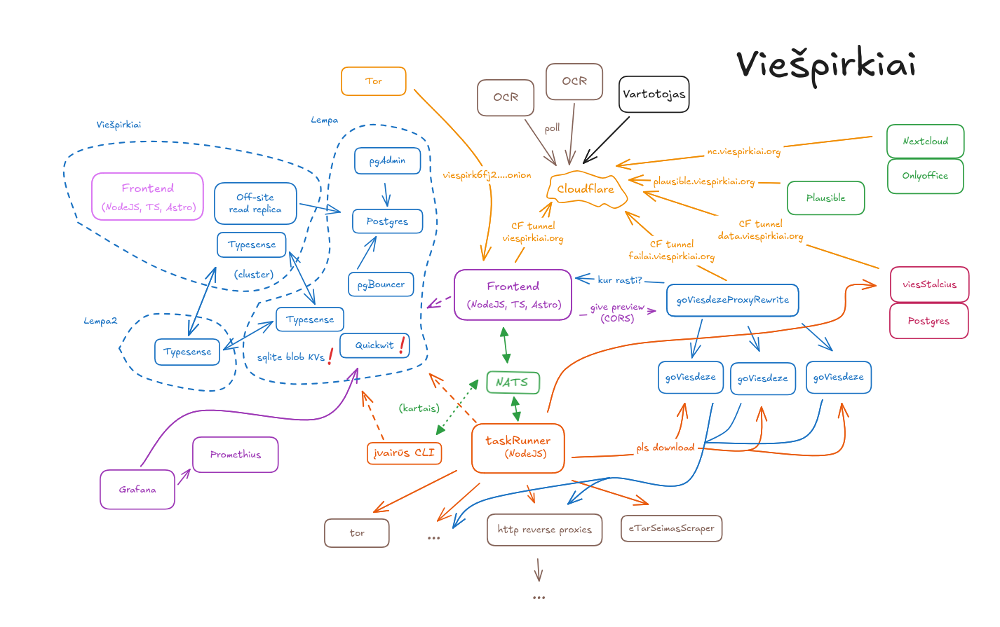
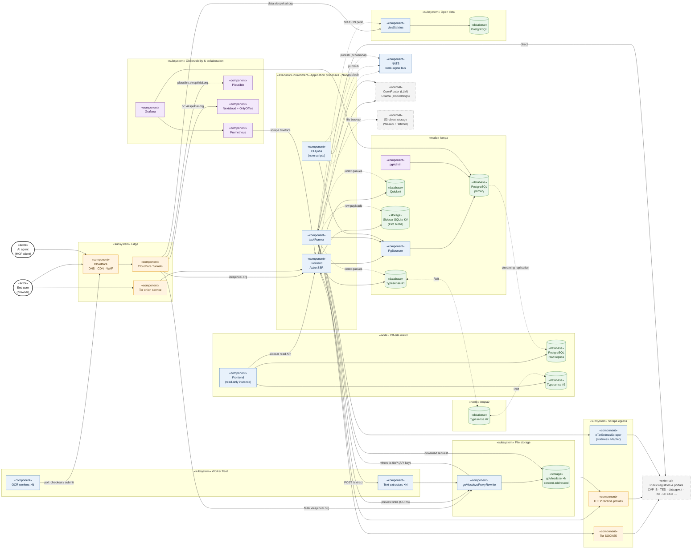
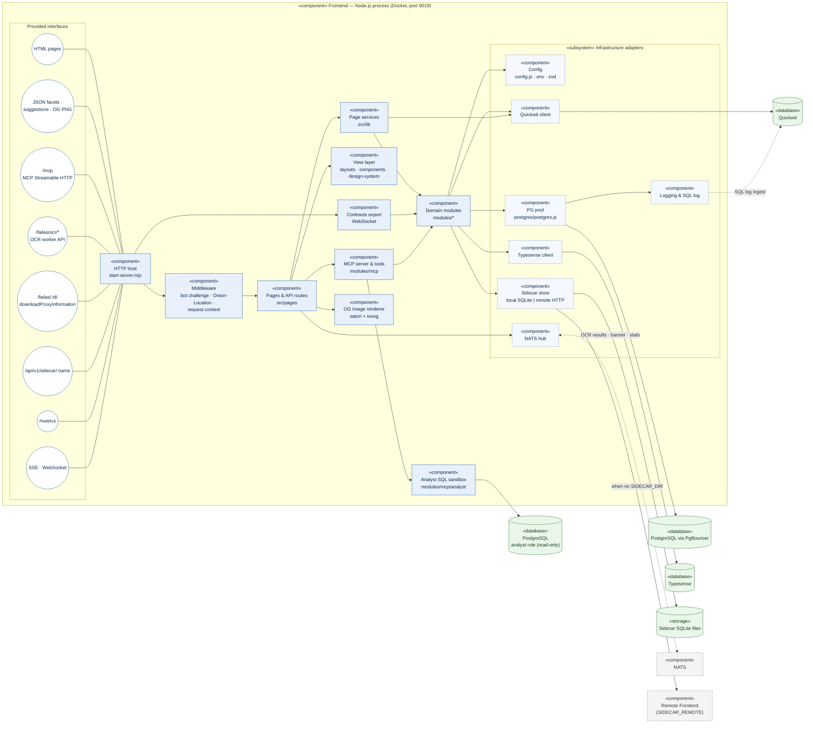
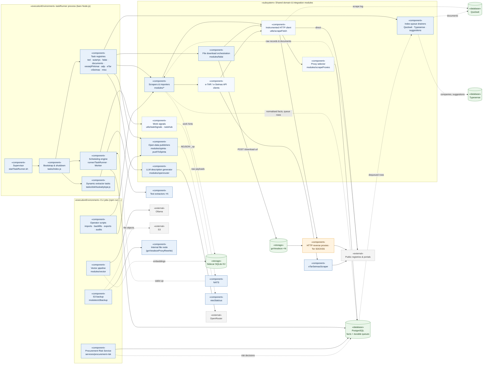
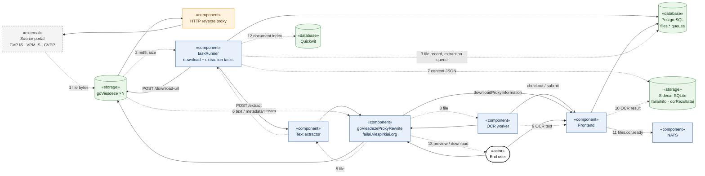

# Viešpirkiai — Current Architecture (as-is)

> **Status:** Phase 1 — architecture discovery. Describes the system *as it is today*; no recommendations yet.
> **Sources:** the hand-drawn sketch below, plus a reading of the repository (`start-server.mjs`, `tasks/`, `runner/`, `modules/`, `utils/`, `src/`, `config.sample.js`, `utils/configEnv.js`, `Dockerfile`, `compose.sample.yml`, `migrations/`).

Original sketch (kept for reference; `lempa` and `lempa2` are physical servers):

---

## 0. Notation

Mermaid has no native UML component diagram, so the diagrams use flowchart syntax laid out as UML component diagrams:

| Element | Notation |
|---|---|
| Component | rectangle with the `«component»` stereotype |
| Data store | cylinder with the `«database»` / `«storage»` stereotype |
| Deployment node (physical or virtual host) | subgraph with the `«node»` stereotype |
| Logical grouping of components | subgraph with the `«subsystem»` stereotype |
| External system (not operated by this project) | grey dashed box with the `«external»` stereotype |
| Actor | rounded box with the `«actor»` stereotype |
| Provided interface (Diagram 2) | circle (lollipop) |
| **Dependency**: A calls or uses B's interface | **solid arrow** `A ──▶ B` |
| **Data flow**: data moves from A to B | **dotted arrow** `A ┈┈▶ B` |

Colour key: blue = components built in this repository · green = data stores · orange = edge/network · purple = observability and tooling · grey = external.

The system is decomposed into five views:

1. **System overview**: deployment nodes and major components (redraw of the sketch).
2. **Frontend**: internal components of the Astro SSR web process.
3. **Background processing**: task runner, CLI jobs, and their integrations.
4. **File pipeline**: file download, storage, extraction and OCR end to end.
5. **Deployment**: servers, Docker containers, processes that run outside Docker, and how they connect.

---

## 1. System overview

### 1.1 Component catalogue

#### Edge

| Component | Responsibility | Evidence |
|---|---|---|
| **Cloudflare** | Public DNS, TLS termination, CDN caching and WAF / bot filtering for all `*.viespirkiai.org` hostnames. | `src/pages/privatumas.astro` (`cf_clearance`), sketch |
| **Cloudflare Tunnels** | Outbound-only tunnels from internal hosts to Cloudflare, so no inbound ports are opened. One hostname per tunnel: `viespirkiai.org`, `failai.`, `data.`, `plausible.`, `nc.` | sketch |
| **Tor onion service** | Publishes the Frontend as a `.onion` site. The Frontend adds an `Onion-Location` header to responses. | `src/middleware.ts`, `config.onionAddress` |

#### Application processes

| Component | Responsibility | Evidence |
|---|---|---|
| **Frontend** | Astro 7 SSR web app on Node 24. Serves HTML pages, facet and suggestion APIs, OpenGraph PNGs, the MCP endpoint, the OCR-worker API, the file-proxy lookup API, the sidecar read API, Prometheus metrics, SSE streams and a WebSocket export. Runs in Docker with host networking and a 2 GB memory limit. | `start-server.mjs`, `Dockerfile`, `compose.sample.yml` |
| **Frontend (off-site, read-only)** | A second Frontend instance on another host. It reads from a PostgreSQL read replica and a local Typesense node. It has no local sidecar files, so it reads them over HTTP from the main Frontend (`SIDECAR_REMOTE`). | sketch, `utils/sidecarStore.js`, `src/pages/api/v1/sidecar/[name].ts` |
| **taskRunner** | Long-lived background process (`tasks/index.js`) with about 100 registered tasks (cron and `asap` workers, up to 18 concurrent jobs). Handles scraping, imports, download orchestration, indexing, open-data publishing and LLM description generation. A bash loop (`startTaskRunner.sh`) restarts it on exit; it does not run in Docker. | `tasks/*.js`, `runner/TaskRunner.js` |
| **CLI jobs** | About 80 one-off or operator-run `npm run …` scripts: backfills, imports, exports, vector embedding, S3 backup, and the Procurement Risk Service. They sometimes publish NATS signals ("kartais" in the sketch). | `package.json` scripts, `scripts/`, `services/procurement-risk/` |
| **NATS** | Lightweight pub/sub bus that replaced PostgreSQL `LISTEN/NOTIFY`. Delivery is at-most-once and non-transactional. Messages are only *hints*: the durable state stays in PostgreSQL queue tables. Also used for live UI updates (SSE) and info-banner refresh. | `utils/natsHub.js`, `utils/taskSignals.js` |

#### Data tier (`lempa`, `lempa2`, off-site)

| Component | Responsibility | Evidence |
|---|---|---|
| **PostgreSQL (primary)** | System of record. Several schemas (`public`, `files`, `infra`, `auth`, `documents`, `ppa`, `risk`, `viespirkiai`, …). Also stores durable work queues and runtime configuration such as proxies, workers and storage boxes. | `postgres/postgres.js`, `migrations/`, `dbSchema/` |
| **PgBouncer** | Connection pooler in front of PostgreSQL, in transaction pooling mode. Code that needs session semantics (for example advisory session locks) connects directly (`PG_DIRECT_HOST/PORT`). | `utils/configEnv.js`, `postgres/sessionLock.js` |
| **PostgreSQL read replica** | Off-site streaming replica. Used by the read-only Frontend and as a disaster-recovery copy. | sketch |
| **pgAdmin** | Web-based DBA console. | sketch |
| **Typesense cluster (3 nodes)** | Raft-replicated search engine used for search-as-you-type suggestions and company (`juridiniai`) search. Each Frontend talks to its nearest node. If Typesense is unavailable (`typesenseUp`), search falls back to PostgreSQL. | `typesense/`, `modules/juridiniai/search.js`, `src/lib/searchSuggestions.ts` |
| **Quickwit** | Full-text search over document and file contents, contracts and procurements. Also stores operational logs (SQL query log, scrape log, MCP tool calls) that power the `/statistika` pages. | `quickwit/`, `src/lib/dokumentai/search/` |
| **Sidecar SQLite KV** | Compressed (zstd) key/value blob stores, one SQLite file per registry: `failaiInfo`, `dokumentai`, `ocrRezultatai`, `liteko2`, `eTar`, `eSeimas`. They keep large raw payloads out of PostgreSQL. Only the node with `SIDECAR_DIR` can write to them. The sketch flags this component with a "!" (a known concern). | `utils/sidecarPaths.js`, `utils/sqliteSidecarStore.js` |

#### File storage and worker fleet

| Component | Responsibility | Evidence |
|---|---|---|
| **goViesdeze ×N ("dėžės")** | Content-addressed file storage nodes, registered in `files.dezes` (URL, capacity, priority, API key). Each node downloads a source URL itself (`POST /download-url`), stores the file under its md5 and reports capacity (`/storage-usage`). | `modules/failai/parsiusti.js`, `modules/failai/kopijuoti.js` |
| **goViesdezeProxyRewrite** | Public file gateway (`failai.viespirkiai.org`). For a requested file it asks the Frontend which box holds it (`/failas/:id/downloadProxyInformation`, authenticated with a reverse-proxy API key), then streams the file from that box. Handles files extracted from archives too. | `src/pages/failas/[id]/downloadProxyInformation.ts`, `modules/failai/proxy.js` |
| **OCR workers ×N** | External, volunteer or remote machines. Each one polls the Frontend through Cloudflare (`/failas/ocr/checkout`), fetches the file, OCRs it and posts the text back (`/failas/ocr/submit`). Workers are authenticated by API key (`infra.ocrNuskaitytojai`); a worker holding more than 5,000 reservations gets HTTP 429. | `src/pages/failas/ocr/*.ts`, `modules/failai/auth.js` |
| **Text extractors ×N** *(missing from sketch)* | HTTP text-extraction services registered in `infra.dokNuskaitytojai`. taskRunner creates a dynamic task per enabled row (re-synced every 10 s) that calls `POST {url}/extract` with a file URL. | `tasks/dokNuskaitytojai.js`, `modules/failai/nuskaitytiTeksta.js` |

#### Egress, integrations, external systems

| Component | Responsibility | Evidence |
|---|---|---|
| **HTTP reverse proxies** | Outbound proxies registered in `infra.scrapeProxies` (types `httpReverse` and `socks5`), picked at random per source site. Used to spread and anonymise scraping of CVP IS and VPM IS. The repository includes a reference implementation (`modules/proxy/server.js`, HTTP to SOCKS5). | `modules/scrapeProxies/`, `migrations/scrapeProxies/` |
| **Tor SOCKS5** | Anonymous egress for selected scrapers (`TOR_ADDRESS`). | `config.sample.js` |
| **eTarSeimasScraper** | Stateless HTML-to-JSON adapter (with its own OpenAPI spec) for e-TAR and e-Seimas. All caching happens on the Viešpirkiai side (PostgreSQL and sidecars). | `modules/etar/eTarApi.js`, `modules/eSeimas/eSeimasApi.js` |
| **Public registries & portals** | Upstream data sources: eviesiejipirkimai.lt (CVP IS), viesiejipirkimai.lt, cvpp, mw.eviesiejipirkimai.lt (VPM IS), TED, data.gov.lt (ADP `:changes` feeds), Registrų centras, LITEKO, VTEK PINREG, DOMREG, Sodra, Regitra, VDI, STT, KOTIS, ES investicijos, OpenStreetMap / Overpass. | `modules/*`, `config.sample.js` |
| **viesStalcius** | Open-data API server (Stalčius, Spinta-compatible NDJSON `_op` write protocol) published at `data.viespirkiai.org`, backed by its own PostgreSQL. taskRunner and CLI jobs push data to it. | `modules/spinta/`, `modules/*/pushToSpinta.js` |
| **OpenRouter** *(missing from sketch)* | Hosted LLM gateway. Generates procurement and contract descriptions in a tool loop that reuses the MCP tools. | `modules/openrouter/`, `modules/viesiejiPirkimai/aprasymoGeneravimas.js` |
| **Ollama** *(missing from sketch)* | LAN embedding service (bge-m3) for experimental vector search over file chunks and CPV codes. Vectors are stored in SQLite. | `modules/vector/` |
| **S3 object storage** *(missing from sketch)* | Off-site backup of the whole file archive (about 3.8 M md5s, about 7.2 TB). Files are pulled from the internal file node and uploaded to S3 (Wasabi or Hetzner). | `modules/s3backup/` |

#### Observability and collaboration

| Component | Responsibility | Evidence |
|---|---|---|
| **Prometheus** | Scrapes `/metrics` on the Frontend, which exposes the `/statistika` data in text exposition format. | `src/pages/metrics.ts` |
| **Grafana** | Dashboards over Prometheus and PostgreSQL. | sketch |
| **Plausible** | Cookieless web analytics. The script is injected through `customHead`, and `/analitika` redirects to the dashboard. | `config.sample.js`, `src/pages/analitika.ts` |
| **Nextcloud + OnlyOffice** | Team file sharing and document editing (`nc.viespirkiai.org`). Not integrated with the code. | sketch |

---

## 2. Frontend — component decomposition

### 2.1 Component catalogue

| Component | Responsibility |
|---|---|
| **HTTP host** (`start-server.mjs`) | Loads `.env`, starts Astro's standalone handler on an `http`/`https` server, attaches WebSocket upgrades, optionally logs requests, and shuts down gracefully on `SIGTERM`/`SIGINT`. |
| **Contracts export WebSocket** (`modules/sutartys/exportWebSocket.js`) | Streams large contract exports to the browser over `ws`, with abort handling and back-pressure. |
| **Middleware** (`src/middleware.ts`) | Feature gating (for example ATN-1 routes), a JavaScript/cookie bot challenge for expensive search pages that still emits OG tags for crawlers, the `Onion-Location` header, and a per-request `AsyncLocalStorage` context (host) used to attribute SQL log entries. |
| **Pages & API routes** (`src/pages`) | File-based routing: about 40 entity and search pages (`sutartis`, `pirkimas`, `tiekejas`, `juridiniai`, `dokumentai`, `teisesAktas`, `rysiai`, `statistika`, …), facet and suggestion APIs, `*.png.ts` OpenGraph endpoints, plus the machine-facing APIs (OCR, file proxy, sidecar, metrics, MCP). |
| **View layer** (`src/layouts`, `src/components`, `src/design-system`) | Astro components and an in-house design system (tables, cards, filters, charts, maps). Client-side islands include the Sigma.js relationship graph (`src/rysiai-app.ts`). |
| **Page services** (`src/lib`, TypeScript) | Page-specific orchestration: search panels, page-data assemblers, labels and formatters, SSE producers, OG metadata. Bridges typed pages and the untyped domain modules. |
| **MCP server & tools** (`modules/mcp`) | Model Context Protocol server exposing domain queries as tools at `/mcp`. Tool calls are logged and indexed into Quickwit. |
| **Analyst SQL sandbox** (`modules/mcp/analyst`) | Optional `get_schema` / `execute_query` tools. Uses a separate read-only PostgreSQL role and pool, SQL parsing, and `statement_timeout`. |
| **Domain modules** (`modules/*`, JavaScript ESM) | Business logic and queries organised by data source (`sutartys`, `viesiejiPirkimai`, `juridiniai`, `failai`, `teisekura`, `rysiai`, `risk`, `statistika`, …). The **same modules are imported by the Frontend, the taskRunner and the CLI jobs**. |
| **OG image renderer** (`utils/openGraphImage.js`) | Renders social preview images server-side without a headless browser. |
| **Config** (`utils/config.js`, `configEnv.js`, `configSchema.js`) | Merges `config.js` with environment variables (the Docker image uses `.env` only), validates with zod, and exposes the result as a module and as `global.CONFIG`. |
| **PG pool** (`postgres/postgres.js`, `prepared.js`, `streamQuery.js`) | Shared `pg` pool with global type parsers (dates as strings, numerics as floats), optional prepared statements, streaming cursors and query logging. |
| **Typesense / Quickwit clients** | Thin HTTP clients, guarded by the `typesenseUp` / `quickwitUp` feature flags. |
| **Sidecar store** (`utils/sidecarStore.js`) | Reads blobs from local SQLite (worker-thread pool) or, on nodes without files, from a remote node over HTTP. |
| **NATS hub** (`utils/natsHub.js`) | One lazily opened NATS connection per process. Used for the OCR live-results SSE, NATS statistics, info-banner refresh and publishing work signals. |
| **Logging & SQL log** (`utils/log.js`, `quickwit/sqlLogIngest.js`) | Caller-tagged logging. An optional JSONL SQL profile log is shipped to Quickwit. |

---

## 3. Background processing — component decomposition

### 3.1 Component catalogue

| Component | Responsibility |
|---|---|
| **Supervisor** (`startTaskRunner.sh`) | Bash restart loop that forwards signals to Node and logs start times. It is the only process supervision for the task runner (no systemd or container). |
| **Bootstrap & shutdown** (`tasks/index.js`) | Builds the `TaskRunner` (18 concurrent jobs, tasks can be disabled via `TASKRUNNER_DISABLED_TASKS`), registers all task lists, and drains in-flight jobs, NATS and the PG pool on shutdown. The force-exit timeout is 10 minutes. |
| **Scheduling engine** (`runner/TaskRunner.js`, `Worker.js`) | In-process scheduler supporting `cron` and `asap` modes, priority, concurrency, cooldown and error cooldown, `nudge()` chaining (`onSuccess`), and `wakeOn` NATS subjects. |
| **Task registries** (`tasks/*.js`) | Declarative task definitions per domain (about 100 tasks). Each wraps a function from `modules/`. |
| **Dynamic extractor tasks** (`tasks/dokNuskaitytojai.js`) | Every 10 s, reconciles runner tasks with the `infra.dokNuskaitytojai` table, one task per extractor with its configured concurrency. |
| **Scrapers & importers** (`modules/*`) | Source-specific ETL: CVP IS contracts, procurements (CfT/PMC/DPS), planned procurements, TED notices, ADP `:changes` feeds from data.gov.lt, JAR/RC, LITEKO court decisions, PINREG, DOMREG, Sodra, Regitra, VDI, e-TAR / e-Seimas legislation, and more. |
| **File download orchestration** (`modules/failai`) | Takes a file from the download queue, picks the highest-priority box with free capacity, asks it to fetch the source URL (through a reverse proxy where required), records the md5 and size, and cleans up stale reservations. |
| **Index-queue drainers** | Read durable PostgreSQL index queues and bulk-index into Quickwit (documents, contracts, procurements, companies, MCP tool calls) and Typesense (companies, search suggestions). |
| **Open-data publishers** | Push datasets (contracts, domains, ADP-derived tables) to the Spinta-protocol server (viesStalcius), authenticated with an API key or OAuth client credentials. |
| **LLM description generator** (`modules/openrouter`) | Generates human-readable procurement and contract descriptions through OpenRouter, reusing the MCP tools via `mcpAdapter`, with a FIFO rate limiter. |
| **Instrumented HTTP client** (`utils/scrapeFetch.js`) | Wraps `fetch` for outbound scraping, recording redacted metadata (host, path, status, bytes, timing) to a JSONL log and Quickwit. |
| **Proxy selector** (`modules/scrapeProxies`) | Picks a random enabled proxy per site from `infra.scrapeProxies` (cached for 10 s) and maps it back to the public origin for logging. |
| **e-TAR / e-Seimas API clients** | Rate-limited (`*_MAX_INFLIGHT`) clients of the stateless adapter, with a rolling refresh window (`*_RECENT_DAYS`, `*_REFRESH_HOURS`). |
| **Work signals** (`utils/taskSignals.js`) | A fixed catalogue of NATS subjects, `viespirkiai.<env>.work.*`. A signal only means "check the PostgreSQL queue now". |
| **Operator scripts** (`scripts/`, `modules/*/…js`) | Manual imports (address register, VPT XLSX), backfills, audits, JSONL exports and schema tooling. |
| **Vector pipeline** (`modules/vector`) | Chunks text with a bundled bge-m3 tokenizer, gets embeddings from Ollama and stores float32 vectors in SQLite. Experimental search CLI. |
| **S3 backup** (`modules/s3backup`) | Resumable queue plus multipart upload of every file from the internal file node to S3, with per-target status tracking. |
| **Procurement Risk Service** (`services/procurement-risk`, `modules/risk`) | TypeScript batch job. Takes a PostgreSQL session lock, evaluates risk indicators (for example `LT-COM-*`, `LT-PRO-*`) over ATN-1 procurement reports and writes decisions to the `risk` schema. Run on demand, not yet scheduled. |

---

## 4. File pipeline — acquisition, storage, extraction, OCR

This view traces the flows around `goViesdeze` from the sketch. Numbers show the order of the flows.

### 4.1 Flow narrative

1. A scraper records a file reference in PostgreSQL and signals `files.download.ready`.
2. The download task picks the highest-priority box with free space and asks it to fetch the source URL. Where a site requires it (CVPP always does), the URL is rewritten to go through a registered reverse proxy. The box returns the md5 and size.
3. The file record is updated and queued for extraction (`files.extraction.ready`).
4. A dynamic extractor task calls the extractor's `/extract` with the public file URL. The extractor fetches the file through `goViesdezeProxyRewrite`, which resolves md5 to box via the Frontend's API-key-protected `downloadProxyInformation` endpoint.
5. Extracted content is stored in the `failaiInfo` sidecar and PostgreSQL. Files that need OCR go to `files.ocrQueue`.
6. OCR workers poll `checkout` (a reservation valid for 6 h), download the file, and `submit` the text. The Frontend deletes the reservation in a transaction, stores the result (`ocrRezultatai` sidecar), and publishes the result on NATS so live SSE pages update.
7. Document index queues feed Quickwit. End users open previews and downloads through `failai.viespirkiai.org`.

---

## 5. Deployment view

> **Evidence and confidence.** The production `compose.yml` has been git-ignored since commit `a6e03063` (2026-07-16). Today only `compose.sample.yml` is tracked, and it defines just the `frontend` service. This view is rebuilt from:
> - the **last committed `compose.yml`** (`git show a6e03063^:compose.yml`) and its `postgres/` and `pgbouncer/` Dockerfiles,
> - the earlier **`plausible/compose.yml`** (`32e0678f^`),
> - `.env.sample`, `ENV.md`, `.dockerignore` / `.gitignore` and `.github/workflows/build-image.yml`.
>
> Solid boxes are defined in the repository. Boxes with a dashed grey border are **inferred**: the runtime is not defined in this repository. Compare against the live `compose.yml` on `lempa` before relying on exact ports and memory limits.

```mermaid
flowchart TB
  classDef device fill:#fafafa,stroke:#333,stroke-width:1.5px,color:#111
  classDef ctr fill:#e8f1fb,stroke:#1f5fa8,color:#0b2545
  classDef proc fill:#fff8e1,stroke:#b28704,color:#3e2c00
  classDef store fill:#eaf6ea,stroke:#2e7d32,color:#123d14
  classDef inferred fill:#ffffff,stroke:#888,stroke-dasharray:4 3,color:#444
  classDef ext fill:#f4f4f4,stroke:#777,stroke-dasharray:4 3,color:#333

  subgraph GH["«cloud» GitHub"]
    gha["«executionEnvironment»<br/>GitHub Actions<br/>build-image.yml"]:::ext
    ghcr[("«artifact repository»<br/>ghcr.io · frontend image<br/>tags: sha, branch, latest")]:::ext
  end

  subgraph CFN["«cloud» Cloudflare"]
    cfe["«device»<br/>Cloudflare edge<br/>DNS · TLS · WAF"]:::ext
  end

  subgraph LEMPA["«device» lempa — primary server"]
    subgraph DK1["«executionEnvironment» Docker Engine · compose project: viespirkiai (6 containers)"]
      c_fe["«container» frontend<br/>node:24-slim · Astro SSR<br/>network_mode: host · :9019 · 2 GB"]:::ctr
      c_pgb["«container» viespirkiai_pgbouncer<br/>alpine:3.19 + PgBouncer (transaction)<br/>:9120 → 6432 · 256 MB"]:::ctr
      c_pg["«container» viespirkiai_postgres<br/>postgres:18 + PostGIS 3 + pg_repack<br/>:9118 → 5432 · 10 GB"]:::ctr
      c_pga["«container» viespirkiai_pgadmin<br/>dpage/pgadmin4<br/>:9119 → 80 · 2 GB"]:::ctr
      c_ts["«container» viespirkiai_typesense<br/>typesense:28.0 · host network<br/>API :8108 · peering :8107 · 1 GB"]:::ctr
      c_qw["«container» quickwit<br/>quickwit:v0.9.0-rc<br/>:7280 · 6 GB"]:::ctr
    end

    subgraph DK2["«executionEnvironment» Docker Engine · compose project: plausible (3 containers)"]
      c_pl["«container» plausible<br/>community-edition:v2.1.1<br/>:9025 → 8000"]:::ctr
      c_pldb["«container» plausible_db<br/>postgres:16-alpine"]:::ctr
      c_plch["«container» plausible_events_db<br/>clickhouse-server:24.3"]:::ctr
    end

    subgraph HOST["«executionEnvironment» Host OS · processes outside Docker"]
      p_tr["«process» taskRunner<br/>startTaskRunner.sh → node tasks/index.js"]:::proc
      p_cli["«process» CLI jobs<br/>npm run …"]:::proc
      p_nats["«process» NATS server<br/>:4222 (runtime not in repo)"]:::inferred
      p_tor["«process» Tor daemon<br/>SOCKS5 :9050"]:::inferred
      p_cfd["«process» cloudflared<br/>(runtime not in repo)"]:::inferred
    end

    vol[("«storage» Host bind mounts<br/>/flashas/viespirkiai — sidecars, OCR, files<br/>./postgres/18 · ./quickwit/qwdata · ./typesense/data<br/>./public · ./modules (read-only into frontend)")]:::store
  end

  subgraph LEMPA2["«device» lempa2"]
    c_ts2["«container» typesense node #2"]:::inferred
  end

  subgraph OFFS["«device» Off-site mirror"]
    o_fe["«container» frontend<br/>read-only instance"]:::inferred
    o_pg[("«database»<br/>PostgreSQL read replica")]:::inferred
    o_ts["«container» typesense node #3"]:::inferred
  end

  subgraph OTHER["«device» Other hosts — not defined in this repository"]
    others["goViesdeze boxes ×N · goViesdezeProxyRewrite ·<br/>OCR workers · text extractors · eTarSeimasScraper ·<br/>HTTP reverse proxies · viesStalcius ·<br/>Prometheus + Grafana · Nextcloud + OnlyOffice"]:::inferred
  end

  %% ── Build & delivery ──
  gha -->|"docker build & push"| ghcr
  ghcr -.->|"image (or local compose build)"| c_fe

  %% ── Ingress ──
  p_cfd -->|"outbound tunnel"| cfe
  p_cfd -->|"localhost:9019"| c_fe
  p_cfd -->|"localhost:9025"| c_pl

  %% ── lempa internal communication paths ──
  c_fe -->|"localhost:9120"| c_pgb
  p_tr -->|"localhost:9120"| c_pgb
  p_cli -->|"localhost:9120"| c_pgb
  p_tr -->|"localhost:9118 · session locks"| c_pg
  c_pgb -->|"compose network postgres:5432"| c_pg
  c_pga -->|"postgres:5432"| c_pg
  c_fe -->|"localhost:8108"| c_ts
  c_fe -->|"localhost:7280"| c_qw
  p_tr -->|":8108 · :7280"| c_ts
  p_tr --> c_qw
  c_fe <-.->|"nats://127.0.0.1:4222"| p_nats
  p_tr <-.->|"work signals"| p_nats
  p_tr -->|"socks5h://127.0.0.1:9050"| p_tor
  c_pl --> c_pldb
  c_pl --> c_plch
  c_fe --> vol
  p_tr --> vol

  %% ── Inter-host ──
  c_ts <-.->|"Raft peering :8107 · WireGuard"| c_ts2
  c_ts2 <-.->|"Raft peering"| o_ts
  c_pg -.->|"streaming replication"| o_pg
  o_fe --> o_pg
  o_fe --> o_ts
  o_fe -->|"HTTPS /api/v1/sidecar"| cfe
  p_tr -->|"HTTP: download, extract, e-TAR, Spinta push"| others
  others -->|"OCR poll · file lookup · /metrics"| cfe
  cfe -->|"tunnel"| p_cfd
```

### 5.1 Container inventory

**Answer:** 9 containers run on `lempa`, in two Docker Compose projects. That is 6 for the application and data stack plus 3 for Plausible. On other hosts there is at least one more Typesense container (`lempa2`), and probably a Typesense node and a Frontend on the off-site mirror. Those are not defined in this repository.

| # | Container | Image / build | Host · network · ports | Memory limit | Volumes / notes |
|---|---|---|---|---|---|
| 1 | `frontend` | Local build from `Dockerfile` (multi-stage `node:24-slim`); CI also publishes it to `ghcr.io` | lempa · `network_mode: host` · 9019 | 2 GB | `./public`, **`./modules` (read-only)**, `/flashas/viespirkiai`; config via `.env`; HTTP healthcheck on `/` |
| 2 | `viespirkiai_postgres` | Local build: `postgres:18` + `postgis-3` + `pg_repack` | lempa · bridge · `9118→5432` | 10 GB | `./postgres/18`; `shm_size 512mb` |
| 3 | `viespirkiai_pgbouncer` | Local build: `alpine:3.19` + `pgbouncer` | lempa · bridge · `9120→6432` | 256 MB | `pool_mode=transaction`, `max_client_conn=200`, `default_pool_size=50`, SCRAM auth |
| 4 | `viespirkiai_pgadmin` | `dpage/pgadmin4` | lempa · bridge · `9119→80` | 2 GB | `./postgres/pgadmin-data` |
| 5 | `viespirkiai_typesense` | `typesense/typesense:28.0` | lempa · `network_mode: host` · 8108 API, 8107 peering | 1 GB | `./typesense/data`, `./typesense/nodes` (cluster membership); peers reached over WireGuard |
| 6 | `quickwit` | `quickwit/quickwit:v0.9.0-rc` (release candidate) | lempa · bridge · `7280` | 6 GB | `./quickwit/qwdata`, `quickwit.yaml`; `nofile` 1 048 576 |
| 7 | `plausible` | `ghcr.io/plausible/community-edition:v2.1.1` | lempa · bridge · `9025→8000` | — | separate compose project (`plausible/`) |
| 8 | `plausible_db` | `postgres:16-alpine` | lempa · internal | — | `./db-data` |
| 9 | `plausible_events_db` | `clickhouse/clickhouse-server:24.3.3.102-alpine` | lempa · internal | — | `./event-data`, `./event-logs` |

Memory limits for the main stack add up to about **21.3 GB** (Plausible has no limits).

Not part of production: `docker/risk/compose.yml` (`viespirkiai_risk_postgres`, `postgres:18`, port `15432`) is a local database for developing risk indicators.

### 5.2 Runtimes outside Docker

| Runtime | How it runs | Evidence |
|---|---|---|
| **taskRunner** | Bare `node tasks/index.js` under the `startTaskRunner.sh` restart loop, from the same repository checkout and `.env` as the frontend. No container, no systemd unit. | `startTaskRunner.sh`, `ENV.md` ("Du procesai") |
| **CLI jobs** | Run by hand with `npm run …` from the same checkout. | `package.json` |
| **NATS server** | Expected at `nats://127.0.0.1:4222` on the same host. Its runtime (container, package or binary) is **not defined anywhere in the repository**. | `.env.sample`, `ENV.md` |
| **Tor daemon** | Expected at `socks5h://127.0.0.1:9050` for the taskRunner. Runtime not defined in the repository. | `config.sample.js` |
| **cloudflared** | Implied by the Cloudflare Tunnels in the sketch. Runtime not defined in the repository. | sketch |
| **wireproxy** *(removed)* | WireGuard-to-HTTP proxy binary (`127.0.0.1:8001`), removed from the repository in `a6e03063`. | git history |

### 5.3 Deployment observations

- **Two ways to deliver the frontend.** CI pushes an image to GHCR on every `main` commit, but the compose file builds the image locally (`build:`). Which one production actually runs is unclear.
- **The frontend image is not self-contained.** `./modules` and `./public` are bind-mounted from the host checkout at runtime. The deployed code is therefore the image *plus* whatever is checked out on `lempa`.
- **Mixed networking.** `frontend` and `typesense` use host networking; the other containers publish ports on a bridge network. Everything else reaches the stores via `localhost:<port>`.
- **One host for most things.** Database, pooler, search engines, web app, task runner, signal bus and analytics all share `lempa`. Only Typesense is clustered across hosts; PostgreSQL has a single off-site replica.
- **Only part of the infrastructure is described in the repository.** The production compose file is git-ignored, and NATS, Tor, cloudflared and every component on other hosts have no definition in the repository.
- **Outdated documentation.** `ENV.md` still says Chromium is installed in the image; the `Dockerfile` has replaced it with satori + resvg.

---

## 6. Differences between the sketch and the code

| # | Finding | Type |
|---|---|---|
| 1 | **Text extractors** (`infra.dokNuskaitytojai`) are a separate worker fleet driven by the taskRunner. | Missing component |
| 2 | **OpenRouter** (LLM descriptions) and **Ollama** (embeddings) are external AI dependencies. | Missing component |
| 3 | **S3 backup** of the whole file archive (Wasabi / Hetzner). | Missing component |
| 4 | **Procurement Risk Service**: a separate TypeScript batch job with its own `risk` schema. | Missing component |
| 5 | **MCP endpoint** (`/mcp`) with a separate **read-only analyst PostgreSQL role**. | Missing interface |
| 6 | **Sidecar read API** (`/api/v1/sidecar/:name`) lets the off-site Frontend read blobs without local files. | Missing interface |
| 7 | **Prometheus `/metrics`** on the Frontend is what Prometheus scrapes. | Missing interface |
| 8 | **SSE streams** (OCR results, NATS stats) and a **WebSocket** contract-export channel. | Missing interface |
| 9 | **Quickwit as a log store**: SQL query log, scrape log and MCP tool calls are ingested and shown on `/statistika`. | Missing data flow |
| 10 | **PostgreSQL is also the control plane**: proxies (`infra.scrapeProxies`), OCR workers, extractors, storage boxes (`files.dezes`), API keys (`auth.raktai`) and the info banner are all runtime-configured rows. | Missing concept |
| 11 | **NATS carries hints only**: durable work lives in PostgreSQL queue tables, and NATS is at-most-once. | Clarified semantics |
| 12 | **Session-level PG access** bypasses PgBouncer (`PG_DIRECT_HOST`) for advisory locks. | Missing dependency |
| 13 | **Scrape egress** has two proxy types (`httpReverse`, `socks5`), and a reference proxy implementation exists in the repository. | Clarified component |
| 14 | **Shared-kernel coupling**: `modules/*` is imported by the Frontend, the taskRunner and the CLI jobs alike. | Structural observation |
| 15 | **Deployment asymmetry**: the Frontend is a multi-stage Docker image, while the taskRunner runs as bare Node under a bash restart loop. | Structural observation |

## 7. Assumptions and open questions

These could not be confirmed from the repository alone. Please verify them before Phase 2.

- **Hosts of the Frontend and taskRunner.** The sketch places them outside `lempa`. The last committed `compose.yml` runs the frontend on host networking next to PostgreSQL, Typesense and Quickwit, and the taskRunner shares its checkout and `.env`, so both are modelled on `lempa` (section 5).
- **Live production `compose.yml`.** It is git-ignored; section 5 reflects the last committed version (2026-07-16). Container names, image tags, ports and memory limits may have changed since.
- **NATS, Tor and cloudflared runtimes.** Not defined in the repository. Each could be a container, a system package or a plain binary.
- **Which frontend image production runs.** The GHCR image published by CI, or a local `docker compose build`.
- **Off-site Frontend.** Assumed to be read-only, using the replica, Typesense #3 and `SIDECAR_REMOTE`.
- **"give preview (CORS)" arrow.** Modelled as Frontend pages linking or embedding previews from `failai.viespirkiai.org`. The rewrite proxy is not in this repository.
- **Internal file node `10.1.10.1:4000`** (used by S3 backup and `internalFileBase`). Assumed to be the internal side of `goViesdezeProxyRewrite`.
- **Grafana data sources.** Assumed to be Prometheus plus a direct PostgreSQL connection, following the sketch arrow into `lempa`.
- **Quickwit on `lempa` with "sqlite blob KVs !".** Interpreted as the sidecar SQLite stores co-located with Quickwit. The "!" marks are read as known pain points to address in Phase 2.
