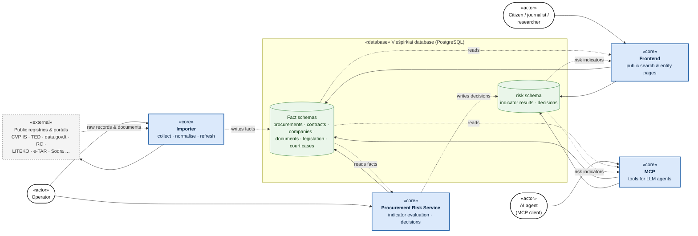

# Viešpirkiai — Target Architecture (Upgrade)

> **Status:** Phase 3, step 1: functional decomposition from the use-case perspective.
> **Inputs:** [`architecture-current.md`](architecture-current.md) (as-is) and [`architecture-review.md`](architecture-review.md) (pain points).
> **Scope of this step:** *what* the system does, grouped into functional components with clear data ownership. *How* each component is deployed (processes, containers, hosts) is decided in a later step. A functional component is a unit of responsibility, not necessarily a separate service.

Notation is the same as in `architecture-current.md`:

| Notation | Meaning |
|---|---|
| **Solid arrow** | Dependency (A uses B) |
| **Dotted arrow** | Data flow (data moves from A to B) |
| `«core»` | Main functional component |
| `«supporting»` | Supporting or secondary functional component |

---

## 1. Core functional components

The system has **four core functional components** around **one shared database**:

| # | Component | Purpose (one sentence) | Primary actors |
|---|---|---|---|
| 1 | **Importer** | Collects, normalises and keeps up to date public procurement, company, legal and court data in the Viešpirkiai database. | Upstream registries & portals (source), operator |
| 2 | **Frontend** | Publishes the collected data as a searchable public website. | Citizens, journalists, researchers, NGOs |
| 3 | **Procurement Risk Service** | Evaluates procurements against risk indicators and records explainable risk decisions. | Analysts (through Frontend and MCP), operator |
| 4 | **MCP** | Gives LLM agents structured, read-only access to the data through tools. | AI agents / MCP clients |

### 1.1 Core functional component diagram

### 1.2 Core components: use cases and data ownership

| Component | Key use cases | Reads | Writes (owns) | Current code |
|---|---|---|---|---|
| **Importer** | Discover new records at a source · import and refresh records incrementally · backfill history · link entities (company codes, CPV, addresses) · detect changes (contract edits, legislation versions, court decision updates) | Upstream sources, its own import state | **Fact schemas** (`public`, `eppsViesiejiPirkimai`, `vpmSutartys`, `rcJar`, `sabis`, `ppa`, `pinreg`, `cpva`, `files`, `documents`, …) | `tasks/*`, `modules/<source>/*`, `runner/` |
| **Frontend** | Search contracts, procurements, companies and documents · view entity pages (buyer, supplier, person, contract, procurement, legal act, court decision) · explore relationships · view statistics · share pages (OpenGraph previews) | Fact schemas, `risk` | Nothing in the fact schemas. **Target:** read-only. | `src/`, parts of `modules/*` |
| **Procurement Risk Service** | Run evaluation for all procurements or a subset · evaluate each deployed indicator · record explainable decisions · re-evaluate after data changes | Fact schemas (read-only views) | **`risk` schema** only | `services/procurement-risk/`, `modules/risk/` |
| **MCP** | List tools · search and fetch entities · read contract changes · describe schema · run bounded read-only SQL (optional) | Fact schemas, `risk` (through the `analyst` role and views) | **Target:** nothing in the database. Tool-call audit goes to Supporting component S9 (Observability). | `modules/mcp/`, `src/pages/mcp.astro`, `src/lib/mcp.ts` |

**Ownership rule (target):** each schema has **exactly one writing component**. The Importer owns the facts. The Risk Service owns `risk`. The Frontend and MCP are **read-only consumers**.

Today this rule is broken in several places:
- The Frontend writes OCR results, the info banner and runtime DDL.
- MCP writes tool-call logs.
- Every process imports the same `modules/*` code, so any of them *can* write anywhere.

The supporting components below give these writes a proper owner.

---

## 2. Supporting (secondary) functional components

These do not deliver end-user value on their own, but the core components can't function reliably without them. Most **already exist implicitly** in the codebase, without a name, a boundary or an owner. Some are **missing** and should exist.

| # | Component | Responsibility | Serves | Exists today? | Current code / gap |
|---|---|---|---|---|---|
| **S1** | **Job Orchestration** | Scheduling (cron and continuous), durable work queues, retries and back-off, reservation expiry, concurrency limits, wake-up signals | Importer, Risk, S3, S4, S5, S6 | ✅ Home-grown | `runner/`, `tasks/`, per-domain `SKIP LOCKED` queues, `utils/taskSignals.js`, NATS |
| **S2** | **Source Gateway** (egress) | All outbound access to upstream sources: proxy and Tor selection, per-source rate limits, polite scraping, request logging, stateless adapters (e-TAR / e-Seimas) | Importer, S3 | ✅ Scattered | `utils/scrapeFetch.js`, `modules/scrapeProxies/`, `modules/proxy/`, eTarSeimasScraper |
| **S3** | **File Acquisition & Storage** | Download source attachments, content-addressed storage (md5), capacity across storage boxes, public file gateway, archive unpacking | Importer, S4, Frontend | ✅ Split across repos | `modules/failai/` (download, boxes), goViesdeze, goViesdezeProxyRewrite |
| **S4** | **Document Processing** | Text and metadata extraction, OCR work distribution to external workers (checkout/submit), results storage (sidecars), document normalisation | Importer, Search Indexing, Frontend, MCP | ✅ Coupled to Frontend | `tasks/dokNuskaitytojai.js`, `modules/failai/`, `modules/documents/`, `/failas/ocr/*` in Frontend |
| **S5** | **Search Indexing** (read models) | Build and maintain derived search projections (Quickwit full-text, Typesense suggestions and companies) from the database; requeue, rebuild and drift detection | Frontend, MCP | ✅ Partial | `quickwit/`, `modules/*/quickwitProcessIndexQueue.js`, `modules/juridiniai/typesense*`, `modules/searchSuggestion/` |
| **S6** | **AI Enrichment** | LLM-generated descriptions of procurements and contracts, embeddings and vector search; cost and rate control, prompt and model versioning | Frontend, MCP, Risk (future) | ✅ Experimental | `modules/openrouter/`, `modules/vector/`, `scripts/aprasyti*.js` |
| **S7** | **Open Data Publishing** | Publish curated datasets to the open-data API (Spinta / viesStalcius), bulk JSONL / CSV exports, streaming exports | External data consumers | ✅ Scattered | `modules/spinta/`, `modules/*/pushToSpinta.js`, `export:*` scripts, contract export WebSocket |
| **S8** | **Identity & Access** | API keys for machine clients (OCR workers, file gateway, storage boxes, publishers), worker registry, MCP client identification, rate limiting and abuse protection, analyst role policy | Frontend, MCP, S3, S4 | ⚠️ Partial | `auth.raktai`, `modules/failai/auth.js`, `src/lib/botChallenge.ts`; **no rate limiting, no key rotation** |
| **S9** | **Observability & Statistics** | Operational metrics, logs (SQL, scrape, MCP tool calls), job health, alerting, public statistics pages | Operator, Frontend (`/statistika`) | ⚠️ Partial | `modules/statistika/`, `/metrics`, `quickwit/sqlLogIngest.js`, `scrapeLogIngest.js`; **no taskRunner health, no alerting** |
| **S10** | **Schema & Data Governance** | Versioned migrations, schema documentation (`COMMENT ON`), table ownership map, data-quality checks (nulls, NaN, duplicates, referential gaps), reconciliation between the database and derived stores | All core components | ⚠️ Fragmented | `migrations/` (incomplete), `postgres/dumpSchema.js`, `scripts/trukstamiLenteliuKomentarai.js`, `scripts/aptiktiLenteliuRasytojus.js`, `teisekura:audit`; **no migration runner** |
| **S11** | **Backup & Recovery** | Scheduled PostgreSQL backups with point-in-time recovery, sidecar and derived-store backups, file archive backup, **tested restore procedure** | Whole system | ❌ Mostly missing | Only `modules/s3backup/` (raw files); **no DB or sidecar backup defined** |
| **S12** | **Operations Console** (admin) | Manage runtime configuration kept as data: source proxies, OCR workers, extractors, storage boxes, API keys, info banner, task enable/disable, manual requeue and backfill triggers | Operator | ❌ Missing | Done today with pgAdmin, raw SQL and `npm run` scripts |
| **S13** | **Configuration & Secrets** | One source of truth for configuration, secret storage and rotation, per-environment settings | All components | ⚠️ Sprawl | `config.js`, `.env`, `utils/config*.js`, `ENV.md`; secret found in git history |
| **S14** | **Reference Data** | Shared classifiers and dictionaries used across sources: CPV codes, legal forms, addresses and geocoding, country and municipality codes, court classifiers | Importer, Frontend, Risk, MCP | ✅ Implicit | `modules/bvpz/`, `modules/geografija/`, `modules/liteko2/klasifikatoriai.js`, JAR forms |
| **S15** | **Entity Resolution & Relationships** | Match the same organisation or person across sources (company code, name variants), build and serve the relationship graph | Frontend, MCP, Risk | ✅ Implicit | `modules/rysiai/`, `modules/juridiniai/`, `rastiPareiskejuKodus.js` |

### 2.1 Full functional component diagram

```mermaid
flowchart TB
  classDef actor fill:#ffffff,stroke:#222,stroke-width:1.5px,color:#111
  classDef core fill:#dbe9fb,stroke:#1f5fa8,stroke-width:2px,color:#0b2545
  classDef sup fill:#f5f9ff,stroke:#1f5fa8,stroke-dasharray:3 2,color:#0b2545
  classDef missing fill:#fff4f4,stroke:#c62828,stroke-dasharray:3 2,color:#5a1010
  classDef store fill:#eaf6ea,stroke:#2e7d32,color:#123d14
  classDef ext fill:#f4f4f4,stroke:#777,stroke-dasharray:4 3,color:#333

  subgraph L1["Actors"]
    op(["«actor»<br/>Operator"]):::actor
    citizen(["«actor»<br/>Citizen / journalist"]):::actor
    agent(["«actor»<br/>AI agent"]):::actor
    odc(["«actor»<br/>Open-data consumer"]):::actor
    ocrw(["«actor»<br/>OCR / extraction workers"]):::actor
  end

  subgraph L2["Core functional components"]
    imp["«core»<br/><b>Importer</b>"]:::core
    risk["«core»<br/><b>Procurement Risk Service</b>"]:::core
    fe["«core»<br/><b>Frontend</b>"]:::core
    mcp["«core»<br/><b>MCP</b>"]:::core
  end

  subgraph L3A["Supporting: data acquisition"]
    s1["«supporting» S1<br/>Job Orchestration"]:::sup
    s2["«supporting» S2<br/>Source Gateway"]:::sup
    s3["«supporting» S3<br/>File Acquisition & Storage"]:::sup
    s4["«supporting» S4<br/>Document Processing"]:::sup
  end

  subgraph L3B["Supporting: shared data services"]
    s14["«supporting» S14<br/>Reference Data"]:::sup
    s15["«supporting» S15<br/>Entity Resolution & Relationships"]:::sup
    s5["«supporting» S5<br/>Search Indexing"]:::sup
    s6["«supporting» S6<br/>AI Enrichment"]:::sup
    s7["«supporting» S7<br/>Open Data Publishing"]:::sup
  end

  subgraph L4["«database» Viešpirkiai data"]
    ctrl[("PostgreSQL<br/>control schemas<br/>infra · auth · queues")]:::store
    facts[("PostgreSQL<br/>fact schemas")]:::store
    riskdb[("PostgreSQL<br/>risk schema")]:::store
    files[("File store<br/>content-addressed")]:::store
    docs[("Document store<br/>extracted text · OCR")]:::store
    search[("Search projections<br/>Quickwit · Typesense")]:::store
  end

  subgraph L5["Supporting: platform & operations (cross-cutting)"]
    s12["«missing» S12<br/>Operations Console"]:::missing
    s8["«supporting» S8<br/>Identity & Access"]:::sup
    s9["«supporting» S9<br/>Observability & Statistics"]:::sup
    s10["«supporting» S10<br/>Schema & Data Governance"]:::sup
    s11["«missing» S11<br/>Backup & Recovery"]:::missing
    s13["«supporting» S13<br/>Configuration & Secrets"]:::sup
  end

  src["«external»<br/>Public registries & portals"]:::ext
  llm["«external»<br/>LLM & embedding providers"]:::ext

  %% ── Actors use components ──
  op --> imp
  op --> risk
  citizen --> fe
  agent --> mcp
  odc --> s7
  ocrw --> s4

  %% ── Core → supporting dependencies ──
  imp --> s1
  imp --> s2
  imp --> s3
  imp --> s14
  imp --> s15
  risk --> s1
  fe --> s5
  fe --> s15
  mcp --> s5
  mcp --> s15
  s3 --> s2
  s4 --> s3
  s2 --> src
  s6 --> llm

  %% ── Writes (data flows into owned stores) ──
  imp -.->|"facts"| facts
  risk -.->|"decisions"| riskdb
  s1 -.->|"job state"| ctrl
  s3 -.->|"file bytes"| files
  s4 -.->|"text · OCR"| docs
  s5 -.->|"projections"| search
  s6 -.->|"descriptions · embeddings"| facts
  s7 -.->|"datasets"| odc

  %% ── Platform ──
  s12 --> ctrl
  s8 -.->|"keys · clients"| ctrl
  s10 -.->|"migrations"| facts
  s11 -.->|"backups"| L4
```

This diagram shows **dependencies** and **writes into owned stores** only. Read flows (Frontend, MCP and Risk reading facts) are shown in diagram 1.1. Platform components (S8–S13) are cross-cutting; only their data-store edges are drawn, to keep the diagram readable.

---

## 3. Classification rules

These rules decide where new functionality belongs. They exist so that agentic development places code consistently (see pain points P5 and P8 in the review).

1. **Does it bring new data from outside into the database?** → Importer. Its plumbing (fetching, files, OCR) goes to S2–S4.
2. **Does it show data to humans?** → Frontend. It never writes facts.
3. **Does it compute a judgement about procurements (score, flag, indicator)?** → Procurement Risk Service. It writes only to `risk`.
4. **Does it expose data to machines as tools?** → MCP. It never writes facts.
5. **Does it transform existing data into another shape** (index, export, embedding, graph)? → one of S5, S6, S7, S15.
6. **Does it keep the system running, safe or recoverable?** → Platform, S8–S13.
7. **Is it a one-off script?** → it lives under an operator tool in S12 or S10, **not** inside a library module.

---

## 4. Current-to-target mapping of notable misplacements

| Today | Problem | Target owner |
|---|---|---|
| OCR checkout/submit endpoints inside the Frontend | Public web app writes to the database and sidecars | S4 Document Processing |
| `downloadProxyInformation` and sidecar read API inside the Frontend | Internal machine APIs on the public surface | S3 File Acquisition & Storage / S4 |
| MCP tool-call logging to the database and Quickwit | Consumer writes data | S9 Observability |
| Info banner table created and edited through the Frontend | Runtime DDL, no admin UI | S12 Operations Console, S10 migrations |
| LLM description generation inside `modules/viesiejiPirkimai` and `scripts/` | Enrichment mixed with import logic | S6 AI Enrichment |
| `export:*`, `push:*` scripts inside source modules | Distribution mixed with import logic | S7 Open Data Publishing |
| `modules/risk` (11k LOC) run manually via `npm run risk:run` | Core component without scheduling or ownership boundaries | Procurement Risk Service, scheduled through S1 |
| 115 self-executing scripts and 87 `process.exit` calls in `modules/` | CLI entry points inside library code | S12 operator tools / S10 governance scripts |

---

## 5. Next steps (later phases)

1. **Logical architecture:** define the interface of each component (commands, queries, events) and the allowed dependencies between them.
2. **Module structure:** map components to a repository layout, with enforced import boundaries.
3. **Deployment architecture:** decide which components share a process, container or host, taking the review's P4 and P12 into account.
4. **Migration roadmap:** order the changes by risk. S11 Backup & Recovery and S10 migrations come first.
