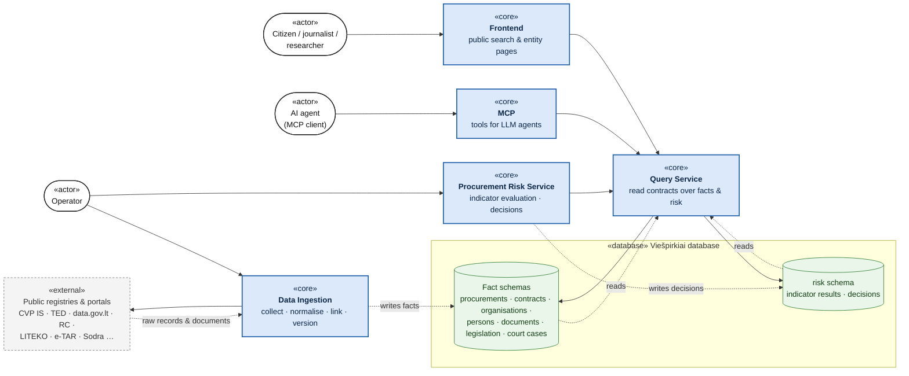
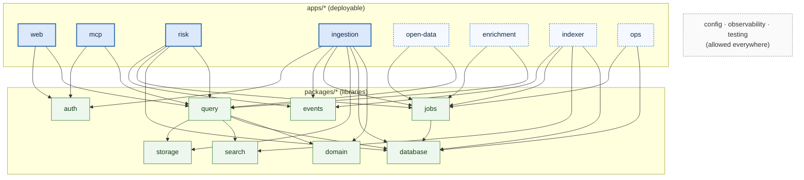
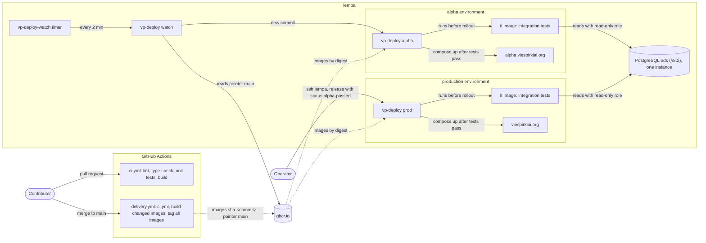
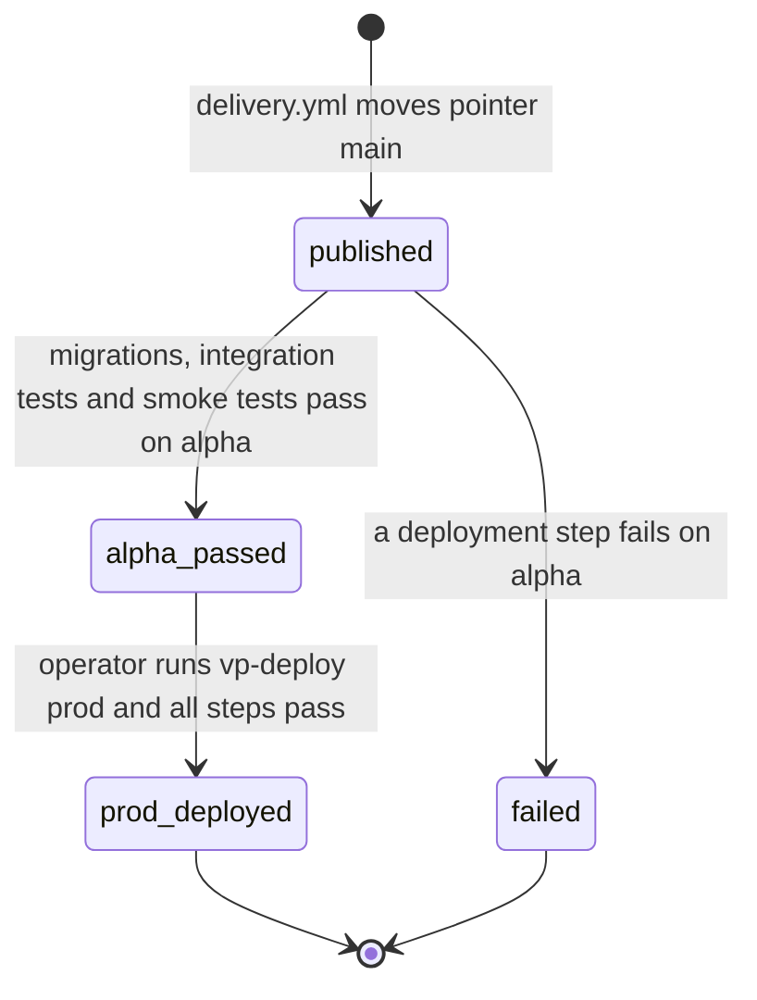
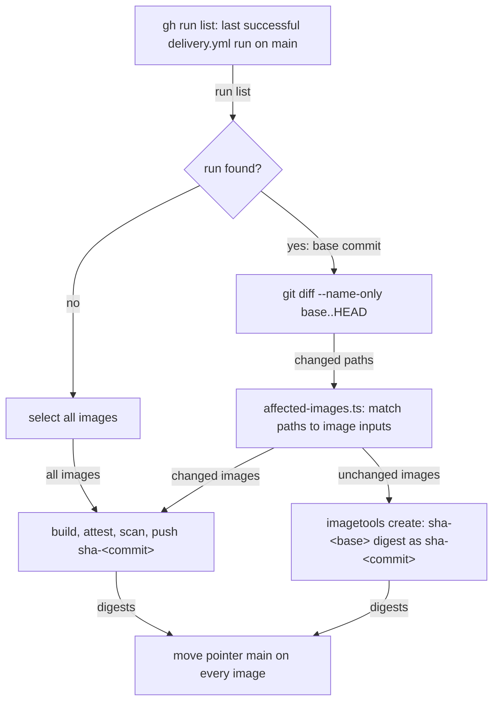
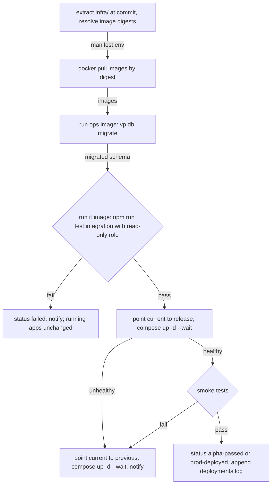
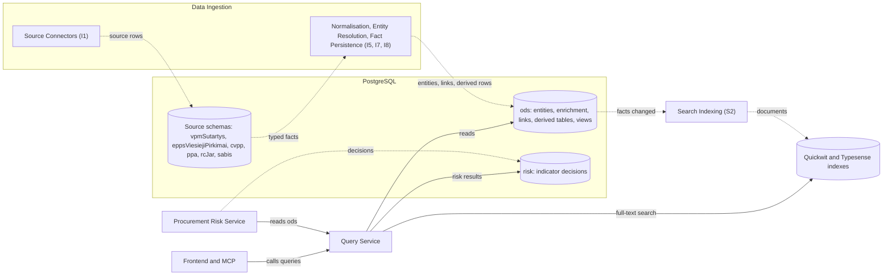

# Viešpirkiai — Target Architecture (Upgrade)

> **Status:** Phase 3, target architecture: functional decomposition (§1–5), monorepo structure (§6), CI/CD pipeline
> (§7) and data layers (§8). The document defines the target state only. It contains no migration plan.
> **Inputs:** [`architecture-current.md`](architecture-current.md) (as-is) and [
`architecture-review.md`](architecture-review.md) (pain points).
> **Scope:** *what* the system does, grouped into functional components with clear data ownership. A functional
> component is a unit of responsibility, not necessarily a separate service.

Notation is the same as in `architecture-current.md`:

| Notation         | Meaning                                      |
|------------------|----------------------------------------------|
| **Solid arrow**  | Dependency (A uses B)                        |
| **Dotted arrow** | Data flow (data moves from A to B)           |
| Circle           | Provided interface (lollipop)                |
| `«core»`         | Main functional component                    |
| `«supporting»`   | Supporting or secondary functional component |

---

## 1. Core functional components

The system has **five core functional components** around **one shared database**:

| # | Component                    | Purpose (one sentence)                                                                                                                     | Primary actors                                                    |
|---|------------------------------|--------------------------------------------------------------------------------------------------------------------------------------------|-------------------------------------------------------------------|
| 1 | **Data Ingestion**           | Brings public data from upstream sources into the Viešpirkiai database as normalised, linked and versioned facts.                          | Upstream registries & portals, OCR / extraction workers, operator |
| 2 | **Query Service**            | The single read path to Viešpirkiai data: entity lookups, search, relationships, documents and risk results behind stable query contracts. | Frontend, MCP, Procurement Risk Service                           |
| 3 | **Procurement Risk Service** | Evaluates procurements against risk indicators and records explainable risk decisions.                                                     | Analysts (through Frontend and MCP), operator                     |
| 4 | **Frontend**                 | Publishes the data as a searchable public website.                                                                                         | Citizens, journalists, researchers, NGOs                          |
| 5 | **MCP**                      | Gives LLM agents structured, read-only access to the data through tools.                                                                   | AI agents / MCP clients                                           |

### 1.1 Core functional component diagram



### 1.2 Core components: use cases and data ownership

| Component                    | Key use cases                                                                                                                                                                                                                                                      | Depends on                                                            | Writes (owns)                                          | Current code                                                                                                                           |
|------------------------------|--------------------------------------------------------------------------------------------------------------------------------------------------------------------------------------------------------------------------------------------------------------------|-----------------------------------------------------------------------|--------------------------------------------------------|----------------------------------------------------------------------------------------------------------------------------------------|
| **Data Ingestion**           | Discover new records · import and refresh incrementally · backfill history · acquire and process documents (download, extract, OCR) · link entities and reference data · detect and version changes (contract edits, legislation editions, court decision updates) | Upstream sources, S1 Job Orchestration                                | **Fact schemas**, including document content (see §2)  | `tasks/*`, `modules/<source>/*`, `modules/failai/`, `modules/documents/`, `runner/`                                                    |
| **Query Service**            | Look up an entity by identifier · search and facet (contracts, procurements, organisations, documents) · traverse relationships · read document content · read risk results · provide bulk analytical reads · run bounded ad-hoc SQL for analysts                  | Database (read-only role), S2 search indexes, S3 enrichment store | **Nothing.** Read-only by definition.                  | Scattered: SQL in 21 `src/pages`, `src/lib/*`, `modules/*/search*.js`, `modules/rysiai/`, `modules/mcp/tools/`, `modules/mcp/analyst/` |
| **Procurement Risk Service** | Run evaluation for all procurements or a subset · evaluate each deployed indicator · record explainable decisions · re-evaluate after "facts changed"                                                                                                              | **Query Service** (analytical reads), S1                              | **`risk` schema** only                                 | `services/procurement-risk/`, `modules/risk/`                                                                                          |
| **Frontend**                 | Search · entity pages (buyer, supplier, person, contract, procurement, legal act, court decision) · relationship graph · statistics · shareable pages (OpenGraph)                                                                                                  | **Query Service**                                                     | **Nothing.**                                           | `src/`                                                                                                                                 |
| **MCP**                      | List tools · search and fetch entities · read contract changes · describe schema · run analyst SQL (optional)                                                                                                                                                      | **Query Service**                                                     | **Nothing.** Tool-call audit goes to S6 Observability. | `modules/mcp/`, `src/pages/mcp.astro`, `src/lib/mcp.ts`                                                                                |

**Ownership rules (target)**

1. **One writer per schema.** Data Ingestion owns the source schemas and `ods`; the Risk Service owns `risk` (§8).
2. **One read path.** Frontend, MCP and the Risk Service never query the database directly. They go through the Query
   Service. This is the boundary that removes SQL from pages and tools (review P5).
3. Today both rules are broken:
    - SQL is spread across pages, MCP tools and risk indicators.
    - The Frontend writes OCR results and creates tables at runtime.
    - MCP writes tool-call logs.
    - Every process can import any module.

### 1.3 Query Service

The Query Service turns the database schema into a **published query contract**. Consumers depend on named queries with
typed results, never on table layouts. A schema change then touches one component instead of dozens of call sites.

| Query family                                                                                                       | Consumers                  | Notes                                                                        |
|--------------------------------------------------------------------------------------------------------------------|----------------------------|------------------------------------------------------------------------------|
| **Entity queries**: get procurement, contract, organisation, person, document, legal act, court case by identifier | Frontend, MCP              | Includes change history of the entity                                        |
| **Search & facets**: full-text and filtered search, suggestions, facet counts                                      | Frontend, MCP              | Uses S2 search indexes; PostgreSQL fallback lives here, not in consumers |
| **Relationship queries**: organisation–person–contract graph traversal                                             | Frontend, MCP, Risk        | Graph *building* belongs to Data Ingestion; graph *reading* belongs here     |
| **Document content**: extracted text, OCR result, file reference                                                   | Frontend, MCP              | Replaces direct sidecar reads and the sidecar HTTP API                       |
| **Risk results**: indicator results and decisions per procurement or organisation                                  | Frontend, MCP              | Reads the `risk` schema                                                      |
| **Analytical reads**: set-based, streamed reads over large fact sets                                               | Risk Service, S4 Open Data | Versioned read views, not per-row API calls, so batch jobs stay efficient    |
| **Ad-hoc SQL** (bounded): read-only, time-limited, restricted to `ods`                                     | MCP                        | Enforcement by database role grants, not only by SQL parsing (review P3)  |

A functional component is not necessarily a network service. The Query Service is an in-process library with a
read-only connection pool over `ods` and `risk`. Its value is the contract and the boundary, not the deployment.

---

## 2. Data Ingestion — the abstraction

### 2.1 Why one component

Today ingestion is not one thing. It is **30+ source modules**, each re-implementing its own discovery, fetching,
parsing, queues, reservation cleanup and persistence (review P5, P6).

From the rest of the system's point of view, all of it has **one responsibility and one output**: *keep the fact schemas
complete, correct and current*. Treating it as a single black box, with a stable external contract and freely
decomposable internals, gives:

- **Consumers** (Query Service, Risk, Search Indexing, Open Data) depend only on the *facts* and on *"facts changed"*
  notifications, never on how a source is scraped.
- **New sources** plug into a shared pipeline instead of copying a whole module.
- **Internal redesign** (queues, scheduler, document processing) doesn't ripple outside.

### 2.2 External contract (black-box view)


| Interface                | Direction         | Purpose                                                                                                                                                                           |
|--------------------------|-------------------|-----------------------------------------------------------------------------------------------------------------------------------------------------------------------------------|
| **Writes facts**         | Output → database | The only output that matters to consumers: canonical, linked, versioned facts plus document content                                                                               |
| **Facts changed events** | Provided          | "Entity X of type T changed in ingestion run R", emitted **after commit**. It is a hint; consumers re-read through the Query Service. Replaces today's `*.changed` NATS subjects. |
| **Ingestion status**     | Provided          | Per source: last successful sync, lag, error rate, backlog, record counts. Feeds S6 and `/statistika`.                                                                            |
| **Ingestion commands**   | Provided          | Run, backfill, re-process, pause or resume a source; requeue a record. Replaces ad-hoc `npm run` scripts.                                                                         |
| **Work distribution**    | Provided          | Checkout and submit for external OCR and extraction workers. Moves out of the Frontend.                                                                                           |
| Upstream sources, S1     | Required          | Everything the black box needs from outside                                                                                                                                       |

### 2.3 Contract guarantees

These invariants are what "writes facts" *means*. Every internal design decision must preserve them.

| #  | Guarantee                                                                                                                                                     | Why it matters                                                              | Today                                   |
|----|---------------------------------------------------------------------------------------------------------------------------------------------------------------|-----------------------------------------------------------------------------|-----------------------------------------|
| G1 | **Single writer**: only Data Ingestion writes fact schemas                                                                                                    | Clear ownership; safe schema evolution                                      | ❌ multiple writers                     |
| G2 | **Canonical model**: facts use normalised entities (procurement, contract, organisation, person, document, legal act, court case), not source-specific shapes | Consumers stay stable when a source changes format                          | ⚠️ partly: many source-shaped tables    |
| G3 | **Provenance**: every fact records source system, source record id, source URL, retrieval time, ingestion run                                                 | Transparency, auditability, debugging                                       | ⚠️ inconsistent                         |
| G4 | **Idempotency**: re-ingesting a source record never duplicates or corrupts facts                                                                              | Safe retries, backfills and re-processing                                   | ⚠️ per module                           |
| G5 | **Versioned changes**: changes in source records become recorded versions, not silent overwrites                                                              | Contract edits, legislation editions and court updates are product features | ✅ for some sources                     |
| G6 | **Reprocessability**: raw payloads and files are retained, so parsing and normalisation can be re-run without re-scraping                                     | Sources disappear or block access; parsers improve                          | ✅ sidecars, file store (not backed up) |
| G7 | **Commit, then notify**: events and notifications are sent only after facts are committed                                                                     | No consumer reads uncommitted state                                         | ✅ documented NATS rule                 |
| G8 | **Observable freshness**: every source reports sync status and lag                                                                                            | Operators and users know how current the data is                            | ⚠️ partial                              |

### 2.4 Internal view

Every source goes through the same stages. Only the source-specific stages are implemented per source; the rest are
shared.

```mermaid
flowchart LR
    classDef specific fill: #dbe9fb, stroke: #1f5fa8, color: #0b2545
    classDef shared fill: #f5f9ff, stroke: #1f5fa8, stroke-dasharray: 3 2, color: #0b2545
    d["1 · Discover<br/>what is new or changed"]:::specific
    f["2 · Fetch<br/>via Source Gateway"]:::shared
    r["3 · Retain raw<br/>payload · file"]:::shared
    p["4 · Parse & extract<br/>structure · text · OCR"]:::specific
    n["5 · Normalise<br/>to canonical model"]:::specific
    l["6 · Link & enrich<br/>reference data · entity resolution"]:::shared
    w["7 · Persist<br/>upsert · version · provenance"]:::shared
    e["8 · Notify<br/>facts changed"]:::shared
    d -.-> f -.-> r -.-> p -.-> n -.-> l -.-> w -.-> e
```



Solid blue: source-specific stage, implemented by each connector. Dashed: shared stage, implemented once.

**Source connector types.** Grouping sources by *how* they are acquired keeps the number of connector patterns small:

| Connector type                        | Examples today                                                                  |
|---------------------------------------|---------------------------------------------------------------------------------|
| Bulk dataset (CSV / XLSX / JSON dump) | JAR CSV, VPT XLSX reports, address register, Sodra, Regitra                     |
| Change feed                           | data.gov.lt ADP `:changes` datasets                                             |
| Crawler / scraper                     | CVP IS contracts and procurements, CVPP, LITEKO, KOTIS, PINREG, ES investicijos |
| API adapter                           | e-TAR, e-Seimas (stateless adapter), TED                                        |
| Document pipeline (source-agnostic)   | Any fact that references a file: download → store → extract → OCR               |

**Internal sub-components** (candidates for the detailed decomposition):

| #  | Sub-component                       | Responsibility                                                                       | Current code                                                                                    | Previously listed as |
|----|-------------------------------------|--------------------------------------------------------------------------------------|-------------------------------------------------------------------------------------------------|----------------------|
| I1 | **Source Connectors**               | Source-specific discover, parse and normalise, one per source                        | `modules/<source>/*`                                                                            | —                    |
| I2 | **Source Gateway**                  | Outbound access: proxies, Tor, per-source rate limits, request logging, adapters     | `utils/scrapeFetch.js`, `modules/scrapeProxies/`, `modules/proxy/`, eTarSeimasScraper           | S2                   |
| I3 | **Raw Payload Store**               | Retain raw API and HTML payloads for audit and re-processing                         | sidecar SQLite (`eTar`, `eSeimas`, `liteko2`, `failaiInfo`)                                     | —                    |
| I4 | **File & Document Pipeline**        | Download, content-addressed storage, extraction, OCR work distribution, file gateway | `modules/failai/`, `modules/documents/`, `tasks/dokNuskaitytojai.js`, goViesdeze, OCR endpoints | S3, S4               |
| I5 | **Canonical Model & Normalisation** | Shared entity definitions and mapping helpers                                        | `upsert*.js`, per-module mapping code                                                           | —                    |
| I6 | **Reference Data**                  | CPV, legal forms, addresses and geocoding, classifiers                               | `modules/bvpz/`, `modules/geografija/`, `liteko2/klasifikatoriai.js`                            | S14                  |
| I7 | **Entity Resolution**               | Match organisations and persons across sources; build relationship edges             | `modules/juridiniai/`, `modules/rysiai/` (building), `rastiPareiskejuKodus.js`                  | S15                  |
| I8 | **Fact Persistence & Versioning**   | Idempotent upserts, change detection and diffs, provenance, notifications            | `sutartys` change tracking, `teisekura` editions, `utils/taskSignals.js`                        | —                    |
| I9 | **Ingestion Control**               | Per-source schedules, backfills, commands, status and freshness                      | `tasks/*.js` definitions, `npm run` scripts                                                     | —                    |

---

## 3. Supporting (secondary) functional components

These do not deliver end-user value on their own, but the core components can't function reliably without them.
Components absorbed into Data Ingestion (Source Gateway, File Acquisition, Document Processing, Reference Data, Entity
Resolution) are listed in §2.4.

| #       | Component                      | Responsibility                                                                                                                                            | Serves                                  | Exists today?     | Current code / gap                                                                                                  |
|---------|--------------------------------|-----------------------------------------------------------------------------------------------------------------------------------------------------------|-----------------------------------------|-------------------|---------------------------------------------------------------------------------------------------------------------|
| **S1**  | **Job Orchestration**          | Scheduling (cron and continuous), durable work queues, retries and back-off, reservation expiry, concurrency limits, wake-up signals                      | Data Ingestion, Risk, S2, S3, S4        | ✅ Home-grown     | `runner/`, `tasks/`, per-domain `SKIP LOCKED` queues, NATS                                                          |
| **S2**  | **Search Indexing**            | Build search indexes (Quickwit full-text, Typesense suggestions and organisations) from `ods` on "facts changed"; rebuild and drift detection | Query Service                           | ✅ Partial        | `quickwit/`, `modules/*/quickwitProcessIndexQueue.js`, `modules/juridiniai/typesense*`, `modules/searchSuggestion/` |
| **S3**  | **AI Enrichment**              | LLM-generated descriptions, embeddings; owns its own enrichment store (does **not** write facts); cost, rate, prompt and model versioning                 | Query Service                           | ✅ Experimental   | `modules/openrouter/`, `modules/vector/`, `scripts/aprasyti*.js`                                                    |
| **S4**  | **Open Data Publishing**       | Publish curated datasets to the open-data API (Spinta / viesStalcius) and bulk exports; reads through the Query Service                                   | Open-data consumers                     | ✅ Scattered      | `modules/spinta/`, `modules/*/pushToSpinta.js`, `export:*` scripts, export WebSocket                                |
| **S5**  | **Identity & Access**          | API keys for machine clients, worker registry, MCP client identification, rate limiting and abuse protection, analyst role policy                         | Frontend, MCP, Data Ingestion (workers) | ⚠️ Partial        | `auth.raktai`, `modules/failai/auth.js`, `src/lib/botChallenge.ts`; **no rate limiting, no key rotation**           |
| **S6**  | **Observability & Statistics** | Metrics, logs (SQL, scrape, MCP tool calls), ingestion status, job health, alerting, public statistics                                                    | Operator, Frontend (`/statistika`)      | ⚠️ Partial        | `modules/statistika/`, `/metrics`, SQL and scrape log ingest; **no taskRunner health, no alerting**                 |
| **S7**  | **Schema & Data Governance**   | Versioned migrations, schema documentation, table ownership map, data-quality checks, reconciliation of derived stores                                    | All core components                     | ⚠️ Fragmented     | `migrations/` (incomplete), `postgres/dumpSchema.js`, schema scripts; **no migration runner**                       |
| **S8**  | **Backup & Recovery**          | PostgreSQL backups with point-in-time recovery, raw payload and document-store backups, file archive backup, **tested restore**                           | Whole system                            | ❌ Mostly missing | Only `modules/s3backup/` (raw files)                                                                                |
| **S9**  | **Operations Console**         | Issue ingestion commands; manage runtime configuration kept as data (proxies, workers, storage boxes, API keys, info banner, task toggles)                | Operator                                | ❌ Missing        | pgAdmin, raw SQL, `npm run` scripts                                                                                 |
| **S10** | **Configuration & Secrets**    | One source of truth for configuration, secret storage and rotation, per-environment settings                                                              | All components                          | ⚠️ Sprawl         | `config.js`, `.env`, `utils/config*.js`, `ENV.md`                                                                   |

### 3.1 Full functional component diagram

```mermaid
flowchart TB
    classDef actor fill: #ffffff, stroke: #222, stroke-width: 1.5px, color: #111
    classDef core fill: #dbe9fb, stroke: #1f5fa8, stroke-width: 2px, color: #0b2545
    classDef sup fill: #f5f9ff, stroke: #1f5fa8, stroke-dasharray: 3 2, color: #0b2545
    classDef missing fill: #fff4f4, stroke: #c62828, stroke-dasharray: 3 2, color: #5a1010
    classDef store fill: #eaf6ea, stroke: #2e7d32, color: #123d14
    classDef ext fill: #f4f4f4, stroke: #777, stroke-dasharray: 4 3, color: #333

    subgraph L1["Actors"]
        citizen(["«actor»<br/>Citizen / journalist"]):::actor
        agent(["«actor»<br/>AI agent"]):::actor
        odc(["«actor»<br/>Open-data consumer"]):::actor
        op(["«actor»<br/>Operator"]):::actor
    end

    subgraph L2["Consumers"]
        fe["«core»<br/><b>Frontend</b>"]:::core
        mcp["«core»<br/><b>MCP</b>"]:::core
        risk["«core»<br/><b>Procurement Risk Service</b>"]:::core
        s4["«supporting» S4<br/>Open Data Publishing"]:::sup
    end

    subgraph L3["Read path & derived data"]
        qs["«core»<br/><b>Query Service</b>"]:::core
        s2["«supporting» S2<br/>Search Indexing"]:::sup
        s3["«supporting» S3<br/>AI Enrichment"]:::sup
    end

    subgraph L4["«database» Viešpirkiai data"]
        facts[("Fact schemas<br/>+ document content")]:::store
        riskdb[("risk schema")]:::store
        search[("Search indexes<br/>Quickwit · Typesense")]:::store
        enrich[("Enrichment store<br/>descriptions · embeddings")]:::store
        ctrl[("Control schemas<br/>infra · auth · jobs")]:::store
    end

    subgraph L5["Ingestion"]
        ing["«core»<br/><b>Data Ingestion</b>"]:::core
        s1["«supporting» S1<br/>Job Orchestration"]:::sup
    end

    subgraph L6["Platform & operations (cross-cutting)"]
        s9["«missing» S9<br/>Operations Console"]:::missing
        s5["«supporting» S5<br/>Identity & Access"]:::sup
        s6["«supporting» S6<br/>Observability & Statistics"]:::sup
        s7["«supporting» S7<br/>Schema & Data Governance"]:::sup
        s8["«missing» S8<br/>Backup & Recovery"]:::missing
        s10["«supporting» S10<br/>Configuration & Secrets"]:::sup
    end

    workers(["«actor»<br/>OCR / extraction workers"]):::actor
    src["«external»<br/>Public registries & portals"]:::ext
    llm["«external»<br/>LLM & embedding providers"]:::ext
%% ── Actors ──
    citizen --> fe
    agent --> mcp
    odc --> s4
    op --> s9
    workers --> ing
%% ── Read path (dependencies) ──
    fe --> qs
    mcp --> qs
    risk --> qs
    s4 --> qs
    qs --> facts
    qs --> riskdb
    qs --> search
    qs --> enrich
%% ── Derived data ──
    s2 --> facts
    s3 --> qs
    s3 --> llm
%% ── Ingestion & jobs ──
    ing --> src
    ing --> s1
    risk --> s1
    s9 --> ing
%% ── Writes into owned stores (data flows) ──
    ing -.->|" writes facts "| facts
    ing -.->|" facts changed "| s2
    risk -.->|" writes decisions "| riskdb
    s2 -.->|" documents "| search
    s3 -.->|" descriptions · embeddings "| enrich
    s1 -.->|" job state "| ctrl
%% ── Platform ──
    s9 --> ctrl
    s5 -.->|" keys · clients "| ctrl
    s7 -.->|" migrations "| facts
    s8 -.->|" backups "| L4
```



This diagram shows **dependencies** and **writes into owned stores**. Platform components (S5–S10) are cross-cutting;
only their data-store edges are drawn, to keep the diagram readable.

---

## 4. Classification rules

These rules decide where new functionality belongs, so that agentic development places code consistently (review P5,
P8).

1. **Does it bring data from outside into the database** (including files, OCR, reference data, entity linking)? →
   **Data Ingestion.** It is the only component that writes facts.
2. **Does it read Viešpirkiai data for someone else?** → it is a query in the **Query Service**. No other component
   issues read SQL against source, `ods` or `risk` schemas. The only exceptions are S2 index builders and S7 governance
   tooling.
3. **Does it show data to humans?** → **Frontend**, using only the Query Service.
4. **Does it expose data to AI agents?** → **MCP**, using only the Query Service.
5. **Does it compute a judgement about procurements** (score, flag, indicator)? → **Procurement Risk Service.** It reads
   through the Query Service and writes only to `risk`.
6. **Does it turn existing data into another shape** (index, embedding, export)? → **S2, S3 or S4**, each writing only
   to its own store.
7. **Does it keep the system running, safe or recoverable?** → **Platform, S5–S10.**
8. **Is it a one-off or operator script?** → an ingestion command issued through S9, or S7 governance tooling. **Never**
   a self-executing file inside a library module.

---

## 5. Current-to-target mapping of notable misplacements

| Today                                                                                    | Problem                                                      | Target owner                                                                     |
|------------------------------------------------------------------------------------------|--------------------------------------------------------------|----------------------------------------------------------------------------------|
| SQL in 21 `src/pages`, query code in `src/lib`, separate queries in MCP tools            | No single read path; the same logic is written several times | **Query Service**                                                                |
| Risk indicators query `ppa."ataskaitos"` and views directly                              | Risk Service coupled to table layouts                        | **Query Service** (analytical reads)                                             |
| OCR checkout/submit endpoints inside the Frontend                                        | Public web app writes to the database and sidecars           | **Data Ingestion** (I4, work distribution interface)                             |
| `downloadProxyInformation` inside the Frontend                                           | Internal file lookup on the public surface                   | **Data Ingestion** (I4 file gateway)                                             |
| Sidecar HTTP read API inside the Frontend                                                | Direct access to raw stores                                  | **Query Service** (document content)                                             |
| Per-source queues, reservation cleaners and change signals re-implemented in each module | Duplicated ingestion infrastructure                          | **Data Ingestion** shared stages (I8, I9) + S1                                   |
| LLM description generation writing next to import logic                                  | Enrichment mixed with ingestion; writes facts                | **S3 AI Enrichment** (own store)                                                 |
| `export:*`, `push:*` scripts inside source modules                                       | Distribution mixed with ingestion                            | **S4 Open Data Publishing**                                                      |
| MCP tool-call logging to the database and Quickwit                                       | Consumer writes data                                         | **S6 Observability**                                                             |
| Info banner table created and edited through the Frontend                                | Runtime DDL, no admin UI                                     | **S9 Operations Console**, S7 migrations                                         |
| `modules/risk` run manually via `npm run risk:run`                                       | Core component without scheduling                            | **Procurement Risk Service**, scheduled through S1, triggered by "facts changed" |
| 115 self-executing scripts and 87 `process.exit` calls in `modules/`                     | CLI entry points inside library code                         | Ingestion commands via **S9** / **S7** tooling                                   |

---

## 6. Monorepo structure (npm workspaces)

The repository stays a single GitHub monorepo, organised with **npm workspaces**. Each workspace is one functional
component from §1–3. Its build, test and run commands, its dependencies and its configuration belong to that workspace
alone.

### 6.1 Design principles

1. **Workspace = functional component.** Every core and supporting component maps to exactly one workspace, named after
   the component.
2. **Two kinds of workspaces.**
    - `apps/*` are **deployable**: they have an entrypoint, a config schema, a Dockerfile and runtime dependencies.
    - `packages/*` are **libraries**: no process, no environment reading, no `process.exit`.
3. **Dependencies point inward only.** Apps depend on packages. Packages never import apps. Apps never import other
   apps; they communicate through database contracts, events or HTTP.
4. **Imports go through declared dependencies and each package's `exports` entry.** Deep imports
   (`@viespirkiai/query/src/…`) are forbidden.
5. **Plain npm workspaces, no extra monorepo tool.**
    - Node 24 runs TypeScript directly (built-in type stripping); `tsc -b` only type-checks.
    - Only the Astro app has a real build step.
    - Add Turborepo later only if CI time becomes a problem.
6. **Configuration per app.** Each app declares its own zod schema and `.env.example`. Packages receive settings as
   parameters. There is no global `CONFIG`.
7. **Strict TypeScript everywhere.** New code is TypeScript; existing JavaScript is converted when its module moves into
   a workspace.
8. **Create a package only when it is shared.** Code used by one workspace stays inside it; for example, the design
   system stays in `apps/web`. A package exists only for a functional component or for code used by two or more
   workspaces.
9. **Versioned agent instructions.** A root `AGENTS.md`, plus a short `AGENTS.md` per workspace stating its
   responsibility, allowed dependencies and commands (review P8).

### 6.2 Repository tree

```text
viespirkiai/
├── package.json                    # private root: workspaces ["apps/*", "packages/*"], orchestration scripts only
├── package-lock.json               # one lockfile for the whole repository
├── tsconfig.base.json              # strict · module "nodenext" · erasableSyntaxOnly · verbatimModuleSyntax
├── tsconfig.json                   # project references to every workspace (tsc -b)
├── eslint.config.js                # flat config: import hygiene, no process.env outside config.ts
├── .dependency-cruiser.cjs         # architecture rules from §6.4, enforced in CI
├── .node-version                   # 24
├── .editorconfig
├── AGENTS.md                       # repository-wide agent instructions (versioned)
├── README.md
│
├── .github/
│   ├── workflows/                  # see §7.4
│   │   ├── ci.yml                  # PR gate: install → lint → typecheck → boundaries → unit tests → build
│   │   └── delivery.yml            # main: ci → build changed images → tag all images sha-<commit> → move pointer main
│   ├── dependabot.yml
│   └── CODEOWNERS                  # owners per workspace and per migration folder
│
├── apps/                           # ── deployable functional components ──
│   │
│   ├── web/                        # «core» Frontend · @viespirkiai/web (Astro SSR)
│   │   ├── package.json
│   │   ├── AGENTS.md
│   │   ├── Dockerfile
│   │   ├── .env.example
│   │   ├── astro.config.ts
│   │   ├── public/
│   │   ├── src/
│   │   │   ├── config.ts           # web-only config schema
│   │   │   ├── middleware.ts
│   │   │   ├── pages/              # routes: use @viespirkiai/query only, never SQL
│   │   │   ├── components/
│   │   │   ├── design-system/
│   │   │   └── client/             # browser bundles (relationship graph)
│   │   └── test/
│   │
│   ├── mcp/                        # «core» MCP · @viespirkiai/mcp
│   │   ├── package.json
│   │   ├── AGENTS.md
│   │   ├── Dockerfile
│   │   ├── .env.example
│   │   ├── src/
│   │   │   ├── main.ts             # HTTP entrypoint (Streamable HTTP transport)
│   │   │   ├── config.ts
│   │   │   ├── server.ts
│   │   │   └── tools/              # one file per tool, built on @viespirkiai/query
│   │   └── test/
│   │
│   ├── ingestion/                  # «core» Data Ingestion · @viespirkiai/ingestion
│   │   ├── package.json
│   │   ├── AGENTS.md
│   │   ├── Dockerfile
│   │   ├── .env.example
│   │   ├── src/
│   │   │   ├── worker.ts           # entrypoint: pipeline workers and schedules
│   │   │   ├── api.ts              # entrypoint: work distribution (OCR, extractors), file lookup, commands
│   │   │   ├── config.ts
│   │   │   ├── pipeline/           # shared stages: fetch · retain raw · link · persist · notify (I5, I8)
│   │   │   ├── connectors/         # I1 · one folder per source
│   │   │   │   ├── cvp-is/
│   │   │   │   ├── ted/
│   │   │   │   ├── jar/
│   │   │   │   ├── liteko/
│   │   │   │   ├── e-tar/
│   │   │   │   └── …
│   │   │   ├── gateway/            # I2 Source Gateway: proxies, Tor, rate limits, request log
│   │   │   ├── raw-store/          # I3 raw payload retention
│   │   │   ├── documents/          # I4 download, storage boxes, extraction, OCR distribution
│   │   │   ├── reference-data/     # I6
│   │   │   ├── entity-resolution/  # I7
│   │   │   └── control/            # I9 schedules, backfills, freshness status
│   │   └── test/
│   │
│   ├── risk/                       # «core» Procurement Risk Service · @viespirkiai/risk
│   │   ├── package.json
│   │   ├── AGENTS.md
│   │   ├── Dockerfile
│   │   ├── .env.example
│   │   ├── src/
│   │   │   ├── main.ts             # scheduled or event-triggered evaluation run
│   │   │   ├── config.ts
│   │   │   ├── engine/             # run orchestration, decision writer
│   │   │   └── indicators/         # one folder per indicator (LT-COM-01 …) with fixtures and tests
│   │   └── test/
│   │
│   ├── indexer/                    # «supporting» S2 Search Indexing · @viespirkiai/indexer
│   ├── enrichment/                 # «supporting» S3 AI Enrichment · @viespirkiai/enrichment
│   ├── open-data/                  # «supporting» S4 Open Data Publishing · @viespirkiai/open-data
│   └── ops/                        # «supporting» S9 Operations Console · @viespirkiai/ops
│       ├── package.json            # "bin": { "vp": "./src/cli.ts" }
│       └── src/
│           ├── cli.ts              # vp ingestion run|backfill|requeue · vp db migrate · vp backup verify
│           └── commands/
│
├── packages/                       # ── libraries: no entrypoints, no env reading, no process.exit ──
│   │
│   ├── query/                      # «core» Query Service · @viespirkiai/query
│   │   ├── package.json            # "exports": { ".": "./src/index.ts" }
│   │   ├── AGENTS.md
│   │   ├── src/
│   │   │   ├── index.ts            # the published query contract
│   │   │   ├── entities/           # procurement, contract, organisation, person, document, legal act, court case
│   │   │   ├── search/             # search and facets (search indexes + PostgreSQL fallback)
│   │   │   ├── relationships/
│   │   │   ├── documents/          # extracted text, OCR results, file references
│   │   │   ├── risk/               # risk results
│   │   │   ├── analytics/          # set-based, streamed reads for Risk and Open Data
│   │   │   └── analyst-sql/        # bounded ad-hoc SQL
│   │   └── test/
│   │
│   ├── domain/                     # canonical model: entity types, identifiers, Money, dates
│   ├── database/                   # «supporting» S7 Schema & Data Governance
│   │   ├── src/                    # role-scoped pools: readOnly · factsWriter · riskWriter · control
│   │   ├── migrations/
│   │   │   ├── source/             # source schemas, owned by apps/ingestion
│   │   │   ├── ods/                # Operational Data Store, owned by apps/ingestion
│   │   │   ├── risk/               # owned by apps/risk
│   │   │   └── control/            # infra · auth · jobs
│   │   └── schema/                 # generated schema documentation (committed)
│   ├── jobs/                       # «supporting» S1 Job Orchestration: queues, schedules, retries
│   ├── events/                     # "facts changed" event contracts + transport (NATS)
│   ├── search/                     # Quickwit and Typesense clients, index definitions
│   ├── storage/                    # file store, document content, raw payload stores
│   ├── auth/                       # «supporting» S5 Identity & Access: API keys, rate limiting
│   ├── config/                     # «supporting» S10 typed env loader (zod) used by every app's config.ts
│   ├── observability/              # «supporting» S6 structured logging, metrics, health checks
│   └── testing/                    # fixtures, test database (Testcontainers), fakes
│
├── infra/                          # ── how it runs; no application code, not a workspace ──
│   ├── ci/
│   │   ├── images.json             # image name → Dockerfile, target, workspace (§7.4)
│   │   └── affected-images.ts      # changed paths + workspace graph → images to build
│   ├── compose/                    # see §7.6
│   │   ├── viespirkiai-business-compose.yaml  # web · mcp · ingestion · migrate; images by digest; alpha and production
│   │   ├── viespirkiai-data-compose.yaml      # PostgreSQL · PgBouncer · Quickwit · Typesense · NATS; alpha and production
│   │   ├── dev.yaml                # local development services
│   │   └── env/
│   │       ├── alpha.env           # non-secret alpha values
│   │       └── prod.env            # non-secret production values
│   ├── deploy/                     # vp-deploy agent + systemd timer for lempa (§7.5)
│   ├── cloudflared/                # tunnel ingress: viespirkiai.org, alpha.viespirkiai.org
│   ├── postgres/                   # image (PostGIS, pg_repack) and configuration
│   ├── pgbouncer/
│   ├── quickwit/
│   ├── typesense/
│   └── backup/                     # «supporting» S8 Backup & Recovery: scripts and restore runbook
│
└── docs/
    ├── architecture/
    ├── adr/                        # architecture decision records
    └── runbooks/
```

### 6.3 Workspace to functional component map

| Workspace                | Package                      | Functional component                       | Runs as                                 | Moves from (today)                                                                           |
|--------------------------|------------------------------|--------------------------------------------|-----------------------------------------|----------------------------------------------------------------------------------------------|
| `apps/web`               | `@viespirkiai/web`           | «core» Frontend                            | `astro build` → Node server             | `src/`, `start-server.mjs`, `astro.config.mjs`                                               |
| `apps/mcp`               | `@viespirkiai/mcp`           | «core» MCP                                 | `node src/main.ts`                      | `modules/mcp/`, `src/pages/mcp.astro`, `src/lib/mcp.ts`                                      |
| `apps/ingestion`         | `@viespirkiai/ingestion`     | «core» Data Ingestion                      | `node src/worker.ts`, `node src/api.ts` | `tasks/`, `modules/<source>/`, `modules/failai/`, `modules/documents/`, OCR endpoints        |
| `apps/risk`              | `@viespirkiai/risk`          | «core» Procurement Risk Service            | `node src/main.ts` (scheduled)          | `modules/risk/`, `services/procurement-risk/`                                                |
| `apps/indexer`           | `@viespirkiai/indexer`       | S2 Search Indexing                         | `node src/main.ts`                      | `quickwit/`, `modules/*/quickwitProcessIndexQueue.js`, `modules/juridiniai/typesense*`       |
| `apps/enrichment`        | `@viespirkiai/enrichment`    | S3 AI Enrichment                           | `node src/main.ts`                      | `modules/openrouter/`, `modules/vector/`, `scripts/aprasyti*.js`                             |
| `apps/open-data`         | `@viespirkiai/open-data`     | S4 Open Data Publishing                    | `node src/main.ts`                      | `modules/spinta/`, `modules/*/pushToSpinta.js`, `export:*` scripts, export WebSocket         |
| `apps/ops`               | `@viespirkiai/ops`           | S9 Operations Console                      | `vp <command>`                          | about 80 `npm run` scripts, `scripts/`                                                       |
| `packages/query`         | `@viespirkiai/query`         | «core» Query Service                       | library                                 | `src/lib/*`, SQL in pages, `modules/*/search*.js`, `modules/rysiai/`, `modules/mcp/analyst/` |
| `packages/domain`        | `@viespirkiai/domain`        | Canonical model (I5)                       | library                                 | new                                                                                          |
| `packages/database`      | `@viespirkiai/database`      | S7 Schema & Data Governance                | library + migrations                    | `postgres/`, `migrations/`, `dbSchema/`                                                      |
| `packages/jobs`          | `@viespirkiai/jobs`          | S1 Job Orchestration                       | library                                 | `runner/`, per-module queues                                                                 |
| `packages/events`        | `@viespirkiai/events`        | "Facts changed" contract                   | library                                 | `utils/natsHub.js`, `utils/taskSignals.js`                                                   |
| `packages/search`        | `@viespirkiai/search`        | Search clients (used by query and indexer) | library                                 | `quickwit/quickwit.js`, `typesense/`                                                         |
| `packages/storage`       | `@viespirkiai/storage`       | Document and raw payload stores            | library                                 | `utils/sidecar*.js`, `modules/failai/failaiFs.js`, `modules/ocr/rezultataiFs.js`             |
| `packages/auth`          | `@viespirkiai/auth`          | S5 Identity & Access                       | library                                 | `modules/failai/auth.js`, `src/lib/botChallenge.ts`                                          |
| `packages/config`        | `@viespirkiai/config`        | S10 Configuration & Secrets                | library                                 | `utils/config*.js`                                                                           |
| `packages/observability` | `@viespirkiai/observability` | S6 Observability                           | library                                 | `utils/log.js`, SQL and scrape log ingest, metrics                                           |
| `packages/testing`       | `@viespirkiai/testing`       | Test support                               | dev library                             | `test/mocks/`                                                                                |
| `infra/backup`           | —                            | S8 Backup & Recovery                       | scripts, runbook                        | `modules/s3backup/` + new database backups                                                   |

### 6.4 Workspace dependency rules



Solid arrows are allowed dependencies. Any dependency not drawn is forbidden. `config`, `observability` and `testing`are
cross-cutting and may be used by every workspace.

| Rule                                                                                                                   | Enforced by                                                                                     |
|------------------------------------------------------------------------------------------------------------------------|-------------------------------------------------------------------------------------------------|
| `apps/*` import only `packages/*`; never another app                                                                   | dependency-cruiser in CI                                                                        |
| `packages/*` never import `apps/*`                                                                                     | dependency-cruiser in CI                                                                        |
| `web`, `mcp`, `open-data`, `enrichment` read data **only through `query`**: no `database` dependency                   | dependency-cruiser + `package.json` review (CODEOWNERS)                                         |
| Only `ingestion` imports `@viespirkiai/database/facts-writer`; only `risk` imports `@viespirkiai/database/risk-writer` | Per-role `exports` entries + dependency-cruiser + **PostgreSQL role grants** (defence in depth) |
| No deep imports; only paths listed in `exports`                                                                        | Node `exports` resolution + ESLint                                                              |
| Every import is a declared dependency (npm hoisting would otherwise hide mistakes)                                     | ESLint `import/no-extraneous-dependencies` or `knip`                                            |
| No `process.env` outside an app's `src/config.ts`; no `process.exit` or top-level side effects in packages             | ESLint (`n/no-process-env`, custom rule)                                                        |

### 6.5 Commands

**Root `package.json`**, which orchestrates only:

```json
{
  "name": "viespirkiai",
  "private": true,
  "type": "module",
  "engines": {
    "node": ">=24"
  },
  "workspaces": [
    "apps/*",
    "packages/*"
  ],
  "scripts": {
    "dev:web": "npm run dev -w @viespirkiai/web",
    "dev:mcp": "npm run dev -w @viespirkiai/mcp",
    "build": "npm run build --workspaces --if-present",
    "typecheck": "tsc -b",
    "lint": "eslint .",
    "boundaries": "depcruise apps packages",
    "test": "npm run test --workspaces --if-present",
    "check": "npm run lint && npm run typecheck && npm run boundaries && npm test"
  }
}
```

**A workspace `package.json`** (`apps/mcp`):

```json
{
  "name": "@viespirkiai/mcp",
  "private": true,
  "type": "module",
  "scripts": {
    "dev": "node --watch --env-file=.env src/main.ts",
    "start": "node src/main.ts",
    "test": "vitest run"
  },
  "dependencies": {
    "@viespirkiai/query": "*",
    "@viespirkiai/auth": "*",
    "@viespirkiai/config": "*",
    "@viespirkiai/observability": "*",
    "@modelcontextprotocol/server": "^2.0.0",
    "zod": "^4.3.6"
  },
  "devDependencies": {
    "@viespirkiai/testing": "*"
  }
}
```

**A library `package.json`** (`packages/query`):

```json
{
  "name": "@viespirkiai/query",
  "private": true,
  "type": "module",
  "exports": {
    ".": "./src/index.ts"
  },
  "scripts": {
    "test": "vitest run"
  },
  "dependencies": {
    "@viespirkiai/domain": "*",
    "@viespirkiai/database": "*",
    "@viespirkiai/search": "*",
    "@viespirkiai/storage": "*"
  }
}
```

Typical workflows:

| Task                                           | Command                                                       |
|------------------------------------------------|---------------------------------------------------------------|
| Run the website locally                        | `npm run dev:web`                                             |
| Test only the Query Service                    | `npm test -w @viespirkiai/query`                              |
| Add a dependency to MCP only                   | `npm install <pkg> -w @viespirkiai/mcp`                       |
| Build the MCP image with only its dependencies | `npm ci -w @viespirkiai/mcp` inside `apps/mcp/Dockerfile`     |
| Run a backfill                                 | `npx vp ingestion backfill --source cvp-is --from 2024-01-01` |
| Apply migrations                               | `npx vp db migrate`                                           |
| Full local gate (same as CI)                   | `npm run check`                                               |

### 6.6 Configuration separation

| Level        | Where                              | Contains                                                                                       |
|--------------|------------------------------------|------------------------------------------------------------------------------------------------|
| App schema   | `apps/<app>/src/config.ts`         | zod schema of **only** the variables that app needs; the only place `process.env` is read      |
| App template | `apps/<app>/.env.example`          | documented defaults for local development; replaces the shared `ENV.md` and `config.sample.js` |
| Packages     | constructor or function parameters | no environment access; the app passes typed settings in                                        |
| Runtime      | `infra/compose/compose.yaml`       | environment per service; secrets injected by the runtime, never committed                      |

Database access is split by **role-specific connection strings**, so each app can only receive the credentials it is
allowed to use:

| App                              | Database connection variables                       |
|----------------------------------|-----------------------------------------------------|
| `web`, `open-data`, `enrichment` | `DATABASE_URL_READONLY`                             |
| `mcp`                            | `DATABASE_URL_READONLY`, `DATABASE_URL_ANALYST`     |
| `risk`                           | `DATABASE_URL_READONLY`, `DATABASE_URL_RISK_WRITER` |
| `ingestion`                      | `DATABASE_URL_FACTS_WRITER`                         |
| `indexer`                        | `DATABASE_URL_READONLY`                             |
| `ops`                            | `DATABASE_URL_MIGRATOR`                             |

---

## 7. CI/CD pipeline

### 7.1 Assessment of the current pipeline

Source: [`architecture-current.md` §5.4](architecture-current.md#54-cicd-pipeline) and
`.github/workflows/build-image.yml`.

**What is worth keeping**

| Practice                                                                                                 | Why it is right                                                                    |
|----------------------------------------------------------------------------------------------------------|------------------------------------------------------------------------------------|
| **GHCR** as the registry, authenticated with the ephemeral `GITHUB_TOKEN`                                | No long-lived registry secret; the image sits next to the code and its permissions |
| **Immutable commit tags** (`sha-<full>`, `sha-<short>`) from `docker/metadata-action`                    | Every image can be traced to exactly one commit                                    |
| **Multi-stage `Dockerfile`** (`deps` → `builder` → `runtime`), production-only `node_modules`            | Small runtime image without dev tooling                                            |
| **BuildKit with the GitHub Actions cache** (`type=gha`)                                                  | Fast rebuilds                                                                      |
| **Commit baked into the image** (`GIT_COMMIT` → `build-info.json`)                                       | The running version is visible in the footer                                       |
| **Secrets kept out of the build context** (`.dockerignore` excludes `config.js`, `.env*`, `compose.yml`) | The image can be public                                                            |

**Gaps**

| #   | Gap                                                                                                                                                                                                     | Consequence                                                                                                               | Review  |
|-----|---------------------------------------------------------------------------------------------------------------------------------------------------------------------------------------------------------|---------------------------------------------------------------------------------------------------------------------------|---------|
| C1  | **No quality gate.** Tests, `astro check` and lint never run; there is no `pull_request` trigger.                                                                                                       | A broken commit is still built and pushed as `latest`.                                                                    | P2      |
| C2  | **Build without a consumer.** The published image is not used. Compose builds locally from the host checkout.                                                                                           | Two artifacts, no single source of truth; the CI image is never exercised.                                                | P2      |
| C3  | **The image is not self-contained.** `./modules` and `./public` are bind-mounted from the host.                                                                                                         | The same image digest can run different code. Promoting an image between environments is meaningless until this is fixed. | P2      |
| C4  | **Only the frontend is packaged.** The taskRunner runs as bare Node under `startTaskRunner.sh`; CLI jobs run from the checkout.                                                                         | Web and background processes can run different versions of the same modules.                                              | P2, P12 |
| C5  | **Mutable tags are the only readable tags.** `latest` and `main` are overwritten on every push; no `v*` tag has ever been created.                                                                      | No releases, no rollback target, no answer to "what is in production?"                                                    | P2      |
| C6  | **No deployment definition.** No deploy job, no environments, no approvals, no health checks, no rollback. The production `compose.yml` is git-ignored.                                                 | Deployment is a manual, unrecorded procedure.                                                                             | P2, P4  |
| C7  | **Integration tests don't gate anything.** The `*.it.ts` suites read `config.js` and need a live, pre-populated database.                                                                               | They don't run automatically and can't gate a release.                                                                    | P2      |
| C8  | **No database migration step.** `migrations/` is incomplete and there is no runner; tables are also created at runtime.                                                                                 | Schema changes can't be deployed or rolled back safely.                                                                   | P1, P11 |
| C9  | **No supply-chain controls.** Actions are pinned to major versions rather than commit SHAs; no image scan, no SBOM, no provenance attestation. `npm audit` shows 1 critical and 5 high vulnerabilities. | Vulnerabilities and tampered dependencies ship unnoticed.                                                                 | P3      |
| C10 | **`cancel-in-progress: true` for every ref.**                                                                                                                                                           | A new push can cancel a publish halfway, leaving a partial set of images.                                                 | —       |

**Conclusion.** The pipeline stops at *build and push*. The target pipeline keeps the good build practices, but puts a
gate in front of the push and an integration stage and controlled deployments behind it. Before *build once, promote the
same image* can mean anything, the image must be self-contained (C3) and the taskRunner must be packaged (C4).

### 7.2 Design principles

1. **Build once, promote the same digest.** CI builds an image only for a commit that changes the inputs of that image.
   Integration tests, alpha and production run that same digest.
2. **Deploy by digest.** Compose files reference `image@sha256:…`. Every commit on `main` has the tag `sha-<commit>` on
   every image. CI moves one pointer tag, `main`, for discovery only. CI does not publish `latest`.
3. **GitHub Actions verifies and publishes.** Lint, type-check, unit tests and build pass before an image reaches
   `ghcr.io`. Unit tests use mocks only: no network, no database.
4. **lempa pulls. Nothing pushes into lempa.** lempa needs no inbound port, no GitHub runner and no GitHub write
   credentials.
5. **Integration tests are read-only and run on the real database** of the target environment, with a read-only role.
   They run before every rollout and on demand at any time.
6. **Alpha deploys automatically. Production deploys only by an operator command on lempa**, and only a release that
   passed alpha.
7. **Alpha and production use the same compose files.** They differ only in their env files.
8. **Migrations are expand/contract.** The previous app version works on the new schema, so an app rollback needs no
   database rollback.
9. **No self-hosted GitHub Actions runner.** The repository is public, so a pull request from a fork can run code on a
   self-hosted runner.
10. **lempa verifies provenance.** `vp-deploy` verifies the image provenance attestation with `cosign` before it pulls
    an image.

### 7.3 Pipeline overview

GitHub Actions runs unit tests, builds and publishes. The `vp-deploy` agent on lempa pulls images, runs integration tests
and deploys.



| # | Stage             | Runs on                                    | Trigger                                      | Result                                                          |
|---|-------------------|--------------------------------------------|----------------------------------------------|-----------------------------------------------------------------|
| 1 | Verify            | GitHub Actions `ci.yml`                    | every pull request; reused by `delivery.yml` | lint, type-check, boundaries, unit tests and build pass         |
| 2 | Publish           | GitHub Actions `delivery.yml`              | push to `main`, after stage 1                | changed images built; all images tagged `sha-<commit>`; pointer `main` |
| 3 | Detect            | lempa `vp-deploy watch`                    | systemd timer, every 2 minutes               | release directory for the new commit                            |
| 4 | Deploy alpha      | lempa, compose project `vp-alpha-business` | new commit detected, **automatic**           | release status `alpha-passed` or `failed`                       |
| 5 | Deploy production | lempa, compose project `vp-prod-business`  | `vp-deploy prod`, **manual**                 | release status `prod-deployed` or `failed`                      |

| Test kind         | Runs in                                 | Reads                                        | Side effects                                   |
|-------------------|-----------------------------------------|----------------------------------------------|------------------------------------------------|
| Unit tests        | GitHub Actions, stage 1                 | mocks and fixtures only                      | none; no network, no database                  |
| Integration tests | lempa, `it` image, stages 4 and 5 (§7.5) | the one `ods` instance and search indexes    | none; read-only role, search-only keys         |

A release moves through these states:



### 7.4 GitHub Actions: verify and publish

**Stage 1 — Verify** (`ci.yml`):

| Check            | Command                                             | Blocks merge                           |
|------------------|-----------------------------------------------------|----------------------------------------|
| Install          | `npm ci`                                            | yes                                    |
| Lint             | `npm run lint`                                      | yes                                    |
| Type-check       | `npm run typecheck` (`tsc -b`, `astro check`)       | yes                                    |
| Boundaries       | `npm run boundaries`                                | yes                                    |
| Unit tests       | `npm test` (no network, no database)                | yes                                    |
| Build            | `npm run build`; `docker buildx build` without push | yes                                    |
| Dependency audit | `npm audit --omit=dev --audit-level=high`           | yes                                    |
| Dockerfile lint  | `hadolint`                                          | yes                                    |

**Stage 2 — Publish** (`delivery.yml`, push to `main` only):

1. Run `ci.yml` as a reusable workflow. The unit tests run again on the merged commit.
2. Detect the changed images with `infra/ci/affected-images.ts`.
3. Build and push each changed image with the tag `sha-<full commit>`.
4. Generate an SBOM and a provenance attestation for each built image.
5. Scan each built image with Trivy. `CRITICAL` findings block the publish.
6. Tag each unchanged image: add `sha-<full commit>` to the digest of `sha-<base commit>`. This is a registry operation
   (`docker buildx imagetools create`), without a build.
7. **Move the pointer tag `main`** on every image to the new digests. This step runs last, so lempa never sees a partial
   release.

The images are the deployable apps (§6.3), `ops` and `it`.

#### `delivery.yml` builds only the changed images

`delivery.yml` selects the images to build from the paths changed since the last successful publish:



`infra/ci/images.json` declares each image. `affected-images.ts` resolves the image inputs from the workspace graph:

| Image                                         | Inputs                                                                                                        |
|-----------------------------------------------|---------------------------------------------------------------------------------------------------------------|
| `web`, `mcp`, `ingestion`, `risk`, supporting apps | `apps/<app>/**` and every workspace in its transitive `@viespirkiai/*` `dependencies` (§6.4)             |
| `ops`                                         | `apps/ops/**` and its transitive workspace dependencies, which include `packages/database/migrations/**`      |
| `it`                                          | `apps/**`, `packages/**`                                                                                      |
| All images                                    | `package.json`, `package-lock.json`, `tsconfig.base.json`, `.node-version`, `infra/ci/**`                     |

| Rule                                                                                                   | Effect                                                                                     |
|--------------------------------------------------------------------------------------------------------|--------------------------------------------------------------------------------------------|
| The base commit is the last **successful** run, not `HEAD^`                                            | Changes from cancelled or failed runs are included in the next build                       |
| Every image gets `sha-<commit>` on every commit                                                        | `vp-deploy` resolves a complete `manifest.env` for any commit, without knowing what changed |
| An unchanged image keeps its digest                                                                    | `compose up` does not recreate its containers                                              |
| A change in `infra/compose/**` or `infra/deploy/**` builds no image, but still creates a release       | Compose and deploy changes deploy through alpha like code changes                          |
| `push` has `paths-ignore: ['docs/**', '**/*.md']`                                                      | Documentation changes create no release                                                    |
| `workflow_dispatch` input `all-images: true` selects all images                                        | An operator rebuilds everything, for example to pick up a patched base image              |

Workflow settings:

- `concurrency: { group: delivery, cancel-in-progress: true }`. A newer push cancels an older publish before step 7.
- Minimal `permissions:` per job. `GITHUB_TOKEN` is the only credential.
- Actions are pinned by commit SHA. Dependabot updates them.

The `it` image is the `it` target of the `Dockerfile`. It contains the source, `devDependencies` and the `*.it.ts`
suites, so lempa runs tests without a checkout.

### 7.5 Deploy agent `vp-deploy` on lempa

| Element                              | Location                                                        | Responsibility                                                                    |
|--------------------------------------|-----------------------------------------------------------------|-----------------------------------------------------------------------------------|
| `vp-deploy`                          | `infra/deploy/vp-deploy` (bash), installed to `/usr/local/bin/` | Commands `watch`, `it`, `alpha`, `prod`, `rollback`, `status`, `refresh-alpha-db` |
| `vp-deploy-watch.timer` + `.service` | `infra/deploy/systemd/`                                         | Runs `vp-deploy watch` every 2 minutes as user `deploy`                           |
| `deploy` user                        | lempa                                                           | Member of the `docker` group; owns `/srv/viespirkiai/`                            |
| Repository mirror                    | `/srv/viespirkiai/repo.git`                                     | Bare clone of the public repository; `git fetch` only                             |
| Release directories                  | `/srv/viespirkiai/releases/<commit>/`                           | `infra/` extracted at `<commit>`, `manifest.env`, `status`, test logs             |
| Environment state                    | `/srv/viespirkiai/{alpha,prod}/`                                | `current` and `previous` symlinks, `secrets.env`, `deployments.log`               |
| Lock                                 | `/srv/viespirkiai/deploy.lock`                                  | `flock`: one `vp-deploy` command at a time                                        |
| Notification                         | `NOTIFY_WEBHOOK_URL` in `/srv/viespirkiai/deploy.env`           | Message on every failure and every production deployment                          |

```text
/srv/viespirkiai/
├── deploy.env                     # NOTIFY_WEBHOOK_URL, poll settings
├── deploy.lock
├── repo.git/                      # bare mirror of github.com/racionalas/viespirkiai
├── releases/
│   └── <commit>/
│       ├── infra/                 # compose files, env files and scripts at <commit>
│       ├── manifest.env           # WEB_IMAGE=ghcr.io/racionalas/viespirkiai-web@sha256:… (one line per image)
│       ├── status                 # published · alpha-passed · prod-deployed · failed
│       └── logs/
├── alpha/
│   ├── current -> ../releases/<commit>
│   ├── previous -> ../releases/<commit>
│   ├── secrets.env                # chmod 600, not in git
│   └── deployments.log
└── prod/                          # same layout as alpha/
```

`vp-deploy` uses only Docker, git and `curl`. The images and the repository are public, so lempa needs no GitHub or GHCR
credentials.

#### `vp-deploy` deploys a release to an environment

`vp-deploy alpha <commit>` and `vp-deploy prod <commit>` run the same steps against their own environment.
`vp-deploy prod` first requires status `alpha-passed`, a typed short commit and a fresh database backup.



The integration tests run before rollout, so they test the new code against the migrated schema. The running apps keep
serving during the test run, because migrations are expand/contract.

#### Integration tests read the real database

| Rule                                                                     | Enforcement                                                                                     |
|--------------------------------------------------------------------------|-------------------------------------------------------------------------------------------------|
| Tests only read: queries, views, search requests                         | PostgreSQL role from `DATABASE_URL_READONLY`: `SELECT` grants only, `default_transaction_read_only = on` |
| Tests use the data of the target environment                             | The `it` container joins network `vp-<env>-data`                                                |
| Search tests use read access only                                        | Typesense search-only API key; Quickwit search endpoints only                                   |
| Tests assert on structure and invariants, not on exact row counts or values | Code review of `*.it.ts`                                                                     |
| Tests run any number of times with the same effect                       | `vp-deploy it <env>` runs the suite against the running environment, without a deployment      |
| A test run has a time limit                                              | 15 minutes                                                                                      |

### 7.6 Compose files

The compose files are in the monorepo, in `infra/compose/`. lempa runs the copy in `releases/<commit>/infra/`, never a
live checkout. A compose change therefore deploys and rolls back with its release.

| File                                 | Contains                                                                              | Compose projects                | Applied by                                                     |
|--------------------------------------|---------------------------------------------------------------------------------------|---------------------------------|----------------------------------------------------------------|
| `viespirkiai-business-compose.yaml`  | `web`, `mcp`, `ingestion`, `migrate` (profile `migrate`)                              | `vp-alpha-business`, `vp-prod-business` | `vp-deploy alpha` / `vp-deploy prod`, every release    |
| `viespirkiai-data-compose.yaml`      | `postgres`, `pgbouncer`, `quickwit`, `typesense`, `nats`, network `vp-<env>-data`     | `vp-alpha-data`, `vp-prod-data` | Operator, `vp-deploy data <env>`, only on data-service changes |
| `env/alpha.env`, `env/prod.env`      | Non-secret values per environment: ports, memory limits, data paths, feature switches | —                               | Committed                                                      |
| `/srv/viespirkiai/<env>/secrets.env` | Passwords, API keys                                                                   | —                               | On lempa only                                                  |
| `releases/<commit>/manifest.env`     | Image digests                                                                         | —                               | Generated by `vp-deploy`                                       |

**One set of compose files, two env files.** Separate alpha and production compose files drift apart, and alpha then
stops testing what production runs. Structural differences go into env values; an override file is added only for a
difference that env values can't express.

**Data and business services are separate compose projects.** A business deployment never recreates PostgreSQL or the
search engines.

`vp-deploy` starts the business services with:

```bash
docker compose -p vp-alpha-business \
  -f releases/<commit>/infra/compose/viespirkiai-business-compose.yaml \
  --env-file releases/<commit>/infra/compose/env/alpha.env \
  --env-file releases/<commit>/manifest.env \
  up -d --wait --remove-orphans
```

`infra/compose/viespirkiai-business-compose.yaml`:

```yaml
name: vp-${VP_ENV}-business

x-app: &app
  restart: unless-stopped
  env_file:
    - ./env/${VP_ENV}.env
    - /srv/viespirkiai/${VP_ENV}/secrets.env
  networks: [ data ]
  logging:
    driver: json-file
    options: { max-size: 50m, max-file: "5" }

services:
  migrate:
    <<: *app
    image: ${OPS_IMAGE}
    command: [ "vp", "db", "migrate" ]
    restart: "no"
    profiles: [ migrate ]

  web:
    <<: *app
    image: ${WEB_IMAGE}
    ports: [ "127.0.0.1:${WEB_PORT}:9019" ]
    volumes: [ "${DATA_ROOT}:/data" ]
    healthcheck:
      test: [ "CMD", "node", "-e", "fetch('http://localhost:9019/health').then(r=>process.exit(r.ok?0:1)).catch(()=>process.exit(1))" ]
      interval: 15s
      timeout: 5s
      retries: 5
      start_period: 40s
    deploy:
      resources: { limits: { memory: "${WEB_MEMORY}" } }

  mcp:
    <<: *app
    image: ${MCP_IMAGE}
    ports: [ "127.0.0.1:${MCP_PORT}:9022" ]
    healthcheck:
      test: [ "CMD", "node", "-e", "fetch('http://localhost:9022/health').then(r=>process.exit(r.ok?0:1)).catch(()=>process.exit(1))" ]
      interval: 15s
      timeout: 5s
      retries: 5
    deploy:
      resources: { limits: { memory: "${MCP_MEMORY}" } }

  ingestion:
    <<: *app
    image: ${INGESTION_IMAGE}
    command: [ "node", "src/worker.ts" ]
    volumes: [ "${DATA_ROOT}:/data" ]
    stop_grace_period: 120s          # lets running jobs release their reservations
    deploy:
      resources: { limits: { memory: "${INGESTION_MEMORY}" } }

networks:
  data:
    external: true
    name: vp-${VP_ENV}-data          # created by viespirkiai-data-compose.yaml
```

`infra/compose/env/alpha.env`:

```bash
VP_ENV=alpha
PUBLIC_URL=https://alpha.viespirkiai.org
DATA_ROOT=/flashas/viespirkiai-alpha
WEB_PORT=9029
MCP_PORT=9032
WEB_MEMORY=1g
MCP_MEMORY=512m
INGESTION_MEMORY=1g
PG_HOST=pgbouncer
PG_PORT=6432
ROBOTS_NOINDEX=true
TASKS_ENABLED=quickwit-index,typesense-index,risk
SPINTA_PUSH_ENABLED=false
LLM_ENABLED=false
S3_BACKUP_ENABLED=false
```

`env/prod.env` has the same keys with production values: `WEB_PORT=9019`, `MCP_PORT=9022`,
`DATA_ROOT=/flashas/viespirkiai`, all tasks and side effects enabled.

**Alpha and production on lempa:**

| Aspect                                | alpha                                                                                             | production                                                             |
|---------------------------------------|---------------------------------------------------------------------------------------------------|------------------------------------------------------------------------|
| Compose projects                      | `vp-alpha-data`, `vp-alpha-business`                                                              | `vp-prod-data`, `vp-prod-business`                                     |
| Docker network                        | `vp-alpha-data` (bridge)                                                                          | `vp-prod-data` (bridge)                                                |
| Public hostname (cloudflared ingress) | `alpha.viespirkiai.org` → `127.0.0.1:9029`                                                        | `viespirkiai.org` → `127.0.0.1:9019`                                   |
| Data root                             | `/flashas/viespirkiai-alpha`                                                                      | `/flashas/viespirkiai`                                                 |
| PostgreSQL                            | Own instance, restored from the latest production backup by `vp-deploy refresh-alpha-db` (weekly) | Primary, with off-site replica                                         |
| Search                                | Own single-node Quickwit and Typesense, rebuilt from the alpha database                           | Production Quickwit; Typesense cluster (host network for Raft peering) |
| Ingestion                             | Only the tasks in `TASKS_ENABLED`; no upstream scraping                                           | All tasks                                                              |
| Outbound side effects                 | Off: Spinta push, LLM enrichment, S3 archive backup                                               | On                                                                     |
| Search engine indexing                | `noindex`                                                                                         | Normal                                                                 |

- Apps reach data services by service name (`pgbouncer:6432`) over the bridge network, not over `localhost`.
- The cloudflared configuration is versioned in `infra/cloudflared/config.yml`.
- The weekly alpha database restore also serves as the tested restore that S8 Backup & Recovery requires.

### 7.7 Open questions

1. **lempa capacity for alpha**: alpha adds a second PostgreSQL, Quickwit and Typesense to lempa (§7.6). The production
   stack has about 21.3 GB of memory limits (`architecture-current.md` §5.1).
   Question to address: do lempa's free disk and memory hold a full copy of the production database and search indexes?
   Option 1: full restore with low memory limits for alpha.
   Option 2: restore a subset of the data (recent years only) into alpha.
2. **Notification channel**: `vp-deploy` sends failures to `NOTIFY_WEBHOOK_URL` (§7.5).
   Question to address: which channel receives deployment messages?
   Option 1: Telegram bot.
   Option 2: e-mail through an SMTP relay.

---

## 8. Data layers: source schemas and the Operational Data Store

Input: [`architecture-review.md` P13](architecture-review.md#p13--no-operational-data-store-pages-and-tools-read-source-schemas-directly-)
and [`../indicators-story/domain-model.md`](../indicators-story/domain-model.md). This section defines guarantee G2
(canonical model) from §2.3 and the data that the Query Service (§1.3) reads.

### 8.1 Principal theses

| #   | Thesis                                                                                                                                                             | Resolves (P13)     |
|-----|--------------------------------------------------------------------------------------------------------------------------------------------------------------------|--------------------|
| T1  | **PostgreSQL holds two data layers, each with one writer:** the source schemas and the Operational Data Store `ods`. The `risk` schema holds risk decisions.       | D1, D8             |
| T2  | **Frontend, MCP and the Risk Service MUST NOT read source schemas.** They read `ods` and `risk` through the Query Service.                                         | D6, D8, D9         |
| T3  | **`domain-model.md` defines the entities of `ods`.** Their keys and grain are the contract for every consumer, the Frontend included.                             | D10, D11           |
| T4  | **`ods` entities are tables written by Data Ingestion,** with typed keys, enforced foreign keys, provenance and version.                                          | D2, D13            |
| T5  | **`ods` carries the enrichment that Frontend and MCP serve.** Display attributes are `ods` columns or `ods` tables keyed by an entity.                             | D8, D14, D18       |
| T6  | **Entity resolution runs once, in Data Ingestion.** `ods` stores each result as a link row with `patikimumas` and `metodas`.                                       | D4, D5             |
| T7  | **Each identifier has one type and one format in `ods`.** `jarKodas` is 9-digit `text`. Type conversion happens only between a source schema and `ods`.          | D3, D16            |
| T8  | **An `ods` object is a view only when its read cost is small** (§8.7). Otherwise Data Ingestion maintains it as a derived table.                                  | D13, D17           |
| T9  | **One concept has one definition.** Each aggregate exists once in `ods`. No page and no second view recomputes it.                                               | D12, D17           |
| T10 | **Migrations create every `ods` object.** CI verifies each object against the migrated schema.                                                                  | D10, D11           |
| T11 | **Page reads are bounded.** A page section reads `ods` by key or reads one derived table. No page runs entity resolution.                                        | D5, D14, D15, D19  |
| T12 | **Search indexes are the only denormalised copies.** Quickwit and Typesense documents are built from `ods`.                                                     | D18                |

The front page reads the Quickwit contract index built from `ods`. A source schema is never the data source of a page.

### 8.2 Data Layer model

The diagram shows the writer of each data layer and the read path of every consumer.



| Layer          | Schema names                                                                                          | ETL term                         | Grain                                   | Writer                                        | Readers                                   | Rebuilt from                      |
|----------------|-------------------------------------------------------------------------------------------------------|----------------------------------|-----------------------------------------|-----------------------------------------------|-------------------------------------------|-----------------------------------|
| Source         | One schema per upstream source: `vpmSutartys`, `eppsViesiejiPirkimai`, `cvpp`, `ppa`, `rcJar`, `sabis` | Persistent staging area          | One row per source record               | Source Connectors (I1)                        | Data Ingestion (I5), S7 governance tooling | Raw Payload Store (I3), re-scrape |
| ODS            | `ods`                                                                                                 | Operational Data Store           | One row per entity, link or aggregate   | Data Ingestion (I5, I6, I7, I8); migrations for views | Query Service, Search Indexing (S2)   | Source schemas                    |
| Risk decisions | `risk`                                                                                                | Analytical output                | One row per indicator decision          | Procurement Risk Service                      | Query Service                             | `ods` and indicator code          |

### 8.3 `ods` object kinds

| Kind              | Content                                                                                      | Physical form                                           | Writer                              | Example                                   |
|-------------------|----------------------------------------------------------------------------------------------|---------------------------------------------------------|-------------------------------------|-------------------------------------------|
| Entity table      | One entity of `domain-model.md` §1                                                            | Table                                                   | Normalisation (I5)                  | `ods."sutartys"`                          |
| Enrichment        | Attributes that Frontend or MCP show: names, classifier titles, registry flags, payroll, finance | Entity table column (1:1) or table keyed by the entity (1:N) | Normalisation (I5), Reference Data (I6) | `ods."organizacijos"."darbuotojai"`, `ods."organizacijuFinansai"` |
| Link table        | A relationship that the sources do not key, with its match score                              | Table                                                   | Entity Resolution (I7)              | `ods."sutarciuPirkimai"`                  |
| Derived table     | An aggregate over many entity rows whose view cost is not small                               | Table, updated on "facts changed"                      | Fact Persistence (I8)               | `ods."pirkejuTiekejuRysiai"`              |
| View              | A join or aggregate whose read cost is small                                                 | View                                                    | Migration                           | `ods."rinkos"`                            |

- An attribute with one value per entity is a column of the entity table.
- A 1:N attribute, or an attribute set with its own refresh cycle, is a table keyed by the entity.

### 8.4 Entity tables and enrichment

Every entity, enrichment and link table has these provenance columns:

| Column            | Type          | Meaning                                                    |
|-------------------|---------------|------------------------------------------------------------|
| `saltinis`        | `text`        | Code of the source schema that supplied the fact           |
| `saltinioIrasoId` | `text`        | Key of the record in the source schema                     |
| `ikelimoId`       | `bigint`      | Id of the ingestion run that wrote the row                 |
| `ikeltaAt`        | `timestamptz` | Commit time of that ingestion run                          |
| `versija`         | `integer`     | Version of the fact; increments on each change             |

The table shows the core entities. The remaining entities of `domain-model.md` §1.3 follow the same pattern.

| Table                       | Domain entity         | Key                                                        | Foreign keys                                                       | Enrichment for Frontend and MCP                                                                 |
|-----------------------------|-----------------------|------------------------------------------------------------|--------------------------------------------------------------------|-------------------------------------------------------------------------------------------------|
| `ods."organizacijos"`       | Įmonė                 | `organizacijosId` (surrogate); `jarKodas` unique if known  | —                                                                  | `pavadinimas`, `teisineForma`, `statusas`, `adresas`, `koordinates`, `darbuotojai`, `vidutinisAtlyginimas`, blacklist validity intervals |
| `ods."pirkimoPlanai"`       | Pirkimo planas        | `planoRaktas`                                              | `pirkejoId` → `organizacijos`                                      | `pavadinimas`, `numatomaVerte`, `bvpzKodai`, `bvpzPavadinimai`                                  |
| `ods."pirkimai"`            | Pirkimas              | `pirkimoRaktas` (`saltinis` + `pirkimoNumeris`)            | `pirkejoId` → `organizacijos`                                      | `pavadinimas`, `pirkimoBudas`, `statusas`, `numatomaVerteEur`, `bvpzKodai`, `bvpzPavadinimai`   |
| `ods."skelbimai"`           | Skelbimas             | `skelbimoRaktas`                                           | `pirkimoRaktas` → `pirkimai`                                       | `skelbimoRusis`, `skelbimoTipas`, `paskelbimoData`                                              |
| `ods."pirkimoDalys"`        | Pirkimo dalis         | `daliesRaktas`                                             | `pirkimoRaktas` → `pirkimai`                                       | `daliesPavadinimas`, `dalyviuSkaicius`, `atmestuSkaicius`                                       |
| `ods."dalyviai"`            | Dalyvis               | `dalyvioRaktas`                                            | `daliesRaktas` → `pirkimoDalys`; `tiekejoId` → `organizacijos`     | `eileNumeris`, `pasiulymoKaina`, `atmetimoPriezastis`                                           |
| `ods."sutartys"`            | Sutartis              | `sutartiesUnikalusId`                                      | `pirkejoId`, `tiekejoId` → `organizacijos`                         | `pavadinimas`, `tipoPavadinimas`, `kategorija`, `verte`, `faktineVerte`, `bvpzPavadinimas`, `dokumentuSkaicius` |
| `ods."sutarciuPakeitimai"`  | Sutarties pakeitimas  | `pakeitimoRaktas`                                          | `sutartiesUnikalusId` → `sutartys`                                 | Changed fields with previous and new values                                                     |
| `ods."dokumentai"`          | Dokumentas            | `dokumentoRaktas`                                          | `pirkimoRaktas` → `pirkimai` or `sutartiesUnikalusId` → `sutartys` | `pavadinimas`, `pletinys`, `parsiustas`, `nuskaitytas`, `failoNuoroda`                          |
| `ods."mokejimai"`           | Mokėjimas             | `mokejimoRaktas`                                           | `sutartiesUnikalusId` → `sutartys`                                 | `israsymoData`, `suma`, `busena`                                                                |
| `ods."bylos"`               | Byla                  | `bylosId`                                                  | `organizacijosId` → `organizacijos`                                | `bylosNumeris`, `bylosRusis`, `bylojeKaip`                                                      |
| `ods."asmenuRysiai"`        | Asmens ryšys          | `rysioId`                                                  | `organizacijosId` → `organizacijos`                                | `vardas`, `pavarde`, `pareigos`                                                                 |
| `ods."valdymas"`            | Valdymas              | `valdymoRaktas`                                            | `organizacijosId`, `valdytojoId` → `organizacijos`                 | `valdymoTipas`, `dalis`                                                                         |
| `ods."organizacijuFinansai"` | Įmonės finansai (enrichment) | `finansuRaktas`                                     | `organizacijosId` → `organizacijos`                                | `laikotarpis`, balance sheet and profit-and-loss lines                                          |

### 8.5 Link tables

| Table                                | Links                                        | Match evidence                                                              | Columns beyond the keys                  |
|--------------------------------------|----------------------------------------------|-----------------------------------------------------------------------------|------------------------------------------|
| `ods."sutarciuPirkimai"`             | `sutartys` → `pirkimai`                      | Procurement number, buyer, title similarity, publication and signing dates  | `patikimumas`, `metodas`, `pozymiai`     |
| `ods."daliuSutartys"`                | `pirkimoDalys` → `sutartys`                  | Procurement number, buyer, supplier, value, signing date                    | `patikimumas`, `metodas`                 |
| `ods."pirkimoNumeriuAtitikmenys"`    | Source `pirkimoNumeris` value → `pirkimai`   | Normalised number; one row per reference in a multi-reference value         | `patikimumas`, `metodas`                 |
| `ods."organizacijuIdentifikatoriai"` | Source party code or name → `organizacijos`  | Registry code, name, country                                                | `saltinis`, `patikimumas`, `metodas`     |

- A link row keeps its `patikimumas`. Each consumer states the minimum `patikimumas` it accepts.
- `organizacijos` includes foreign suppliers and natural persons without a `jarKodas`.
- Buyer and supplier are roles of `organizacijos`, as `domain-model.md` §1.1 defines.
- A relationship that the sources do not key is a link table row, never a nullable foreign key filled by a guess.

### 8.6 Derived tables and views

| Object                        | Form          | Grain                                  | Built from (`ods`)          | Consumers                                                | Evidence for the form                                   |
|-------------------------------|---------------|----------------------------------------|-----------------------------|----------------------------------------------------------|---------------------------------------------------------|
| `ods."pirkejuTiekejuRysiai"`  | Derived table | One row per buyer–supplier pair        | `sutartys`                  | Organisation page, relationship graph, MCP, Risk Service | Recompute 8,933 ms; stored table 5.4 ms (review D17)    |
| `ods."organizacijuMetai"`     | Derived table | One row per organisation and year      | `sutartys`                  | Organisation activity charts                             | 161 ms per view for a buyer with 14,052 contracts       |
| `ods."dalyviuPoros"`          | View          | One row per unordered pair of bidders  | `dalyviai`                  | Risk Service, MCP                                        | Input is about 37 k bid rows                            |
| `ods."rinkos"`                | View          | One row per BVPŽ division              | `pirkimai`                  | Market statistics, Risk Service                          | 45 rows over about 51 k procurements                   |

- A derived table has `perskaiciuotaAt` instead of the provenance columns.
- Fact Persistence (I8) updates the affected derived rows in the transaction that writes the entity rows.

### 8.7 Read cost budget for views

- A view is small when its consumer query takes at most 50 ms at p95 on production data volume.
- Each `ods` view has an `EXPLAIN ANALYZE` result at production volume, recorded next to its migration.
- A view that exceeds the budget MUST be a derived table.

### 8.8 Consumers read `ods`

| Consumer                              | Reads                                                                                                     |
|---------------------------------------|-----------------------------------------------------------------------------------------------------------|
| `/` contract search                   | Quickwit contract index built from `ods."sutartys"`                                                       |
| `/sutartis/[sutartiesUnikalusId]`     | `ods."sutartys"`, `ods."sutarciuPirkimai"`, `ods."dokumentai"`, `ods."mokejimai"`                         |
| `/pirkimas/[pirkimoRaktas]`           | `ods."pirkimai"`, `ods."pirkimoDalys"`, `ods."dalyviai"`, `ods."sutarciuPirkimai"`                        |
| `/organizacija/[jarKodas]`            | `ods."organizacijos"`, `ods."pirkejuTiekejuRysiai"`, `ods."organizacijuMetai"`, enrichment tables         |
| Procurement and organisation search   | Quickwit and Typesense indexes built from `ods`                                                           |
| MCP tools                             | `ods` through the Query Service                                                                           |
| MCP analyst SQL                       | `ods` with `SELECT` grants; no separate analyst view layer                                                |
| Procurement Risk Service              | `ods` through the Query Service                                                                           |

### 8.9 Placement rules

1. A fact that a source records, or an identity that Data Ingestion resolves, goes to an `ods` entity or link table.
2. An attribute that Frontend or MCP shows goes to `ods` as an enrichment column or enrichment table.
3. An aggregate over many entity rows goes to an `ods` view within the budget, or else to a derived table.
4. A judgement about a subject goes to `risk`.
5. A source-shaped record goes to its source schema. A raw payload goes to the Raw Payload Store (I3).

### 8.10 Clarifications

- The source schemas are a persistent staging area. They are not integrated and not subject-oriented, so they are not a
  data warehouse.
- The architecture has no data warehouse and no data mart layer. Source schemas keep source history (G5, G6), and `ods`
  keeps entity versions.
- `ods` also holds aggregates. One schema gives Frontend, MCP and risk one read contract.
- The `public` schema is not a data layer. It holds PostGIS catalog objects only.
