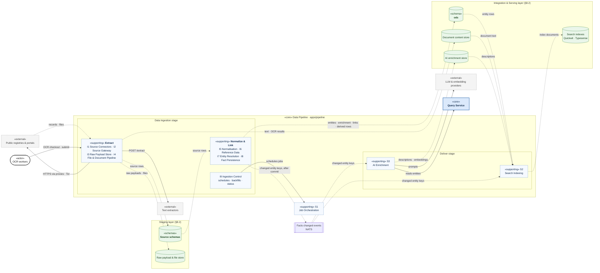
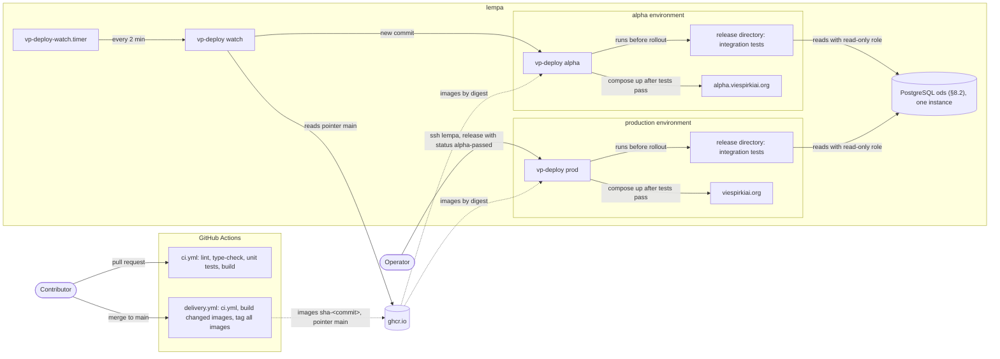
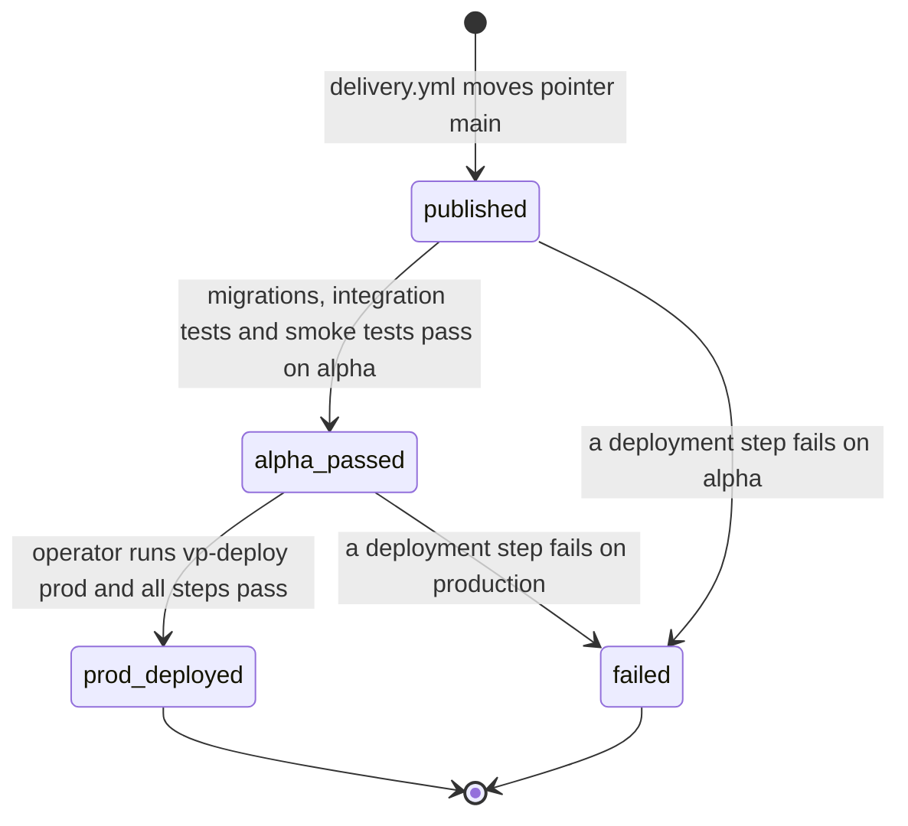
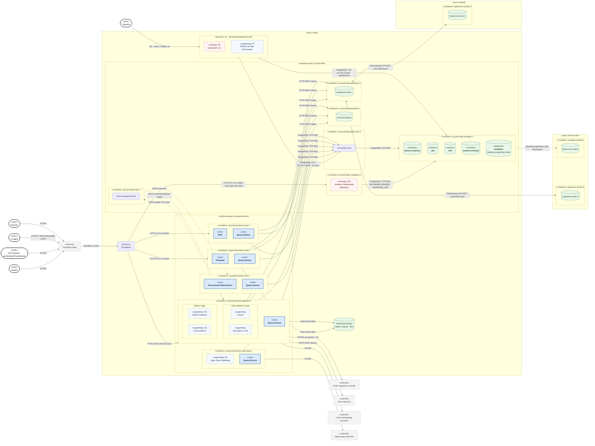

# Viešpirkiai — Target Architecture (Upgrade)

Notation follows `architecture-current.md`, with stereotypes for the target components:

| Notation         | Meaning                                                               |
|------------------|-----------------------------------------------------------------------|
| **Solid arrow**  | Dependency (A uses B)                                                 |
| **Dotted arrow** | Data flow (data moves from A to B)                                    |
| Circle           | Provided interface (lollipop)                                         |
| `«core»`         | Core Component: main functional component (solid blue)                |
| `«supporting»`   | Supporting Component: secondary functional component (dashed blue). A decomposed core component can own supporting components |
| `«missing»`      | Supporting Component that does not exist today (dashed red)           |
| `«database»`     | Data store (green cylinder)                                           |
| `«schema»`       | One PostgreSQL schema inside a database (green cylinder, bold name)   |
| `«schemas»`      | Group of PostgreSQL schemas of one kind (green cylinder, bold names)  |
| `«actor»`        | Person or external system that starts an interaction                  |
| `«external»`     | System outside this repository (dashed grey)                          |
| `«host»`         | Physical or virtual server (deployment diagram)                       |
| `«container»`    | Running container instance: one isolated process with its own memory limit and credentials; it wraps the component instances it runs (deployment diagram) |
| `«process»`      | Operating system process outside Docker (deployment diagram)          |

## Terminology

The document uses these terms with one meaning each:

| Term                      | Meaning                                                                                                       | Code or section                                        |
|---------------------------|---------------------------------------------------------------------------------------------------------------|--------------------------------------------------------|
| Functional component      | Unit of responsibility with owned data. It is not necessarily a separate process                             | §1, §3                                                 |
| Core component            | Functional component that delivers the main value of the system. Diagrams mark it `«core»`                   | §1                                                     |
| Supporting component      | Functional component that core components need. A core component can own supporting components when it is decomposed. Diagrams mark it `«supporting»` | §2, §3                                  |
| `S1`–`S11`, `I1`–`I9`     | Ids of the supporting components (§3) and of the sub-components of Extract and Normalize & Link (§2.3)        | —                                                      |
| Source schema             | PostgreSQL schema that mirrors one upstream source: a persistent staging area                                 | `vpmSutartys`, `eppsViesiejiPirkimai`, `rcJar`; §8.2   |
| `ods`                     | Operational Data Store: canonical entities, enrichment, link tables, derived tables and views                 | §8                                                     |
| Fact schemas              | The source schemas and `ods` together. Data Ingestion is their only writer                                    | §1.2, §2.4                                             |
| Extract                   | Supporting component of Data Ingestion. It collects data from upstream sources into the source schemas and document content | §2.1, §2.3                               |
| Normalize & Link          | Supporting component of Data Ingestion. It reads the source schemas and writes `ods`                         | §2.1, §2.3                                             |
| Document content          | Extracted text and OCR results of downloaded files                                                            | I4, `@viespirkiai/data/storage`                        |
| Enrichment                | Attributes from registries and classifiers that Normalize & Link adds to `ods` entities                       | §8.3                                                   |
| AI enrichment             | LLM descriptions and embeddings that S3 writes to the AI enrichment store                                     | S3                                                     |
| Control schemas           | `infra`, `auth` and `jobs`: runtime configuration, API keys and job state. They form the Control layer        | §3, §8.10                                              |
| Staging layer             | Source schemas, raw payloads and files. Extract writes it; only Normalize & Link and S7 read it               | §8.2                                                   |
| Integration & Serving layer | `ods`, document content, `risk`, search indexes and the AI enrichment store. The Query Service reads only this layer | §8.2                                          |
| Control layer             | The control schemas. It holds no domain data                                                                  | §8.2, §8.10                                            |
| Data Pipeline             | Core component that holds the ETL components: the Data Ingestion stage and the Deliver stage. Workspace `apps/pipeline` | §1, §3.1, §6.2, §7.7                          |
| Data Ingestion            | First stage of Data Pipeline: Extract and Normalize & Link. The only writer of the fact schemas              | §2                                                     |
| Deliver stage             | Second stage of Data Pipeline: S2 Search Indexing and S3 AI Enrichment. It runs after Data Ingestion commits facts | §3, §3.1                                         |
| Facts changed event       | Hint that Normalize & Link committed changes to `ods` entities in one ingestion run                           | `@viespirkiai/platform/events`, §2.2                   |
| Ingestion run             | One execution of an ingestion job. `ods` rows store its id in `ikelimoId`                                     | §8.4                                                   |
| Job                       | Unit of scheduled or queued work that S1 manages. The current code calls it a *task*                          | `@viespirkiai/platform/jobs`; `tasks/*.js`, `runner/`  |
| Metabase                  | Analytics dashboard service of S11. It reads `ods` and `risk` with the read-only role `METABASE_READER`      | S11, §7.7                                              |
| Organisation              | Party of a procurement: registered legal entity, foreign company or natural person. Buyer and supplier are roles | `ods."organizacijos"`; §9 Q3, Q11                   |
| Risk signal               | Result of one risk indicator for one subject                                                                  | `risk."signals"`                                       |
| Procurement risk decision | Current risk evaluation of one procurement. It groups the risk signals of that procurement                   | `risk."procurementDecisions"`                          |
| BVPŽ                      | Lithuanian name of the Common Procurement Vocabulary (CPV)                                                    | `bvpzKodai`                                            |
| `lempa`                   | Primary physical server. It runs the alpha and production environments                                        | §7                                                     |
| Environment               | `alpha` or `prod` on `lempa`: one data compose project and one business compose project                       | §7.6                                                   |
| Release                   | Image digests and the source tree of one published commit on `main`                                           | §7.3, §7.5                                             |
| Operator                  | Team member who issues ingestion commands and production deployments                                         | §2.2, §7                                               |

---

## 1. Core functional components

The system has **five core functional components** around **one shared database**:

| # | Component                    | Purpose (one sentence)                                                                                                                     | Primary actors                                                    |
|---|------------------------------|--------------------------------------------------------------------------------------------------------------------------------------------|-------------------------------------------------------------------|
| 1 | **Data Pipeline**            | Brings public data from upstream sources into the Viešpirkiai database as normalised, linked and versioned facts, and delivers search indexes and AI enrichment built from them. | Upstream registries & portals, OCR workers, text extractors, LLM providers, operator |
| 2 | **Query Service**            | The single read path of application code to Viešpirkiai data: entity lookups, search, relationships, documents and risk results behind stable query contracts. | Frontend, MCP, Procurement Risk Service, Data Pipeline (S3), S4   |
| 3 | **Procurement Risk Service** | Evaluates procurements against risk indicators and records explainable risk decisions.                                                     | Analysts (through Frontend, MCP and S11 Metabase), operator       |
| 4 | **Frontend**                 | Publishes the data as a searchable public website.                                                                                         | Citizens, journalists, researchers, NGOs                          |
| 5 | **MCP**                      | Gives LLM agents structured, read-only access to the data through tools.                                                                   | AI agents / MCP clients                                           |

Data Pipeline has two stages: **Data Ingestion** (Extract, Normalize & Link; §2) writes the fact schemas, and the
**Deliver stage** (S2 Search Indexing, S3 AI Enrichment; §3) writes the derived stores.

### 1.1 Core functional component diagram


### 1.2 Core components: use cases and data ownership

| Component                    | Key use cases                                                                                                                                                                                                                                                      | Depends on                                                            | Writes (owns)                                          | Current code                                                                                                                           |
|------------------------------|--------------------------------------------------------------------------------------------------------------------------------------------------------------------------------------------------------------------------------------------------------------------|-----------------------------------------------------------------------|--------------------------------------------------------|----------------------------------------------------------------------------------------------------------------------------------------|
| **Data Pipeline**            | Discover new records · import and refresh incrementally · backfill history · acquire and process documents (download, extract, OCR) · link entities and reference data · detect and version changes (contract edits, legislation editions, court decision updates) · build and rebuild search indexes · generate AI descriptions and embeddings | Upstream sources, LLM providers, S1 Job Orchestration, **Query Service** (S3 only) | **Fact schemas** (Data Ingestion: Extract writes the source schemas and document content; Normalize & Link writes `ods`) and **derived stores** (Deliver: S2 writes the search indexes; S3 writes the AI enrichment store) (§2, §3, §8) | `tasks/*`, `modules/<source>/*`, `modules/failai/`, `modules/documents/`, `runner/`, `quickwit/`, `modules/*/quickwitProcessIndexQueue.js`, `modules/openrouter/`, `modules/vector/` |
| **Query Service**            | Look up an entity by identifier · search and facet (contracts, procurements, organisations, documents) · traverse relationships · read document content · read risk results · provide bulk analytical reads · run bounded ad-hoc SQL for analysts                  | `ods` and `risk` (read-only role), S2 search indexes, document content store, S3 AI enrichment store | **Nothing.** Read-only by definition.                  | Scattered: SQL in 21 pages under `src/pages`, `src/lib/*`, `modules/*/search*.js`, `modules/rysiai/`, `modules/mcp/tools/`, `modules/mcp/analyst/` |
| **Procurement Risk Service** | Run evaluation for all procurements or a subset · evaluate each deployed indicator · record explainable procurement risk decisions and risk signals · re-evaluate after "facts changed"                                                                                                              | **Query Service** (analytical reads), S1                              | **`risk` schema** only                                 | `services/procurement-risk/`, `modules/risk/`                                                                                          |
| **Frontend**                 | Search · entity pages (buyer, supplier, person, contract, procurement, legal act, court decision) · relationship graph · statistics · shareable pages (OpenGraph)                                                                                                  | **Query Service**                                                     | **Nothing.**                                           | `src/`                                                                                                                                 |
| **MCP**                      | List tools · search and fetch entities · read contract changes · read document and legal act text · describe schema · run analyst SQL (optional)                                                                                                                                                      | **Query Service**                                                     | **Nothing.** Tool-call audit goes to S6 Observability. | `modules/mcp/`, `src/pages/mcp.astro`, `src/lib/mcp.ts`                                                                                |

**Ownership rules (target)**

1. **One writer per schema.** Data Pipeline owns the source schemas, `ods` and the derived stores. In its Data Ingestion
   stage, Extract writes the source schemas and Normalize & Link writes `ods`. In its Deliver stage, S2 writes the
   search indexes and S3 writes the AI enrichment store. The Risk Service owns `risk` (§8). The writers of the control
   schemas are open (§9 Q6).
2. **One read path.** Frontend, MCP and the Risk Service never query the database directly. They go through the Query
   Service. This is the boundary that removes SQL from pages and tools (review P5). S11 Metabase is the only
   exception: it reads `ods` and `risk` directly with the read-only role `METABASE_READER`.
3. Today both rules are broken:
    - SQL is spread across pages, MCP tools and risk indicators.
    - The Frontend writes OCR results and creates tables at runtime.
    - MCP writes tool-call logs.
    - Every process can import any module.

### 1.3 Query Service

The Query Service turns the database schema into a **published query contract**. Consumers depend on named queries with
typed results, never on table layouts. A schema change then touches one component instead of dozens of call sites.

| Query family                                                                                                       | Consumers                  | Notes                                                                        |
|--------------------------------------------------------------------------------------------------------------------|----------------------------|------------------------------------------------------------------------------|
| **Entity queries**: get procurement, contract, organisation, person, document, legal act, court case by identifier | Frontend, MCP              | Includes change history of the entity                                        |
| **Search & facets**: full-text and filtered search, suggestions, facet counts                                      | Frontend, MCP              | Uses S2 search indexes; PostgreSQL fallback lives here, not in consumers |
| **Relationship queries**: organisation–person–contract graph traversal                                             | Frontend, MCP, Risk Service | Graph *building* belongs to Normalize & Link; graph *reading* belongs here   |
| **Document content**: extracted text, OCR result, file reference                                                   | Frontend, MCP              | Replaces direct sidecar reads and the sidecar HTTP API                       |
| **Risk results**: procurement risk decisions and their risk signals                                  | Frontend, MCP              | Reads the `risk` schema                                                      |
| **Analytical reads**: set-based, streamed reads over large `ods` sets                                              | Risk Service, S4 Open Data | Reads `ods` tables and views (§8.3), not per-row calls, so batch jobs stay efficient |
| **Ad-hoc SQL** (bounded): read-only, time-limited, restricted to `ods`                                     | MCP                        | Enforcement by database role grants, not only by SQL parsing (review P3)  |

The Query Service reads only the Integration & Serving layer (§8.2). It is an in-process library, not a network service.
It holds a read-only connection pool over `ods` and `risk`, plus clients for the search indexes, the document content
store and the AI enrichment store. Its value is the contract and the
boundary, not the deployment.

---

## 2. Data Pipeline

Data Pipeline is the only writer of the fact schemas and the derived stores. §8.2 defines the data layers that it
writes.

### 2.1 Pipeline flow



### 2.2 Pipeline process

1. I9 Ingestion Control schedules the jobs of each source through S1. Operator commands (`vp ingestion …`, §6.4) are
   S1 jobs too.
2. Extract discovers new and changed records of a source (I1) and fetches them through the Source Gateway (I2).
3. Extract retains each raw payload and file (I3). It parses the payload and upserts the rows of the source schema.
4. The File & Document Pipeline (I4) downloads referenced files and gets their text from text extractors and OCR
   workers. It writes document content.
5. Normalize & Link reads the new source rows. It maps them to the canonical model (I5) and adds enrichment (I6).
6. Entity Resolution (I7) matches organisations, procurements and contracts across sources and produces link rows.
7. Fact Persistence (I8) upserts the `ods` rows with version and provenance in one transaction. The same transaction
   updates the affected derived rows.
8. After commit, I8 publishes a facts changed event with the changed entity keys (§9 Q2).
9. S2 Search Indexing reads the changed `ods` rows and document content, and updates Quickwit and Typesense.
10. S3 AI Enrichment reads the changed entities through the Query Service. It writes LLM descriptions and embeddings.

- Extract and Normalize & Link never call each other. The source schemas are the boundary between them.
- Normalize & Link never calls an upstream source, so `ods` can be rebuilt from the source schemas (G9).
- The Deliver stage writes no facts. A Deliver failure does not delay Data Ingestion.
- Only I1 and I5 contain source-specific code. All other steps are shared by every source.

### 2.3 Data Ingestion sub-components

| #  | Component        | Sub-component                       | Responsibility                                                                                               | Provides                                  | Current code                                                                                                                                                                   |
|----|------------------|-------------------------------------|--------------------------------------------------------------------------------------------------------------|-------------------------------------------|--------------------------------------------------------------------------------------------------------------------------------------------------------------------------------|
| I1 | Extract          | **Source Connectors**               | One connector per source: bulk dataset, change feed, crawler or API adapter. Discovery, parsing, source rows | —                                         | `modules/<source>/*`                                                                                                                                                           |
| I2 | Extract          | **Source Gateway**                  | Outbound access: proxies, Tor, per-source rate limits, request log                                           | —                                         | `utils/scrapeFetch.js`, `modules/scrapeProxies/`, `modules/proxy/`, eTarSeimasScraper clients                                                                                  |
| I3 | Extract          | **Raw Payload Store**               | Retain raw API and HTML payloads for audit and re-processing                                                 | —                                         | sidecar SQLite (`eTar`, `eSeimas`, `liteko2`)                                                                                                                                  |
| I4 | Extract          | **File & Document Pipeline**        | Download, content-addressed storage, text extraction, OCR, document content                                  | OCR work distribution, file lookup        | `modules/failai/`, `modules/documents/`, `tasks/dokNuskaitytojai.js`, goViesdeze, OCR endpoints, sidecar SQLite (`failaiInfo`, `dokumentai`, `ocrRezultatai`)                  |
| I5 | Normalize & Link | **Canonical Model & Normalisation** | Shared entity definitions (`@viespirkiai/data/domain`) and one source-to-canonical mapper per source          | —                                         | `upsert*.js`, per-module mapping code                                                                                                                                          |
| I6 | Normalize & Link | **Reference Data**                  | CPV (BVPŽ), legal forms, addresses and geocoding, classifiers                                                | —                                         | `modules/bvpz/`, `modules/geografija/`, `modules/liteko2/klasifikatoriai.js`                                                                                                   |
| I7 | Normalize & Link | **Entity Resolution**               | Match entities across sources; produce link tables and relationship edges                                    | —                                         | `modules/juridiniai/`, `modules/rysiai/` (building), `modules/2014esinvesticijos/rastiPareiskejuKodus.js`, `src/lib/sutartisPirkimai.ts`, `loadPpaSutarciuAtitikmenys()` in `src/lib/ppa.ts` |
| I8 | Normalize & Link | **Fact Persistence & Versioning**   | Idempotent upserts, change detection, provenance, derived tables                                             | Facts changed events                      | `sutartys` change tracking, `modules/sutartys/upsertVpmSutartis.js`, `teisekura` editions, `utils/taskSignals.js`                                                              |
| I9 | Data Ingestion   | **Ingestion Control**               | Per-source schedules of Extract and Normalize & Link, backfills, freshness                                    | Ingestion commands, ingestion status      | `tasks/*.js` definitions, `npm run` scripts                                                                                                                                    |

### 2.4 Data Ingestion guarantees

| #  | Guarantee                                                                                                                  | Today                                   |
|----|----------------------------------------------------------------------------------------------------------------------------|-----------------------------------------|
| G1 | **Single writer**: only Data Ingestion writes the fact schemas. Extract writes the source schemas; Normalize & Link writes `ods` | ❌ multiple writers                     |
| G2 | **Canonical model**: `ods` uses normalised entities. Only source schemas keep source-specific shapes (§8)                  | ⚠️ only `v_*` analyst views (review P13) |
| G3 | **Provenance**: every `ods` row records its source, source record id and ingestion run (§8.4)                              | ⚠️ inconsistent                         |
| G4 | **Idempotency**: re-ingesting a source record never duplicates or corrupts facts                                           | ⚠️ per module                           |
| G5 | **Versioned changes**: a changed source record becomes a recorded version, not an overwrite                                | ⚠️ some sources                         |
| G6 | **Reprocessability**: raw payloads and files are retained, so parsing and normalisation re-run without re-scraping          | ⚠️ sidecars have no backup              |
| G7 | **Commit, then notify**: events are sent only after facts are committed                                                    | ✅ documented NATS rule                 |
| G8 | **Observable freshness**: every source reports sync status and lag                                                         | ⚠️ partial                              |
| G9 | **Layered flow**: Normalize & Link reads only the source schemas and never calls an upstream source                        | ⚠️ per module                           |

---

## 3. Supporting (secondary) functional components

These do not deliver end-user value on their own, but the core components can't function reliably without them.
Data Ingestion owns two further supporting components, Extract and Normalize & Link (§2.3). Source access and file and
document processing belong to Extract (I2, I4). Reference data and entity resolution belong to Normalize & Link (I6,
I7).

S2 Search Indexing and S3 AI Enrichment form the **Deliver stage** of the core component Data Pipeline. They run after Data Ingestion
commits facts and write derived stores in the Integration & Serving layer. They are not part of Data Ingestion: their
outputs are not facts, S3 output is not deterministic, and their failures must not delay fact writes (G1, G4, G9).
The workspace `apps/pipeline` holds Data Ingestion and the Deliver stage; one container runs both stages (§6.2, §7.7).

| #       | Component                      | Responsibility                                                                                                                                            | Serves                                  | Exists today?     | Current code / gap                                                                                                  |
|---------|--------------------------------|-----------------------------------------------------------------------------------------------------------------------------------------------------------|-----------------------------------------|-------------------|---------------------------------------------------------------------------------------------------------------------|
| **S1**  | **Job Orchestration**          | Scheduling (cron and continuous), durable work queues, retries and back-off, reservation expiry, concurrency limits, wake-up signals                      | Data Pipeline, Risk, S4                 | ✅ Home-grown     | `runner/`, `tasks/`, per-domain `SKIP LOCKED` queues, NATS                                                          |
| **S2**  | **Search Indexing**            | Build search indexes (Quickwit full-text, Typesense suggestions and organisations) from `ods` on "facts changed"; rebuild and drift detection | Query Service                           | ✅ Partial        | `quickwit/`, `modules/*/quickwitProcessIndexQueue.js`, `modules/juridiniai/typesense*`, `modules/searchSuggestion/` |
| **S3**  | **AI Enrichment**              | LLM-generated descriptions, embeddings; owns the AI enrichment store (does **not** write facts, §9 Q7); cost, rate, prompt and model versioning           | Query Service                           | ✅ Experimental   | `modules/openrouter/`, `modules/vector/`, `scripts/aprasyti*.js`; descriptions in `eppsViesiejiPirkimai."aprasymai"` |
| **S4**  | **Open Data Publishing**       | Publish curated datasets to the open-data API (Spinta / viesStalcius) and bulk exports; reads through the Query Service                                   | Open-data consumers                     | ✅ Scattered      | `modules/spinta/`, `modules/*/pushToSpinta.js`, `export:*` scripts, export WebSocket                                |
| **S5**  | **Identity & Access**          | API keys for machine clients, worker registry, MCP client identification, rate limiting and abuse protection, analyst role policy                         | Frontend, MCP, Data Pipeline (workers)  | ⚠️ Partial        | `auth.raktai`, `modules/failai/auth.js`, `src/lib/botChallenge.ts`; **no rate limiting, no key rotation**           |
| **S6**  | **Observability & Statistics** | Metrics, logs (SQL, scrape, MCP tool calls), ingestion status, job health, alerting, public statistics                                                    | Operator, Frontend (`/statistika`)      | ⚠️ Partial        | `modules/statistika/`, `/metrics`, SQL and scrape log ingest; **no taskRunner health, no alerting**                 |
| **S7**  | **Schema & Data Governance**   | Versioned migrations, schema documentation, table ownership map, data-quality checks, reconciliation of derived stores                                    | All core components                     | ⚠️ Fragmented     | `migrations/` (incomplete), `postgres/dumpSchema.js`, schema scripts; **no migration runner**                       |
| **S8**  | **Backup & Recovery**          | PostgreSQL backups with point-in-time recovery, raw payload and document-store backups, file archive backup, **tested restore**                           | Whole system                            | ❌ Mostly missing | Only `modules/s3backup/` (file archive to S3 object storage)                                                                                |
| **S9**  | **Operations CLI**         | `vp` command-line tool on `lempa`: issue ingestion commands; manage runtime configuration kept as data (proxies, workers, storage boxes, API keys, info banner, job toggles)                 | Operator                                | ❌ Missing        | pgAdmin, raw SQL, `npm run` scripts                                                                                 |
| **S10** | **Configuration & Secrets**    | One source of truth for configuration, secret storage and rotation, per-environment settings                                                              | All components                          | ⚠️ Sprawl         | `config.js`, `.env`, `utils/config*.js`, `ENV.md`                                                                   |
| **S11** | **Analytics Dashboards**       | Metabase dashboards and saved questions over `ods` and `risk`; direct read-only SQL with `METABASE_READER`                                                | Analysts, operator                      | ❌ Missing        | new: `infra/services/metabase/`                                                                                     |

### 3.1 Full functional component diagram

```mermaid
flowchart TB
    classDef actor fill: #ffffff, stroke: #222, stroke-width: 1.5px, color: #111
    classDef core fill: #dbe9fb, stroke: #1f5fa8, stroke-width: 2px, color: #0b2545
    classDef sup fill: #f5f9ff, stroke: #1f5fa8, stroke-dasharray: 3 2, color: #0b2545
    classDef missing fill: #fff4f4, stroke: #c62828, stroke-dasharray: 3 2, color: #5a1010
    classDef store fill: #eaf6ea, stroke: #2e7d32, color: #123d14
    classDef ext fill: #f4f4f4, stroke: #777, stroke-dasharray: 4 3, color: #333

    subgraph L1["Actors"]
        citizen(["«actor»<br/>Citizen / journalist"]):::actor
        agent(["«actor»<br/>AI agent"]):::actor
        odc(["«actor»<br/>Open-data consumer"]):::actor
        op(["«actor»<br/>Operator"]):::actor
        analyst(["«actor»<br/>Analyst"]):::actor
    end

    subgraph L2["Consumers"]
        fe["«core»<br/><b>Frontend</b>"]:::core
        mcp["«core»<br/><b>MCP</b>"]:::core
        risk["«core»<br/><b>Procurement Risk Service</b>"]:::core
        s4["«supporting» S4<br/>Open Data Publishing"]:::sup
        s11["«missing» S11<br/>Analytics Dashboards<br/>Metabase"]:::missing
    end

    qs["«core»<br/><b>Query Service</b>"]:::core

    subgraph DATA["Viešpirkiai data"]
       subgraph ISL["Integration & Serving layer"]
          ods[("«schema»<br/><b>ods</b>")]:::store
          docs[("Document content store")]:::store
          riskdb[("«schema»<br/><b>risk</b>")]:::store
          search[("Search indexes<br/>Quickwit · Typesense")]:::store
          enrich[("AI enrichment store<br/>descriptions · embeddings")]:::store
       end
        subgraph STG["Staging layer"]
            srcdb[("«schemas»<br/><b>Source schemas</b>")]:::store
            raw[("Raw payload & file store")]:::store
        end
        subgraph CTL["Control layer"]
            ctrl[("«schemas»<br/><b>Control schemas</b><br/><b>infra</b> · <b>auth</b> · <b>jobs</b>")]:::store
        end
    end

    subgraph PIPE["«core» <b>Data Pipeline</b>"]
        subgraph ing["Data Ingestion stage"]
            extract["«supporting»<br/>Extract"]:::sup
            nl["«supporting»<br/>Normalize & Link"]:::sup
        end
        subgraph DLV["Deliver stage"]
            s2["«supporting» S2<br/>Search Indexing"]:::sup
            s3["«supporting» S3<br/>AI Enrichment"]:::sup
        end
    end
    class PIPE core

    subgraph L6["Platform & operations (cross-cutting)"]
        s1["«supporting» S1<br/>Job Orchestration"]:::sup
        s9["«missing» S9<br/>Operations CLI"]:::missing
        s5["«supporting» S5<br/>Identity & Access"]:::sup
        s6["«supporting» S6<br/>Observability & Statistics"]:::sup
        s7["«supporting» S7<br/>Schema & Data Governance"]:::sup
        s8["«missing» S8<br/>Backup & Recovery"]:::missing
        s10["«supporting» S10<br/>Configuration & Secrets"]:::sup
    end

    workers(["«actor»<br/>OCR workers"]):::actor
    src["«external»<br/>Public registries & portals"]:::ext
    llm["«external»<br/>LLM & embedding providers"]:::ext
%% ── Actors ──
    citizen --> fe
    agent --> mcp
    odc --> s4
    op --> s9
    workers -->|" OCR checkout · submit "| extract
    analyst --> s11
%% ── Read path (dependencies) ──
    fe --> qs
    mcp --> qs
    risk --> qs
    s4 --> qs
    qs -->|" reads "| ISL
    s11 -->|" reads SQL, METABASE_READER "| ods
    s11 -->|" reads SQL, METABASE_READER "| riskdb
%% ── Data Pipeline: Deliver stage ──
   s2 -->|" reads "| ods
   s2 -->|" reads "| docs
   s2 -->|" reads descriptions "| enrich
   s3 --> qs
   s3 --> llm
   DLV --> s1
   risk --> s1
%% ── Data Pipeline: Data Ingestion stage ──
    extract --> src
    nl -->|" reads source rows "| srcdb
    ing --> s1
    s9 --> ing
%% ── Writes into owned stores (data flows) ──
    extract -.->|" source rows · payloads · files "| STG
    extract -.->|" document content "| docs
    nl -.->|" entities · links · derived rows "| ods
    nl -.->|" facts changed "| DLV
    risk -.->|" writes decisions "| riskdb
    s2 -.->|" documents "| search
    s3 -.->|" descriptions · embeddings "| enrich
    s1 -.->|" job state "| ctrl
%% ── Platform ──
    s9 --> ctrl
    s5 -.->|" keys · clients "| ctrl
    s7 -.->|" migrations "| DATA
    s8 -.->|" backups "| DATA
```



This diagram shows **dependencies** and **writes into owned stores**. The Query Service reads only the Integration &
Serving layer; the Staging layer is internal to the data pipeline. S11 Metabase reads `ods` and `risk` directly.
Platform components (S5–S10) are cross-cutting;
only their data-store edges are drawn, to keep the diagram readable.

---

## 4. Classification rules

These rules decide where new functionality belongs, so that agentic development places code consistently (review P5,
P8).

1. **Does it bring data from outside into the database** (including files, OCR, reference data, entity linking)? →
   **Data Pipeline**, stage **Data Ingestion**. It is the only stage that writes facts. Collecting from a source and staging source rows go
   to **Extract**. Mapping, enrichment and linking into `ods` go to **Normalize & Link**.
2. **Does it read Viešpirkiai data for someone else?** → it is a query in the **Query Service**. No other component
   issues read SQL against source, `ods` or `risk` schemas. The exceptions: a writer reads its own schemas, S2 index
   builders read `ods`, S11 Metabase reads `ods` and `risk`, and S7 governance tooling reads every schema.
3. **Does it show data to humans?** → **Frontend**, using only the Query Service.
4. **Does it expose data to AI agents?** → **MCP**, using only the Query Service.
5. **Does it compute a judgement about procurements** (score, flag, indicator)? → **Procurement Risk Service.** It reads
   through the Query Service and writes only to `risk`.
6. **Does it turn existing data into another shape** (index, embedding, export)? → **S2, S3 or S4**, each writing only
   to its own store. An aggregate inside `ods` is a derived table or view of Normalize & Link (§8.9).
7. **Does it keep the system running, safe or recoverable?** → **Platform, S5–S10.**
8. **Is it a one-off or operator script?** → an ingestion command issued through S9, or S7 governance tooling. **Never**
   a self-executing file inside a library module.

---

## 5. Current-to-target mapping of notable misplacements

| Today                                                                                    | Problem                                                      | Target owner                                                                     |
|------------------------------------------------------------------------------------------|--------------------------------------------------------------|----------------------------------------------------------------------------------|
| SQL in 21 pages under `src/pages`, query code in `src/lib`, separate queries in MCP tools            | No single read path; the same logic is written several times | **Query Service**                                                                |
| Risk indicators query `ppa."ataskaitos"` and views directly                              | Risk Service coupled to table layouts                        | **Query Service** (analytical reads)                                             |
| OCR checkout/submit endpoints inside the Frontend                                        | Public web app writes to the database and sidecars           | **Extract** of Data Ingestion (I4, OCR work distribution interface)                  |
| `downloadProxyInformation` inside the Frontend                                           | Internal file lookup on the public surface                   | **Extract** of Data Ingestion (I4, file lookup interface)                                  |
| Sidecar HTTP read API inside the Frontend                                                | Direct access to raw stores                                  | **Query Service** (document content)                                             |
| Per-source queues, reservation cleaners and change signals re-implemented in each module | Duplicated ingestion infrastructure                          | **Data Ingestion**: Ingestion Control (I9), Normalize & Link persistence (I8), S1 |
| LLM description generation (`scripts/aprasyti*.js`) writes `eppsViesiejiPirkimai."aprasymai"`                                  | AI enrichment mixed with ingestion; writes a source schema                | **S3 AI Enrichment** (AI enrichment store)                                                 |
| `export:*`, `push:*` scripts inside source modules                                       | Distribution mixed with ingestion                            | **S4 Open Data Publishing**                                                      |
| MCP tool-call logging to the database and Quickwit                                       | Consumer writes data                                         | **S6 Observability**                                                             |
| Info banner table created and edited through the Frontend                                | Runtime DDL, no admin UI                                     | **S9 Operations CLI**, S7 migrations                                         |
| `modules/risk` run manually via `npm run risk:run`                                       | Core component without scheduling                            | **Procurement Risk Service**, scheduled through S1, triggered by "facts changed" |
| 115 self-executing files and 87 files with `process.exit` in `modules/`                     | CLI entry points inside library code                         | Ingestion commands via **S9** / **S7** tooling                                   |
| Entity resolution in page services: `src/lib/sutartisPirkimai.ts`, `loadPpaSutarciuAtitikmenys()` in `src/lib/ppa.ts` | Links are computed per request and never stored (review D5)  | **Normalize & Link** (I7), `ods` link tables (§8.5)                              |
| `VPM_SUTARTIS_ROW_SQL` rebuilds contract rows for pages, Quickwit and exports            | Consumers depend on the shape of a dropped table (review D9) | `ods."sutartys"` (§8.4), written by **Normalize & Link**                         |
| `ensureAnalystViews()` creates the `v_*` views at runtime                                | Views drift from the schema; no migration (review D10)       | `ods` views and derived tables (§8.6), **S7** migrations                         |
| Buyer–supplier aggregate in `"vpmSutartys"."sumosPirkejasTiekejas"` and `v_pirkejo_tiekejo_rysys` | Two definitions of one concept (review D12)          | `ods."pirkejuTiekejuRysiai"` (§8.6)                                              |

---

## 6. Monorepo structure (npm workspaces)

The repository stays a single GitHub monorepo, organised with **npm workspaces**. Each app workspace is one functional
component from §1–3. Its build, test and run commands, its dependencies and its configuration belong to that workspace
alone.

### 6.1 Design principles

1. **App workspace = functional component.** Each core component, and each supporting component with its own process,
   has one app workspace (§6.3). A supporting component that a core component owns is a folder in the workspace of that
   core component: `apps/pipeline` (Data Pipeline) holds Extract and Normalize & Link under `src/ingestion/`, and S2 and
   S3 under `src/deliver/`.
2. **Two kinds of workspaces.**
    - `apps/*` are **deployable**: they have an entrypoint, a config schema and runtime dependencies. Every app
      except `ops` has a Dockerfile; `ops` runs from the release directory on `lempa` (§7.5).
    - `packages/*` are **libraries**: no process, no environment reading, no `process.exit`.
3. **Dependencies point inward only.** Apps depend on packages. Packages never import apps. Apps never import other
   apps; they communicate through database contracts, S1 jobs, events or HTTP.
4. **Imports go through declared dependencies and each package's subpath `exports`.** Deep imports
   (`@viespirkiai/query/src/…`) are forbidden. dependency-cruiser enforces these boundary rules in CI:
    - `web`, `mcp` and `open-data` import no `@viespirkiai/data` module. They read data only through `query`.
    - Only `pipeline/src/ingestion/**` imports `@viespirkiai/data/database/facts-writer`. Only `risk` imports
      `@viespirkiai/data/database/risk-writer`. PostgreSQL role grants enforce the same rule.
    - Inside `pipeline`, `src/ingestion/extract/**`, `src/ingestion/normalize-link/**` and `src/deliver/**` never import
      each other.
5. **Plain npm workspaces, no extra monorepo tool.**
    - Node 24 runs TypeScript directly (built-in type stripping); `tsc -b` only type-checks.
    - Only the Astro app has a real build step.
    - Add Turborepo later only if CI time becomes a problem.
6. **Configuration per app.** Each app declares its own zod schema and `.env.example`. Packages receive settings as
   parameters. There is no global `CONFIG`.
7. **Strict TypeScript everywhere.** New code is TypeScript; existing JavaScript is converted when its module moves into
   a workspace.
8. **Few packages, grouped by consumers and runtime dependencies.**
    - A package groups modules that the same workspaces import and that change together.
    - Subpath `exports` (`@viespirkiai/platform/jobs`) separate the modules inside one package.
    - A module becomes its own package only when its consumers or its runtime dependencies differ.
    - Code used by one workspace stays inside it; for example, the design system stays in `apps/web`.
9. **Versioned agent instructions.** A root `AGENTS.md`, plus a short `AGENTS.md` per workspace stating its
   responsibility, allowed dependencies and commands (review P8).

### 6.2 Repository tree

```text
viespirkiai/
├── package.json                    # private root: workspaces ["apps/*", "packages/*"], orchestration scripts only
├── package-lock.json               # one lockfile for the whole repository
├── tsconfig.base.json              # strict · module "nodenext" · erasableSyntaxOnly · verbatimModuleSyntax
├── tsconfig.json                   # project references to every workspace (tsc -b)
├── eslint.config.js                # flat config: import hygiene, no process.env outside config.ts
├── .dependency-cruiser.cjs         # boundary rules from §6.1, enforced in CI
├── .node-version                   # 24
├── .editorconfig
├── AGENTS.md                       # repository-wide agent instructions (versioned)
├── README.md
│
├── .github/
│   ├── workflows/                  # see §7.4
│   │   ├── ci.yml                  # PR gate: install → lint → typecheck → boundaries → unit tests → build → audit → hadolint
│   │   └── delivery.yml            # main: ci → build changed images → tag all images sha-<commit> → move pointer main
│   ├── dependabot.yml
│   └── CODEOWNERS                  # owners per workspace and per migration folder
│
├── apps/                           # ── deployable functional components ──
│   │
│   ├── web/                        # «core» Frontend · @viespirkiai/web (Astro SSR)
│   │   ├── package.json
│   │   ├── AGENTS.md
│   │   ├── Dockerfile
│   │   ├── .env.example
│   │   ├── astro.config.ts
│   │   ├── public/
│   │   ├── src/
│   │   │   ├── config.ts           # web-only config schema
│   │   │   ├── middleware.ts
│   │   │   ├── pages/              # routes: use @viespirkiai/query only, never SQL
│   │   │   ├── components/
│   │   │   ├── design-system/
│   │   │   └── client/             # browser bundles (relationship graph)
│   │   └── test/
│   │
│   ├── mcp/                        # «core» MCP · @viespirkiai/mcp
│   │   ├── package.json
│   │   ├── AGENTS.md
│   │   ├── Dockerfile
│   │   ├── .env.example
│   │   ├── src/
│   │   │   ├── main.ts             # HTTP entrypoint (Streamable HTTP transport)
│   │   │   ├── config.ts
│   │   │   ├── server.ts
│   │   │   └── tools/              # one file per tool, built on @viespirkiai/query
│   │   └── test/
│   │
│   ├── pipeline/                   # «core» Data Pipeline · @viespirkiai/pipeline: Data Ingestion + Deliver stages
│   │   ├── package.json
│   │   ├── AGENTS.md
│   │   ├── Dockerfile              # one image, one container (§7.7)
│   │   ├── .env.example
│   │   ├── src/
│   │   │   ├── main.ts             # entrypoint: Data Ingestion and Deliver workers, HTTP API for OCR work and file lookup
│   │   │   ├── config.ts
│   │   │   ├── ingestion/          # Data Ingestion stage
│   │   │   │   ├── control/        # I9 schedules, backfills, freshness status
│   │   │   │   ├── extract/        # «supporting» Extract: upstream sources → Staging layer, document content
│   │   │   │   │   ├── connectors/ # I1 · one folder per source
│   │   │   │   │   │   ├── cvp-is/
│   │   │   │   │   │   ├── ted/
│   │   │   │   │   │   ├── jar/
│   │   │   │   │   │   ├── liteko/
│   │   │   │   │   │   ├── e-tar/
│   │   │   │   │   │   └── …
│   │   │   │   │   ├── gateway/    # I2 Source Gateway: proxies, Tor, rate limits, request log
│   │   │   │   │   ├── raw-store/  # I3 raw payload retention
│   │   │   │   │   └── documents/  # I4 download, storage boxes, extraction, OCR distribution, file lookup
│   │   │   │   └── normalize-link/ # «supporting» Normalize & Link: source schemas → ods
│   │   │   │       ├── mappers/    # I5 · one source-to-canonical mapper per source
│   │   │   │       ├── reference-data/    # I6
│   │   │   │       ├── entity-resolution/ # I7
│   │   │   │       └── persistence/       # I8 idempotent upserts, versions, derived tables, facts changed
│   │   │   └── deliver/            # Deliver stage
│   │   │       ├── indexing/       # «supporting» S2 Search Indexing: ods · document content → Quickwit, Typesense
│   │   │       └── enrichment/     # «supporting» S3 AI Enrichment: LLM descriptions, embeddings
│   │   └── test/
│   │
│   ├── risk/                       # «core» Procurement Risk Service · @viespirkiai/risk
│   │   ├── package.json
│   │   ├── AGENTS.md
│   │   ├── Dockerfile
│   │   ├── .env.example
│   │   ├── src/
│   │   │   ├── main.ts             # scheduled or event-triggered evaluation run
│   │   │   ├── config.ts
│   │   │   ├── engine/             # run orchestration, decision writer
│   │   │   └── indicators/         # one folder per indicator (LT-COM-01 …) with fixtures and tests
│   │   └── test/
│   │
│   ├── open-data/                  # «supporting» S4 Open Data Publishing · @viespirkiai/open-data
│   └── ops/                        # «supporting» S9 Operations CLI · @viespirkiai/ops · no image: runs on lempa (§7.5)
│       ├── package.json            # "bin": { "vp": "./src/cli.ts" }
│       └── src/
│           ├── cli.ts              # vp commands of §6.4
│           └── commands/
│
├── packages/                       # ── libraries: no entrypoints, no env reading, no process.exit ──
│   │
│   ├── query/                      # «core» Query Service · @viespirkiai/query
│   │   ├── package.json            # "exports": { ".": "./src/index.ts" }
│   │   ├── AGENTS.md
│   │   ├── src/
│   │   │   ├── index.ts            # the published query contract
│   │   │   ├── entities/           # procurement, contract, organisation, person, document, legal act, court case
│   │   │   ├── search/             # search and facets (search indexes + PostgreSQL fallback)
│   │   │   ├── relationships/
│   │   │   ├── documents/          # extracted text, OCR results, file references
│   │   │   ├── risk/               # risk results
│   │   │   ├── analytics/          # set-based, streamed reads for Risk and Open Data
│   │   │   └── analyst-sql/        # bounded ad-hoc SQL
│   │   └── test/
│   │
│   ├── data/                       # «supporting» S7 Schema & Data Governance · @viespirkiai/data
│   │   ├── package.json            # "exports": ./domain · ./database · ./database/facts-writer · ./database/risk-writer · ./search · ./storage
│   │   ├── AGENTS.md
│   │   ├── src/
│   │   │   ├── domain/             # canonical model (I5): entity types, identifiers, Money, dates
│   │   │   ├── database/           # role-scoped pools: readOnly · analyst · factsWriter · riskWriter · migrator (§6.5)
│   │   │   ├── search/             # Quickwit and Typesense clients, index definitions
│   │   │   └── storage/            # file store, document content, raw payload stores
│   │   ├── migrations/
│   │   │   ├── source/             # source schemas, owned by apps/pipeline (Extract)
│   │   │   ├── ods/                # Operational Data Store, owned by apps/pipeline (Normalize & Link)
│   │   │   ├── risk/               # owned by apps/risk
│   │   │   └── control/            # infra · auth · jobs
│   │   ├── schema/                 # generated schema documentation (committed)
│   │   └── test/
│   │
│   ├── platform/                   # «supporting» S1 · S5 · S6 · S10 · @viespirkiai/platform
│   │   ├── package.json            # "exports": ./config · ./observability · ./auth · ./jobs · ./events
│   │   ├── AGENTS.md
│   │   ├── src/
│   │   │   ├── config/             # S10 typed env loader (zod) used by every app's config.ts
│   │   │   ├── observability/      # S6 structured logging, metrics, health checks
│   │   │   ├── auth/               # S5 API keys, rate limiting
│   │   │   ├── jobs/               # S1 queues, schedules, retries
│   │   │   └── events/             # "facts changed" event contracts + transport (NATS)
│   │   └── test/
│   │
│   └── testing/                    # dev only: fixtures, test database (Testcontainers), fakes
│
├── infra/                          # ── how it runs; no application code, not a workspace ──
│   ├── ci/
│   │   ├── images.json             # image name → Dockerfile, target, workspace (§7.4)
│   │   └── affected-images.ts      # changed paths + workspace graph → images to build
│   ├── compose/                    # see §7.6
│   │   ├── viespirkiai-business-compose.yaml  # long-running apps of §6.3; images by digest; alpha and production
│   │   ├── viespirkiai-data-compose.yaml      # PostgreSQL · PgBouncer · Quickwit · Typesense · NATS · Metabase; alpha and production
│   │   ├── dev.yaml                # local development services
│   │   └── env/
│   │       ├── alpha.env           # non-secret alpha values
│   │       └── prod.env            # non-secret production values
│   ├── deploy/                     # vp-deploy agent, vp wrapper, systemd timer for lempa (§7.5)
│   ├── services/                   # image and configuration of each third-party service
│   │   ├── postgres/               # PostGIS, pg_repack
│   │   ├── pgbouncer/
│   │   ├── quickwit/
│   │   ├── typesense/
│   │   ├── metabase/               # «supporting» S11 Analytics Dashboards: application database, data source roles
│   │   └── cloudflared/            # tunnel ingress: viespirkiai.org, alpha.viespirkiai.org
│   └── backup/                     # «supporting» S8 Backup & Recovery: scripts and restore runbook
│
└── docs/
    ├── architecture/
    ├── adr/                        # architecture decision records
    └── runbooks/
```

### 6.3 Workspace to functional component map

The repository has **six app workspaces and four package workspaces**.

| Workspace            | Package                  | Functional component                                                                                   | Workspace dependencies      | Runs as                        | Moves from (today)                                                                                                                                                                                                                                                                                                     |
|----------------------|--------------------------|--------------------------------------------------------------------------------------------------------|-----------------------------|--------------------------------|------------------------------------------------------------------------------------------------------------------------------------------------------------------------------------------------------------------------------------------------------------------------------------------------------------------------|
| `apps/web`           | `@viespirkiai/web`       | «core» Frontend                                                                                        | `query`, `platform`         | `astro build` → Node server    | `src/`, `start-server.mjs`, `astro.config.mjs`                                                                                                                                                                                                                                                                         |
| `apps/mcp`           | `@viespirkiai/mcp`       | «core» MCP                                                                                             | `query`, `platform`         | `node src/main.ts`             | `modules/mcp/`, `src/pages/mcp.astro`, `src/lib/mcp.ts`                                                                                                                                                                                                                                                                |
| `apps/pipeline`      | `@viespirkiai/pipeline`  | «core» Data Pipeline: Data Ingestion (Extract, Normalize & Link), S2 Search Indexing, S3 AI Enrichment | `query`, `data`, `platform` | `node src/main.ts`             | `tasks/`, `modules/<source>/`, `modules/failai/`, `modules/documents/`, OCR endpoints, matching logic in `src/lib/sutartisPirkimai.ts` and `src/lib/ppa.ts`; `quickwit/`, `modules/*/quickwitProcessIndexQueue.js`, `modules/juridiniai/typesense*`, `modules/searchSuggestion/`; `modules/openrouter/`, `modules/vector/`, `scripts/aprasyti*.js` |
| `apps/risk`          | `@viespirkiai/risk`      | «core» Procurement Risk Service                                                                        | `query`, `data`, `platform` | `node src/main.ts` (scheduled) | `modules/risk/`, `services/procurement-risk/`                                                                                                                                                                                                                                                                          |
| `apps/open-data`     | `@viespirkiai/open-data` | S4 Open Data Publishing                                                                                | `query`, `platform`         | `node src/main.ts`             | `modules/spinta/`, `modules/*/pushToSpinta.js`, `export:*` scripts, export WebSocket                                                                                                                                                                                                                                   |
| `apps/ops`           | `@viespirkiai/ops`       | S9 Operations CLI                                                                                  | `data`, `platform`          | `vp <command>` on `lempa`      | about 80 `npm run` scripts, `scripts/`                                                                                                                                                                                                                                                                                 |
| `packages/query`     | `@viespirkiai/query`     | «core» Query Service                                                                                   | `data`                      | library                        | `src/lib/*`, SQL in pages, `modules/*/search*.js`, `modules/rysiai/`, `modules/mcp/analyst/`                                                                                                                                                                                                                           |
| `packages/data`      | `@viespirkiai/data`      | S7 Schema & Data Governance; canonical model (I5); search and storage clients                          | —                           | library + migrations           | `postgres/`, `migrations/`, `dbSchema/`, `quickwit/quickwit.js`, `typesense/`, `utils/sidecar*.js`, `modules/failai/failaiFs.js`, `modules/ocr/rezultataiFs.js`                                                                                                                                                        |
| `packages/platform`  | `@viespirkiai/platform`  | S1 Job Orchestration, S5 Identity & Access, S6 Observability, S10 Configuration, facts changed events  | `data`                      | library                        | `runner/`, per-module queues, `utils/natsHub.js`, `utils/taskSignals.js`, `modules/failai/auth.js`, `src/lib/botChallenge.ts`, `utils/config*.js`, `utils/log.js`, SQL and scrape log ingest, metrics                                                                                                                 |
| `packages/testing`   | `@viespirkiai/testing`   | Test support                                                                                           | `data`                      | dev library                    | `test/mocks/`                                                                                                                                                                                                                                                                                                          |
| `infra/backup`       | —                        | S8 Backup & Recovery                                                                                   | —                           | host scripts, runbook          | `modules/s3backup/` + new database backups                                                                                                                                                                                                                                                                             |
| `infra/services/metabase` | —                   | S11 Analytics Dashboards                                                                               | —                           | Metabase container             | new                                                                                                                                                                                                                                                                                                                    |

`infra/*` directories are not workspaces. The packages group their modules by consumers and runtime dependencies (§6.1,
principle 8):

| Package    | Modules (subpath `exports`)                                                        | Imported by                                   | Separate package because                                                                  |
|------------|------------------------------------------------------------------------------------|-----------------------------------------------|-------------------------------------------------------------------------------------------|
| `query`    | one entry: the query contract                                                      | `web`, `mcp`, `pipeline`, `risk`, `open-data` | It is a core component. Its contract is the read boundary of §1.2                         |
| `data`     | `domain`, `database`, `database/facts-writer`, `database/risk-writer`, `search`, `storage` | `query`, `platform`, `pipeline`, `risk`, `ops`, `testing` | It holds the writer pools and migrations. `web`, `mcp` and `open-data` MUST NOT import it |
| `platform` | `config`, `observability`, `auth`, `jobs`, `events`                                | every app                                     | Every app needs these runtime services; they read no domain data                          |
| `testing`  | fixtures, Testcontainers database, fakes                                           | every workspace, as `devDependency`           | Testcontainers MUST NOT reach a production image                                          |

### 6.4 Commands

| Command                                                                     | Defined in                          | Runs in                                         | Purpose                                                                                     | Replaces (today)                                                                                                                                                                                                                                                                                                                                                                  |
|-----------------------------------------------------------------------------|-------------------------------------|-------------------------------------------------|---------------------------------------------------------------------------------------------|-----------------------------------------------------------------------------------------------------------------------------------------------------------------------------------------------------------------------------------------------------------------------------------------------------------------------------------------------------------------------------------|
| `npm ci`                                                                    | root                                | developer, CI, Dockerfiles                      | Install all workspaces from one lockfile; `-w <workspace>` installs one workspace            | `npm ci`                                                                                                                                                                                                                                                                                                                                                                          |
| `npm install <pkg> -w <workspace>`                                          | root                                | developer                                       | Add a dependency to one workspace                                                           | `npm install <pkg>`                                                                                                                                                                                                                                                                                                                                                               |
| `npm run dev -w @viespirkiai/web`                                           | `apps/web`                          | developer                                       | Astro dev server with hot reload                                                            | `npm run dev`                                                                                                                                                                                                                                                                                                                                                                     |
| `npm run dev -w @viespirkiai/<app>`                                         | `apps/mcp`, `pipeline`, `risk`, `open-data` | developer                               | `node --watch --env-file=.env src/main.ts`                                                  | `node tasks/index.js`, `startTaskRunner.sh`                                                                                                                                                                                                                                                                                                                                       |
| `npm start -w @viespirkiai/<app>`                                           | every app                           | app container                                   | Start the app entrypoint                                                                    | `npm start`, `node tasks/index.js`                                                                                                                                                                                                                                                                                                                                                |
| `npm run build`                                                             | root → `apps/web`                   | developer, CI                                   | `astro build`, public links and build info; other workspaces have no build step             | `npm run build`                                                                                                                                                                                                                                                                                                                                                                   |
| `npm run typecheck`                                                         | root → every workspace              | developer, CI                                   | `tsc -b`; `astro check` in `apps/web`                                                       | `npm run check`                                                                                                                                                                                                                                                                                                                                                                   |
| `npm run lint`                                                              | root                                | developer, CI                                   | ESLint over all workspaces                                                                  | —                                                                                                                                                                                                                                                                                                                                                                                 |
| `npm run boundaries`                                                        | root                                | developer, CI                                   | dependency-cruiser rules of §6.1                                                            | —                                                                                                                                                                                                                                                                                                                                                                                 |
| `npm test [-w <workspace>]`                                                 | every workspace                     | developer, CI                                   | Vitest unit tests; no network, no database                                                  | `npm test`                                                                                                                                                                                                                                                                                                                                                                        |
| `npm run test:integration`                                                  | apps, `packages/query`              | release directory on `lempa` (§7.5)             | Read-only `*.it.ts` suites against the environment database                                 | `npm run test:integration`                                                                                                                                                                                                                                                                                                                                                        |
| `npm run check`                                                             | root                                | developer                                       | lint, typecheck, boundaries and unit tests                                                  | `npm run check`                                                                                                                                                                                                                                                                                                                                                                   |
| `npm run deps:report`, `npm run code:lines`                                 | root                                | developer                                       | Dependency size and code size reports                                                       | same                                                                                                                                                                                                                                                                                                                                                                              |
| `vp ingestion run \| backfill \| reprocess \| requeue --source <source>`    | `apps/ops`                          | S1 job, executed by `apps/pipeline`             | Run, backfill or re-process one source; requeue records                                     | `kotis:*`, `ppa:*`, `liteko2:*`, `eseimas:scrape`, `etar:dokumentai:backfill`, `etar:dokumentai:process`, `juridiniai:atnaujinti`, `juridiniai:papildomi`, `juridiniai:process`, `juridiniai:backfill`, `rcjar:dokumentai:*`, `esinvesticijos:*`, `cpva:projektai`, `regitra:atnaujinti`, `sodra:atnaujinti`, `adresuRegistras:importuoti`, `vptAtaskaitos:importuoti`, `scrape:planuojami-pirkimai`, `sutartys:canonical-json`, `sutartys:rescrape-recent`, `sutartys:rebuildDiffs`, `sutartys:dropEmptyChanges`, `process:*-adp-queue`, `failai:*`, `sidecars:sqlite-missing` |
| `vp ingestion pause \| resume \| status \| audit --source <source>`         | `apps/ops`                          | S1 job, executed by `apps/pipeline`             | Pause or resume a source; show freshness; audit coverage and versions                       | `etar:dokumentai:audit`, `teisekura:audit`, `teisekura:palyginti`, `sutartys:changes`                                                                                                                                                                                                                                                                                             |
| `vp index rebuild \| requeue --index <index>`                               | `apps/ops`                          | S1 job, executed by `apps/pipeline` (S2)        | Rebuild or requeue a Quickwit or Typesense index                                            | `quickwit:*`, `juridiniai:typesense`, `juridiniai:typesense:requeue`                                                                                                                                                                                                                                                                                                              |
| `vp enrich describe \| embed`                                               | `apps/ops`                          | S1 job, executed by `apps/pipeline` (S3)        | Generate LLM descriptions and embeddings                                                    | `pirkimas:aprasas`, `pirkimai:aprasyti`, `pirkimai:aprasymu-eile`, `sutartys:aprasyti`, `vector:*`                                                                                                                                                                                                                                                                                |
| `vp risk run [--procurement <key>]`                                         | `apps/ops`                          | S1 job, executed by `apps/risk`                 | Evaluate all procurements or one procurement                                                | `risk:run`                                                                                                                                                                                                                                                                                                                                                                        |
| `vp open-data export \| push --dataset <dataset>`                           | `apps/ops`                          | S1 job, executed by `apps/open-data`            | Write a bulk export or push a dataset to Spinta                                             | `export:*`, `push:sutartys`, `push:domenai`                                                                                                                                                                                                                                                                                                                                       |
| `vp db migrate`                                                             | `apps/ops`                          | `lempa` host, release directory (§7.5 step 5)   | Apply the migrations of `packages/data/migrations/`                                         | manual SQL                                                                                                                                                                                                                                                                                                                                                                        |
| `vp db schema dump \| comments \| writers`                                  | `apps/ops`                          | developer or `lempa` host                       | Regenerate `packages/data/schema/`; report missing table comments and table writers         | `db:schema:dump`, `db:schema:komentarai`, `db:schema:rasytojai`                                                                                                                                                                                                                                                                                                                   |
| `vp backup status \| verify`                                                | `apps/ops`                          | `lempa` host                                    | Show backup age and errors; run a restore check                                             | `s3backup:status`, `s3backup:klaidos`, `s3backup:get`                                                                                                                                                                                                                                                                                                                             |
| `vp config proxy \| worker \| storage-box \| key \| banner \| job`          | `apps/ops`                          | `lempa` host                                    | Manage runtime configuration in the control schemas                                         | pgAdmin, raw SQL, info banner editing in the Frontend                                                                                                                                                                                                                                                                                                                             |
| `infra/backup/*` scripts                                                    | `infra/backup`                      | `lempa` host, systemd timer                     | Back up PostgreSQL, document content and the file archive                                   | `s3backup:queue`, `s3backup:upload`, `s3backup:requeue`                                                                                                                                                                                                                                                                                                                           |
| `vp-deploy watch \| it \| alpha \| prod \| rollback \| status \| data \| refresh-alpha-db` | `infra/deploy`       | `lempa` host                                    | Deploy and test releases (§7.5)                                                             | manual deployment                                                                                                                                                                                                                                                                                                                                                                 |
| `docker compose -f infra/compose/dev.yaml up <service> -d`                  | `infra/compose`                     | developer                                       | Start local PostgreSQL, PgBouncer, Quickwit, Typesense, NATS or Metabase                    | `docker compose up <service> -d`                                                                                                                                                                                                                                                                                                                                                  |

### 6.5 Configuration to workspace map

| Workspace or directory                                   | Configuration files                                                                       | Runtime values on `lempa`                                                  | Database connections                                  |
|----------------------------------------------------------|-------------------------------------------------------------------------------------------|----------------------------------------------------------------------------|-------------------------------------------------------|
| root                                                     | `tsconfig.base.json`, `tsconfig.json`, `eslint.config.js`, `.dependency-cruiser.cjs`, `.node-version` | —                                                              | —                                                     |
| `apps/web`                                               | `src/config.ts`, `.env.example`, `astro.config.ts`                                        | `env/<env>.env`, `secrets/web.env`                                         | `DATABASE_URL_READONLY`                               |
| `apps/mcp`                                               | `src/config.ts`, `.env.example`                                                           | `env/<env>.env`, `secrets/mcp.env`                                         | `DATABASE_URL_READONLY`, `DATABASE_URL_ANALYST`       |
| `apps/pipeline`                                          | `src/config.ts`, `.env.example`                                                           | `env/<env>.env`, `secrets/pipeline.env`                                    | `DATABASE_URL_FACTS_WRITER`, `DATABASE_URL_READONLY`  |
| `apps/risk`                                              | `src/config.ts`, `.env.example`                                                           | `env/<env>.env`, `secrets/risk.env`                                        | `DATABASE_URL_READONLY`, `DATABASE_URL_RISK_WRITER`   |
| `apps/open-data`                                         | `src/config.ts`, `.env.example`                                                           | `env/<env>.env`, `secrets/open-data.env`                                   | `DATABASE_URL_READONLY`                               |
| `apps/ops`                                               | `src/config.ts`, `.env.example`                                                           | `secrets/ops.env`, read by the `vp` wrapper                                | `DATABASE_URL_MIGRATOR` (PostgreSQL `127.0.0.1`)      |
| `packages/query`, `packages/data`, `packages/platform`   | none; typed settings arrive as function parameters. `@viespirkiai/platform/config` provides the zod loader | —                                                         | Pools from the connection strings of the calling app  |
| `packages/testing`                                       | Testcontainers settings in the test setup                                                 | —                                                                          | Test database                                         |
| Integration tests (`*.it.ts` in apps, `packages/query`)  | `vitest.integration.config.ts`                                                            | `secrets/it.env`, read by `vp-deploy`                                      | `DATABASE_URL_READONLY` (PgBouncer `127.0.0.1`)       |
| `infra/ci`                                               | `images.json`, `affected-images.ts`                                                       | —                                                                          | —                                                     |
| `infra/compose`                                          | `viespirkiai-business-compose.yaml`, `viespirkiai-data-compose.yaml`, `dev.yaml`          | `env/alpha.env`, `env/prod.env` (committed)                                | —                                                     |
| `infra/services/postgres`, `pgbouncer`, `quickwit`, `typesense` | Service configuration files                                                        | `secrets/<service>.env`                                                    | —                                                     |
| `infra/services/metabase`                                | Data source definitions for `ods` and `risk`                                              | `secrets/metabase.env`: `MB_DB_*`, `MB_ENCRYPTION_SECRET_KEY`              | `METABASE_APP` (database `metabase`), `METABASE_READER` |
| `infra/services/cloudflared`                             | `config.yml`                                                                              | Tunnel credentials                                                         | —                                                     |
| `infra/deploy`                                           | `vp-deploy`, systemd units                                                                | `/srv/viespirkiai/deploy.env`                                              | —                                                     |

- `secrets/` is `/srv/viespirkiai/<env>/secrets/` on `lempa`. Secrets are never committed.
- `src/config.ts` is the only reader of `process.env` in an app.
- `.env.example` replaces `ENV.md`, `config.sample.js` and `.env.sample`.
- The roles that write job state and control schemas are open (§9 Q6).

---

## 7. CI/CD pipeline

### 7.1 Assessment of the current pipeline

Source: [`architecture-current.md` §5.4](architecture-current.md#54-cicd-pipeline) and
`.github/workflows/build-image.yml`.

**What is worth keeping**

| Practice                                                                                                 | Why it is right                                                                    |
|----------------------------------------------------------------------------------------------------------|------------------------------------------------------------------------------------|
| **GHCR** as the registry, authenticated with the ephemeral `GITHUB_TOKEN`                                | No long-lived registry secret; the image sits next to the code and its permissions |
| **Immutable commit tags** (`sha-<full>`, `sha-<short>`) from `docker/metadata-action`                    | Every image can be traced to exactly one commit                                    |
| **Multi-stage `Dockerfile`** (`deps` → `builder` → `runtime`), production-only `node_modules`            | Small runtime image without dev tooling                                            |
| **BuildKit with the GitHub Actions cache** (`type=gha`)                                                  | Fast rebuilds                                                                      |
| **Commit baked into the image** (`GIT_COMMIT` → `build-info.json`)                                       | The running version is visible in the footer                                       |
| **Secrets kept out of the build context** (`.dockerignore` excludes `config.js`, `.env*`, `compose.yml`) | The image can be public                                                            |

**Gaps**

| #   | Gap                                                                                                                                                                                                     | Consequence                                                                                                               | Review  |
|-----|---------------------------------------------------------------------------------------------------------------------------------------------------------------------------------------------------------|---------------------------------------------------------------------------------------------------------------------------|---------|
| C1  | **No quality gate.** Tests, `astro check` and lint never run; there is no `pull_request` trigger.                                                                                                       | A broken commit is still built and pushed as `latest`.                                                                    | P2      |
| C2  | **Build without a consumer.** No tracked file uses the published image; every tracked compose file builds locally. `architecture-current.md` §5.4 marks the live state on `lempa` as unconfirmed.                                                                                           | Two artifacts, no single source of truth; the CI image is never exercised.                                                | P2      |
| C3  | **The image is not self-contained.** `./modules` and `./public` are bind-mounted from the host.                                                                                                         | The same image digest can run different code. Promoting an image between environments is meaningless until this is fixed. | P2      |
| C4  | **Only the frontend is packaged.** The taskRunner runs as bare Node under `startTaskRunner.sh`; CLI jobs run from the checkout.                                                                         | Web and background processes can run different versions of the same modules.                                              | P2, P12 |
| C5  | **Mutable tags are the only readable tags.** `latest` and `main` are overwritten on every push; no `v*` tag has ever been created.                                                                      | No releases, no rollback target, no answer to "what is in production?"                                                    | P2      |
| C6  | **No deployment definition.** No deploy job, no environments, no approvals, no health checks, no rollback. The production `compose.yml` is git-ignored.                                                 | Deployment is a manual, unrecorded procedure.                                                                             | P2, P4  |
| C7  | **Integration tests don't gate anything.** The `*.it.ts` suites read `config.js` and need a live, pre-populated database.                                                                               | They don't run automatically and can't gate a release.                                                                    | P2      |
| C8  | **No database migration step.** `migrations/` is incomplete and there is no runner; tables are also created at runtime.                                                                                 | Schema changes can't be deployed or rolled back safely.                                                                   | P1, P11 |
| C9  | **No supply-chain controls.** Actions are pinned to major versions rather than commit SHAs; no image scan, no SBOM, no provenance attestation. `npm audit` shows 1 critical and 5 high vulnerabilities. | Vulnerabilities and tampered dependencies ship unnoticed.                                                                 | P3      |
| C10 | **`cancel-in-progress: true` for every ref.**                                                                                                                                                           | A new push can cancel a publish halfway, leaving a partial set of images.                                                 | —       |

**Conclusion.** The pipeline stops at *build and push*. The target pipeline keeps the good build practices, but puts a
gate in front of the push and an integration stage and controlled deployments behind it. Before *build once, promote the
same image* can mean anything, the image must be self-contained (C3) and the taskRunner must be packaged (C4).

### 7.2 Design principles

1. **Build once, promote the same digest.** CI builds an image only for a commit that changes the inputs of that image.
   Alpha and production run that same digest. Integration tests and `vp` run from the source tree of the same commit.
2. **Deploy by digest.** Compose files reference `image@sha256:…`. Every commit that `delivery.yml` publishes has the
   tag `sha-<commit>` on every image. CI moves one pointer tag, `main`, for discovery only. CI does not publish `latest`.
3. **GitHub Actions verifies and publishes.** Lint, type-check, unit tests and build pass before an image reaches
   `ghcr.io`. Unit tests use mocks only: no network, no database.
4. **lempa pulls. Nothing pushes into lempa.** lempa needs no inbound port, no GitHub runner and no GitHub write
   credentials.
5. **Integration tests are read-only and run on the real database** of the target environment, with a read-only role.
   They run before every rollout and on demand at any time.
6. **Alpha deploys automatically. Production deploys only by an operator command on lempa**, and only a release that
   passed alpha.
7. **Alpha and production use the same compose files.** They differ only in their env files.
8. **Migrations are expand/contract.** The previous app version works on the new schema, so an app rollback needs no
   database rollback.
9. **No self-hosted GitHub Actions runner.** The repository is public, so a pull request from a fork can run code on a
   self-hosted runner.
10. **lempa verifies provenance.** `vp-deploy` verifies the image provenance attestation with `cosign` before it pulls
    an image.

### 7.3 Pipeline overview

GitHub Actions runs unit tests, builds and publishes. The `vp-deploy` agent on lempa pulls images, runs integration tests
and deploys.



| # | Stage             | Runs on                                    | Trigger                                      | Result                                                          |
|---|-------------------|--------------------------------------------|----------------------------------------------|-----------------------------------------------------------------|
| 1 | Verify            | GitHub Actions `ci.yml`                    | every pull request; reused by `delivery.yml` | lint, type-check, boundaries, unit tests and build pass         |
| 2 | Publish           | GitHub Actions `delivery.yml`              | push to `main`, after stage 1                | changed images built; all images tagged `sha-<commit>`; pointer `main` |
| 3 | Detect            | lempa `vp-deploy watch`                    | systemd timer, every 2 minutes               | release directory for the new commit                            |
| 4 | Deploy alpha      | lempa, compose project `vp-alpha-business` | new commit detected, **automatic**           | release status `alpha-passed` or `failed`                       |
| 5 | Deploy production | lempa, compose project `vp-prod-business`  | `vp-deploy prod`, **manual**                 | release status `prod-deployed` or `failed`                      |

| Test kind         | Runs in                                 | Reads                                        | Side effects                                   |
|-------------------|-----------------------------------------|----------------------------------------------|------------------------------------------------|
| Unit tests        | GitHub Actions, stage 1                 | mocks and fixtures only                      | none; no network, no database                  |
| Integration tests | lempa, release directory, stages 4 and 5 (§7.5) | the one `ods` instance and search indexes (§9 Q1)    | none; read-only role, search-only keys         |

A release moves through these states:



### 7.4 GitHub Actions: verify and publish

**Stage 1 — Verify** (`ci.yml`):

| Check            | Command                                             | Blocks merge                           |
|------------------|-----------------------------------------------------|----------------------------------------|
| Install          | `npm ci`                                            | yes                                    |
| Lint             | `npm run lint`                                      | yes                                    |
| Type-check       | `npm run typecheck` (`tsc -b`, `astro check`)       | yes                                    |
| Boundaries       | `npm run boundaries`                                | yes                                    |
| Unit tests       | `npm test` (no network, no database)                | yes                                    |
| Build            | `npm run build`; `docker buildx build` without push | yes                                    |
| Dependency audit | `npm audit --omit=dev --audit-level=high`           | yes                                    |
| Dockerfile lint  | `hadolint`                                          | yes                                    |

**Stage 2 — Publish** (`delivery.yml`, push to `main` only). It builds only the changed images:

1. Run `ci.yml` as a reusable workflow. The unit tests run again on the merged commit.
2. Find the base commit: the commit of the last successful `delivery.yml` run on `main` (`gh run list`). Without a
   successful run, select all images and go to step 5.
3. List the changed paths: `git diff --name-only <base>..HEAD`.
4. Match the paths to the image inputs with `infra/ci/affected-images.ts`:
    - An app image: `apps/<app>/**` and its transitive `@viespirkiai/*` dependencies (§6.3).
    - All images: `package.json`, `package-lock.json`, `tsconfig.base.json`, `.node-version`, `infra/ci/**`.
5. Build each changed image, generate its SBOM and provenance attestation, and scan it with Trivy. `CRITICAL` findings
   block the publish.
6. Push each changed image with the tag `sha-<commit>`.
7. Tag each unchanged image: add `sha-<commit>` to the digest of `sha-<base>` with `docker buildx imagetools create`.
8. **Move the pointer tag `main`** on every image to the new digests. This step runs last.

- The images are the five long-running apps of §6.3: `web`, `mcp`, `pipeline`, `risk` and `open-data`.
- `push` has `paths-ignore: ['docs/**', '**/*.md']`. A change in `apps/ops/**`, `infra/compose/**` or
  `infra/deploy/**` builds no image, but creates a release.
- `workflow_dispatch` input `all-images: true` selects all images.
- `concurrency: { group: delivery, cancel-in-progress: true }`. The next run includes the changes of a cancelled run.
- Minimal `permissions:` per job. `GITHUB_TOKEN` is the only credential. Actions are pinned by commit SHA.

### 7.5 Deploy agent `vp-deploy` on lempa

| Element                              | Location                                                        | Responsibility                                                                    |
|--------------------------------------|-----------------------------------------------------------------|-----------------------------------------------------------------------------------|
| `vp-deploy`                          | `infra/deploy/vp-deploy` (bash), installed to `/usr/local/bin/` | Commands `watch`, `it`, `alpha`, `prod`, `rollback`, `status`, `data`, `refresh-alpha-db` |
| `vp` wrapper                         | `infra/deploy/vp` (bash), installed to `/usr/local/bin/`        | Runs `apps/ops/src/cli.ts` from `/srv/viespirkiai/<env>/current` with `secrets/ops.env`. Operators run `sudo -u deploy vp --env <env> …`, never as root |
| `vp-deploy-watch.timer` + `.service` | `infra/deploy/systemd/`                                         | Runs `vp-deploy watch` every 2 minutes as user `deploy`                           |
| `deploy` user                        | lempa                                                           | Member of the `docker` group; owns `/srv/viespirkiai/`; the only user that runs `vp` |
| Repository mirror                    | `/srv/viespirkiai/repo.git`                                     | Bare clone of the public repository; `git fetch` only                             |
| Release directories                  | `/srv/viespirkiai/releases/<commit>/`                           | Source tree at `<commit>`, `node_modules`, `manifest.env`, `status`, test logs; the last 10 are kept |
| Environment state                    | `/srv/viespirkiai/{alpha,prod}/`                                | `current` and `previous` symlinks, `secrets/<app>.env`, `deployments.log`               |
| Lock                                 | `/srv/viespirkiai/deploy.lock`                                  | `flock`: one `vp-deploy` command at a time                                        |
| Notification                         | `NOTIFY_WEBHOOK_URL` in `/srv/viespirkiai/deploy.env`           | Message on every failure and every production deployment                          |

```text
/srv/viespirkiai/
├── deploy.env                     # NOTIFY_WEBHOOK_URL, poll settings
├── deploy.lock
├── repo.git/                      # bare mirror of github.com/racionalas/viespirkiai
├── releases/
│   └── <commit>/
│       ├── apps/ packages/ infra/ # source tree at <commit> (git archive)
│       ├── node_modules/          # npm ci, devDependencies included
│       ├── manifest.env           # WEB_IMAGE=ghcr.io/racionalas/viespirkiai-web@sha256:… (one line per image)
│       ├── status                 # published · alpha-passed · prod-deployed · failed
│       └── logs/
├── alpha/
│   ├── current -> ../releases/<commit>
│   ├── previous -> ../releases/<commit>
│   ├── secrets/                   # <app>.env per app, ops.env, it.env; chmod 600, not in git
│   └── deployments.log
└── prod/                          # same layout as alpha/
```

`vp-deploy` and `vp` use only Docker, git, Node 24 with npm, `curl`, `cosign` and `flock`. The images and the repository are public, so lempa needs no GitHub or GHCR
credentials.

#### `vp-deploy` deploys a release to an environment

`vp-deploy alpha <commit>` and `vp-deploy prod <commit>` run these steps against their own environment:

1. `prod` only: check status `alpha-passed`, the typed short commit and a fresh database backup.
2. Extract the source tree at the commit with `git archive`, run `npm ci`, and resolve the image digests into
   `manifest.env`.
3. Verify the provenance attestations with `cosign`.
4. Pull the images by digest.
5. Run `vp db migrate` from the release directory.
6. Run `npm run test:integration` from the release directory with `secrets/it.env`.
7. Point `current` to the release and run `docker compose up -d --wait`.
8. Run the smoke tests.
9. Set status `alpha-passed` or `prod-deployed` and append the deployment to `deployments.log`.

- A failed step 1 aborts the command. The release status stays unchanged.
- A failed step 2–6 sets status `failed` and sends a notification. The running apps stay unchanged.
- A failed step 7 or 8 points `current` to `previous`, runs `docker compose up -d --wait`, sets status `failed` and
  sends a notification.

#### Integration tests read the real database

| Rule                                                                     | Enforcement                                                                                     |
|--------------------------------------------------------------------------|-------------------------------------------------------------------------------------------------|
| Tests only read: queries, views, search requests                         | PostgreSQL role from `DATABASE_URL_READONLY`: `SELECT` grants only, `default_transaction_read_only = on` |
| Tests use the data of the target environment                             | `secrets/it.env` points at the `127.0.0.1` data service ports of the target environment (§7.6)  |
| Search tests use read access only                                        | Typesense search-only API key; Quickwit search endpoints only (Quickwit has no API keys, so code review enforces it)                                   |
| Tests assert on structure and invariants, not on exact row counts or values | Code review of `*.it.ts`                                                                     |
| Tests run any number of times with the same effect                       | `vp-deploy it <env>` runs the suite against the running environment, without a deployment      |
| A test run has a time limit                                              | 15 minutes                                                                                      |

### 7.6 Compose files

The compose files are in the monorepo, in `infra/compose/`. lempa runs the copy in `releases/<commit>/infra/`, never a
live checkout. A compose change therefore deploys and rolls back with its release.

| File                                 | Contains                                                                              | Compose projects                | Applied by                                                     |
|--------------------------------------|---------------------------------------------------------------------------------------|---------------------------------|----------------------------------------------------------------|
| `viespirkiai-business-compose.yaml`  | `web`, `mcp`, `pipeline`, `risk`, `open-data`                                         | `vp-alpha-business`, `vp-prod-business` | `vp-deploy alpha` / `vp-deploy prod`, every release    |
| `viespirkiai-data-compose.yaml`      | `postgres`, `pgbouncer`, `quickwit`, `typesense`, `nats`, `metabase`, network `vp-<env>-data` | `vp-alpha-data`, `vp-prod-data` | Operator, `vp-deploy data <env>`, only on data-service changes |
| `env/alpha.env`, `env/prod.env`      | Non-secret values per environment: ports, memory limits, data paths, feature switches | —                               | Committed                                                      |
| `/srv/viespirkiai/<env>/secrets/<app>.env` | Passwords, API keys and `DATABASE_URL_*` values of one app (§6.5)                                                                   | —                               | On lempa only                                                  |
| `releases/<commit>/manifest.env`     | Image digests                                                                         | —                               | Generated by `vp-deploy`                                       |

**One set of compose files, two env files.** Separate alpha and production compose files drift apart, and alpha then
stops testing what production runs. Structural differences go into env values; an override file is added only for a
difference that env values can't express.

**Data and business services are separate compose projects.** A business deployment never recreates PostgreSQL or the
search engines.

`vp-deploy` starts the business services with:

```bash
docker compose -p vp-alpha-business \
  -f releases/<commit>/infra/compose/viespirkiai-business-compose.yaml \
  --env-file releases/<commit>/infra/compose/env/alpha.env \
  --env-file releases/<commit>/manifest.env \
  up -d --wait --remove-orphans
```

`infra/compose/viespirkiai-business-compose.yaml` gives each container its own secrets file, so a container receives
only the credentials of §6.5. The listing shows `web`, `mcp` and `pipeline`. `risk` and `open-data` follow
the same pattern as `mcp`; the public routes of the `pipeline` HTTP API are open (§9 Q13).

```yaml
name: vp-${VP_ENV}-business

x-app: &app
  restart: unless-stopped
  networks: [ data ]
  logging:
    driver: json-file
    options: { max-size: 50m, max-file: "5" }

services:
  web:
    <<: *app
    image: ${WEB_IMAGE}
    env_file: [ ./env/${VP_ENV}.env, /srv/viespirkiai/${VP_ENV}/secrets/web.env ]
    ports: [ "127.0.0.1:${WEB_PORT}:9019" ]
    volumes: [ "${DATA_ROOT}:/data" ]
    healthcheck:
      test: [ "CMD", "node", "-e", "fetch('http://localhost:9019/health').then(r=>process.exit(r.ok?0:1)).catch(()=>process.exit(1))" ]
      interval: 15s
      timeout: 5s
      retries: 5
      start_period: 40s
    deploy:
      resources: { limits: { memory: "${WEB_MEMORY}" } }

  mcp:
    <<: *app
    image: ${MCP_IMAGE}
    env_file: [ ./env/${VP_ENV}.env, /srv/viespirkiai/${VP_ENV}/secrets/mcp.env ]
    ports: [ "127.0.0.1:${MCP_PORT}:9022" ]
    healthcheck:
      test: [ "CMD", "node", "-e", "fetch('http://localhost:9022/health').then(r=>process.exit(r.ok?0:1)).catch(()=>process.exit(1))" ]
      interval: 15s
      timeout: 5s
      retries: 5
    deploy:
      resources: { limits: { memory: "${MCP_MEMORY}" } }

  pipeline:
    <<: *app
    image: ${PIPELINE_IMAGE}
    env_file: [ ./env/${VP_ENV}.env, /srv/viespirkiai/${VP_ENV}/secrets/pipeline.env ]
    command: [ "node", "src/main.ts" ]
    volumes: [ "${DATA_ROOT}:/data" ]
    stop_grace_period: 120s          # lets running jobs release their reservations
    deploy:
      resources: { limits: { memory: "${PIPELINE_MEMORY}" } }

networks:
  data:
    external: true
    name: vp-${VP_ENV}-data          # created by viespirkiai-data-compose.yaml
```

`infra/compose/env/alpha.env`:

```bash
VP_ENV=alpha
PUBLIC_URL=https://alpha.viespirkiai.org
DATA_ROOT=/flashas/viespirkiai-alpha
WEB_PORT=9029
MCP_PORT=9032
POSTGRES_PORT=9128
PGBOUNCER_PORT=9130
QUICKWIT_PORT=7290
TYPESENSE_PORT=8118
WEB_MEMORY=1g
MCP_MEMORY=512m
PIPELINE_MEMORY=1g
ROBOTS_NOINDEX=true
JOBS_ENABLED=quickwit-index,typesense-index,risk
SPINTA_PUSH_ENABLED=false
LLM_ENABLED=false
S3_BACKUP_ENABLED=false
```

`env/prod.env` has the same keys with production values: `WEB_PORT=9019`, `MCP_PORT=9022`, `POSTGRES_PORT=5432`,
`PGBOUNCER_PORT=6432`, `QUICKWIT_PORT=7280`, `TYPESENSE_PORT=8108`,
`DATA_ROOT=/flashas/viespirkiai`, all jobs and side effects enabled.

**Alpha and production on lempa:**

| Aspect                                | alpha                                                                                             | production                                                             |
|---------------------------------------|---------------------------------------------------------------------------------------------------|------------------------------------------------------------------------|
| Compose projects                      | `vp-alpha-data`, `vp-alpha-business`                                                              | `vp-prod-data`, `vp-prod-business`                                     |
| Docker network                        | `vp-alpha-data` (bridge)                                                                          | `vp-prod-data` (bridge)                                                |
| Public hostname (cloudflared ingress) | `alpha.viespirkiai.org` → `127.0.0.1:9029`                                                        | `viespirkiai.org` → `127.0.0.1:9019`                                   |
| Data root                             | `/flashas/viespirkiai-alpha`                                                                      | `/flashas/viespirkiai`                                                 |
| PostgreSQL                            | Own instance, restored from the latest production backup by `vp-deploy refresh-alpha-db` (weekly; §9 Q1, Q10) | Primary, with off-site replica                                         |
| Search                                | Own single-node Quickwit and Typesense, rebuilt from the alpha database                           | Production Quickwit; Typesense cluster (host network for Raft peering; §9 Q14) |
| Jobs                                  | Only the jobs in `JOBS_ENABLED`; no upstream scraping                                             | All jobs                                                               |
| Outbound side effects                 | Off: Spinta push, S3 AI enrichment, file archive backup to S3 object storage                                               | On                                                                     |
| Search engine indexing                | `noindex`                                                                                         | Normal                                                                 |

- Apps reach data services by service name (`pgbouncer:6432`) over the bridge network, not over `localhost`. The
  `DATABASE_URL_*` values in `secrets/<app>.env` point at `pgbouncer:6432`.
- The data compose file publishes PostgreSQL, PgBouncer, Quickwit and Typesense on `127.0.0.1` with the `*_PORT`
  values. The host processes `vp` and the integration tests use these ports.
- The cloudflared configuration is versioned in `infra/services/cloudflared/config.yml`.
- The weekly alpha database restore also serves as the tested restore that S8 Backup & Recovery requires.

### 7.7 Deployment diagram

The diagram shows the running instances of the production environment: hosts, compose projects, containers and the
component instances inside each container. Each container is one isolated process. The arrows show the protocols
between containers.



| Container                          | Image       | Process                     | Component instances                    | Database role                     | Inbound                  |
|------------------------------------|-------------|-----------------------------|----------------------------------------|-----------------------------------|--------------------------|
| `vp-prod-business-web-1`           | `web`       | Astro Node server           | Frontend, Query Service                | `READONLY`                        | HTTP `127.0.0.1:9019`    |
| `vp-prod-business-mcp-1`           | `mcp`       | `node src/main.ts`          | MCP, Query Service                     | `READONLY`, `ANALYST`             | HTTP `127.0.0.1:9022`    |
| `vp-prod-business-pipeline-1`      | `pipeline`  | `node src/main.ts`          | Extract, Normalize & Link, S2 Search Indexing, S3 AI Enrichment, Query Service | `FACTS_WRITER`, `READONLY` | HTTP (§9 Q13) |
| `vp-prod-business-risk-1`          | `risk`      | `node src/main.ts`          | Procurement Risk Service, Query Service | `READONLY`, `RISK_WRITER`        | —                        |
| `vp-prod-business-open-data-1`     | `open-data` | `node src/main.ts`          | S4 Open Data Publishing, Query Service | `READONLY`                        | —                        |
| `vp-prod-data-pgbouncer-1`         | `pgbouncer` | PgBouncer                   | Connection pool                        | —                                 | TCP `6432`               |
| `vp-prod-data-postgres-1`          | `postgres`  | PostgreSQL                  | Staging, Integration & Serving and Control schemas | —                     | TCP `5432`               |
| `vp-prod-data-quickwit-1`          | `quickwit`  | Quickwit                    | Full-text indexes                      | —                                 | HTTP `7280`              |
| `vp-prod-data-typesense-1`         | `typesense` | Typesense, host network     | Suggestion and organisation indexes    | —                                 | HTTP `8108`, Raft `8107` |
| `vp-prod-data-nats-1`              | `nats`      | NATS server                 | Facts changed event transport          | —                                 | TCP `4222`               |
| `vp-prod-data-metabase-1`          | `metabase`  | Metabase (JVM)              | S11 Analytics Dashboards               | `METABASE_READER`, `METABASE_APP` | HTTP `127.0.0.1:3000`    |

**Process isolation.** Each container has its own process namespace, memory limit, restart policy and secrets file
(§6.5, §7.6):

- An out-of-memory kill or a crash stops one container. For example, a pipeline crash does not stop `web-1` or
  `mcp-1`.
- A container receives only the database roles of its row.
- All Data Pipeline stages share one process in `pipeline-1`. S1 gives each stage its own job queues and concurrency
  limits, so a slow S3 queue does not block Data Ingestion jobs. A crash or an out-of-memory kill restarts all stages
  together, and interrupted jobs resume from their reservations.
- `pipeline-1` holds `FACTS_WRITER` for the whole process. The boundary rule of §6.1 keeps `src/deliver/**` from
  importing the facts writer; the database role does not enforce that rule.
- Each Query Service box is a separate instance with its own connection pool. The PgBouncer pool size counts all five
  instances (§9 Q6).
- Metabase connects to PostgreSQL port `5432` directly. PgBouncer transaction pooling breaks its JDBC prepared
  statements.

**Other instances:**

- Alpha runs the same containers as `vp-alpha-business-*` and `vp-alpha-data-*`, on ports `9029` and `9032`, with
  single-node Quickwit and Typesense and no replica (§7.6).
- `vp` (S9, S7) and the integration tests run as host processes as user `deploy`, not in containers (§7.5). They
  reach the data services on `127.0.0.1` ports (§7.6). The integration test process is not drawn.
- The off-site mirror hosts are open (§9 Q15). Container names on `lempa2` and the off-site mirror are not in the
  repository (§10.1).
- S8 Backup & Recovery runs as host scripts from `infra/backup/`. S6 Observability and S10 Configuration are libraries
  inside every application container.
- The data service ports are the image defaults. `web` and `pipeline` mount the data root, as in §7.6. `mcp` cannot
  read the document content until §9 Q8 is decided.

---

## 8. Data layers: source schemas and the Operational Data Store

Input: [`architecture-review.md` P13](architecture-review.md#p13--no-operational-data-store-pages-and-tools-read-source-schemas-directly-)
and [`../indicators-story/domain-model.md`](../indicators-story/domain-model.md). This section defines guarantee G2
(canonical model) from §2.4 and the data that the Query Service (§1.3) reads.

### 8.1 Principal theses

| #   | Thesis                                                                                                                                                             | Resolves (P13)     |
|-----|--------------------------------------------------------------------------------------------------------------------------------------------------------------------|--------------------|
| T1  | **Data is grouped into three layers:** Staging (source schemas), Integration & Serving (`ods`, `risk` and the derived stores) and Control. Each store has one writer. | D1, D8             |
| T2  | **Frontend, MCP and the Risk Service MUST NOT read source schemas.** They read `ods` and `risk` through the Query Service.                                         | D6, D8, D9         |
| T3  | **`domain-model.md` defines the entities of `ods`.** Their keys and grain are the contract for every consumer, the Frontend included. Conflicts with §8.4 are open (§9 Q3).                             | D10, D11           |
| T4  | **`ods` entities are tables written by Normalize & Link,** with typed keys, enforced foreign keys, provenance and version.                                          | D2, D13            |
| T5  | **`ods` carries the attributes and enrichment that Frontend and MCP serve.** Each is an `ods` column or an `ods` table keyed by an entity.                             | D8, D14, D18       |
| T6  | **Entity resolution runs once, in Normalize & Link.** `ods` stores each result as a link row with `patikimumas` and `metodas`.                                       | D4, D5             |
| T7  | **Each identifier has one type and one format in `ods`.** `jarKodas` is 9-digit `text`. Type conversion happens only between a source schema and `ods`.          | D3, D16            |
| T8  | **An `ods` object is a view only when its read cost is small** (§8.7). Otherwise Normalize & Link maintains it as a derived table.                                  | D13, D17           |
| T9  | **One concept has one definition.** Each aggregate exists once in `ods`. No page and no second view recomputes it.                                               | D12, D17           |
| T10 | **Migrations create every `ods` object.** CI verifies each object against the migrated schema.                                                                  | D10, D11           |
| T11 | **Page reads are bounded.** A page section reads `ods` by key or reads one derived table. No page runs entity resolution.                                        | D5, D14, D15, D19  |
| T12 | **Search indexes are the only copies of `ods` data outside PostgreSQL.** Quickwit and Typesense documents are built from `ods`.                                                     | D18                |

The front page reads the Quickwit contract index built from `ods`. A source schema is never the data source of a page.

### 8.2 Data Layer model

§2.1 shows the flow of Data Pipeline into these layers.

| Layer          | Schema names                                                                                          | ETL term                         | Grain                                   | Writer                                        | Readers                                   | Rebuilt from                      |
|----------------|-------------------------------------------------------------------------------------------------------|----------------------------------|-----------------------------------------|-----------------------------------------------|-------------------------------------------|-----------------------------------|
| Staging        | One schema per upstream source, for example `vpmSutartys`, `eppsViesiejiPirkimai`, `cvpp`, `ppa`, `rcJar`, `sabis` | Persistent staging area          | One row per source record               | Extract (I1)                                  | Normalize & Link (I5), S7 governance tooling | Raw Payload Store (I3), re-scrape |
| Integration & Serving | `ods`                                                                                                 | Operational Data Store           | One row per entity, link or aggregate   | Normalize & Link (I5–I8); migrations for views        | Query Service, Search Indexing (S2), Metabase (S11) | Source schemas                    |
| Integration & Serving | `risk`                                                                                         | Analytical output                | One row per procurement risk decision; one row per risk signal          | Procurement Risk Service                      | Query Service, Metabase (S11)             | `ods` and indicator code          |
| Control        | `infra`, `auth`, `jobs`                                                                               | Job control and metadata         | One row per setting, key or job          | S1, S5, S9 (§9 Q6)                            | The writing components                    | Migrations and fixtures           |

- The Integration & Serving layer also holds stores outside PostgreSQL: document content (I4), search indexes (S2) and
  the AI enrichment store (S3).
- The Query Service reads only the Integration & Serving layer. Only Normalize & Link and S7 read the Staging layer.

### 8.3 `ods` object kinds

| Kind              | Content                                                                                      | Physical form                                           | Writer                              | Example                                   |
|-------------------|----------------------------------------------------------------------------------------------|---------------------------------------------------------|-------------------------------------|-------------------------------------------|
| Entity table      | One entity of `domain-model.md` §1                                                            | Table                                                   | Normalisation (I5)                  | `ods."sutartys"`                          |
| Enrichment        | Attributes that Frontend or MCP show: names, classifier titles, registry flags, payroll, finance | Entity table column (1:1) or table keyed by the entity (1:N) | Normalisation (I5), Reference Data (I6) | `ods."organizacijos"."darbuotojai"`, `ods."organizacijuFinansai"` |
| Link table        | A relationship that the sources do not key, with its match score                              | Table                                                   | Entity Resolution (I7)              | `ods."sutarciuPirkimai"`                  |
| Derived table     | An aggregate over many entity rows whose view cost is not small                               | Table, updated with its entity rows (§8.6)                      | Fact Persistence (I8)               | `ods."pirkejuTiekejuRysiai"`              |
| View              | A join or aggregate whose read cost is small                                                 | View                                                    | Migration                           | `ods."rinkos"`                            |

- An attribute with one value per entity is a column of the entity table.
- A 1:N attribute, or an attribute set with its own refresh cycle, is a table keyed by the entity.
- The *Writer* column names the Normalize & Link sub-component that produces the rows. Fact Persistence (I8) executes every `ods` write:
  idempotent upsert, version and provenance.

### 8.4 Entity tables and enrichment

Every entity, enrichment and link table has these provenance columns:

| Column            | Type          | Meaning                                                    |
|-------------------|---------------|------------------------------------------------------------|
| `saltinis`        | `text`        | Code of the source schema that supplied the fact           |
| `saltinioIrasoId` | `text`        | Key of the record in the source schema                     |
| `ikelimoId`       | `bigint`      | Id of the ingestion run that wrote the row                 |
| `ikeltaAt`        | `timestamptz` | Commit time of that ingestion run                          |
| `versija`         | `integer`     | Version of the fact; increments on each change             |

The source row that `saltinis` and `saltinioIrasoId` reference records the source URL and the retrieval time (G3).

The table shows the core entities. The remaining entities of `domain-model.md` §1.3 follow the same pattern. The key
convention, the grain of merged entities and the history model are open (§9 Q3–Q5).

| Table                       | Domain entity         | Key                                                        | Foreign keys                                                       | Attributes for Frontend and MCP (examples)                                                                 |
|-----------------------------|-----------------------|------------------------------------------------------------|--------------------------------------------------------------------|-------------------------------------------------------------------------------------------------|
| `ods."organizacijos"`       | Įmonė                 | `organizacijosId` (surrogate); `jarKodas` unique if known  | —                                                                  | `pavadinimas`, `teisineForma`, `statusas`, `adresas`, `koordinates`, `darbuotojai`, `vidutinisAtlyginimas`, blacklist validity intervals |
| `ods."pirkimoPlanai"`       | Pirkimo planas        | `planoRaktas`                                              | `pirkejoId` → `organizacijos`                                      | `pavadinimas`, `numatomaVerte`, `bvpzKodai`, `bvpzPavadinimai`                                  |
| `ods."pirkimai"`            | Pirkimas              | `pirkimoRaktas` (`saltinis` + `pirkimoNumeris`)            | `pirkejoId` → `organizacijos`                                      | `pavadinimas`, `pirkimoBudas`, `statusas`, `numatomaVerteEur`, `bvpzKodai`, `bvpzPavadinimai`   |
| `ods."skelbimai"`           | Skelbimas             | `skelbimoRaktas`                                           | `pirkimoRaktas` → `pirkimai`                                       | `skelbimoRusis`, `skelbimoTipas`, `paskelbimoData`                                              |
| `ods."pirkimoDalys"`        | Pirkimo dalis         | `daliesRaktas`                                             | `pirkimoRaktas` → `pirkimai`                                       | `daliesPavadinimas`, `dalyviuSkaicius`, `atmestuSkaicius`                                       |
| `ods."dalyviai"`            | Dalyvis               | `dalyvioRaktas`                                            | `daliesRaktas` → `pirkimoDalys`; `tiekejoId` → `organizacijos`     | `eileNumeris`, `pasiulymoKaina`, `atmetimoPriezastis`                                           |
| `ods."sutartys"`            | Sutartis              | `sutartiesUnikalusId`                                      | `pirkejoId`, `tiekejoId` → `organizacijos`                         | `pavadinimas`, `tipoPavadinimas`, `kategorija`, `verte`, `faktineVerte`, `bvpzPavadinimas`, `dokumentuSkaicius` |
| `ods."sutarciuPakeitimai"`  | Sutarties pakeitimas  | `pakeitimoRaktas`                                          | `sutartiesUnikalusId` → `sutartys`                                 | Changed fields with previous and new values                                                     |
| `ods."dokumentai"`          | Dokumentas            | `dokumentoRaktas`                                          | `pirkimoRaktas` → `pirkimai` or `sutartiesUnikalusId` → `sutartys` | `pavadinimas`, `pletinys`, `parsiustas`, `nuskaitytas`, `failoNuoroda`                          |
| `ods."mokejimai"`           | Mokėjimas             | `mokejimoRaktas`                                           | `sutartiesUnikalusId` → `sutartys`                                 | `israsymoData`, `suma`, `busena`                                                                |
| `ods."bylos"`               | Byla                  | `bylosId`                                                  | `organizacijosId` → `organizacijos`                                | `bylosNumeris`, `bylosRusis`, `bylojeKaip`                                                      |
| `ods."asmenuRysiai"`        | Asmens ryšys          | `rysioId`                                                  | `organizacijosId` → `organizacijos`                                | `vardas`, `pavarde`, `pareigos`                                                                 |
| `ods."valdymas"`            | Valdymas              | `valdymoRaktas`                                            | `organizacijosId`, `valdytojoId` → `organizacijos`                 | `valdymoTipas`, `dalis`                                                                         |
| `ods."organizacijuFinansai"` | Įmonės finansai (enrichment) | `finansuRaktas`                                     | `organizacijosId` → `organizacijos`                                | `laikotarpis`, balance sheet and profit-and-loss lines                                          |

### 8.5 Link tables

| Table                                | Links                                        | Match evidence                                                              | Columns beyond the keys                  |
|--------------------------------------|----------------------------------------------|-----------------------------------------------------------------------------|------------------------------------------|
| `ods."sutarciuPirkimai"`             | `sutartys` → `pirkimai`                      | Procurement number, buyer, title similarity, publication and signing dates  | `patikimumas`, `metodas`, `pozymiai`     |
| `ods."daliuSutartys"`                | `pirkimoDalys` → `sutartys`                  | Procurement number, buyer, supplier, value, signing date                    | `patikimumas`, `metodas`                 |
| `ods."pirkimoNumeriuAtitikmenys"`    | Source `pirkimoNumeris` value → `pirkimai`   | Normalised number; one row per reference in a multi-reference value         | `patikimumas`, `metodas`                 |
| `ods."organizacijuIdentifikatoriai"` | Party code or name within one `saltinis` → `organizacijos`  | Registry code, name, country                                                | `patikimumas`, `metodas`     |

- A link row keeps its `patikimumas`. Each consumer states the minimum `patikimumas` it accepts.
- `organizacijos` includes foreign suppliers and natural persons without a `jarKodas`.
- Buyer and supplier are roles of `organizacijos`, as `domain-model.md` §1.1 defines.
- A relationship that the sources do not key is a link table row, never a nullable foreign key filled by a guess.

### 8.6 Derived tables and views

| Object                        | Form          | Grain                                  | Built from (`ods`)          | Consumers                                                | Evidence for the form                                   |
|-------------------------------|---------------|----------------------------------------|-----------------------------|----------------------------------------------------------|---------------------------------------------------------|
| `ods."pirkejuTiekejuRysiai"`  | Derived table | One row per buyer–supplier pair        | `sutartys`                  | Organisation page, relationship graph, MCP, Risk Service | Recompute 8,933 ms; stored table 5.4 ms (review D17)    |
| `ods."organizacijuMetai"`     | Derived table | One row per organisation and year      | `sutartys`                  | Organisation activity charts                             | 161 ms per view for a buyer with 14,052 contracts       |
| `ods."dalyviuPoros"`          | View          | One row per unordered pair of bidders  | `dalyviai`                  | Risk Service, MCP                                        | Input is about 37 k bid rows                            |
| `ods."rinkos"`                | View          | One row per BVPŽ division              | `pirkimai`                  | Market statistics, Risk Service                          | 45 rows over about 51 k procurements                   |

- A derived table has `perskaiciuotaAt` instead of the provenance columns.
- Fact Persistence (I8) updates the affected derived rows in the transaction that writes the entity rows.

### 8.7 Read cost budget for views

- A view is small when its consumer query takes at most 50 ms at p95 on production data volume.
- Each `ods` view has an `EXPLAIN ANALYZE` result at production volume, recorded next to its migration.
- A view that exceeds the budget MUST be a derived table.

### 8.8 Consumers read `ods`

| Consumer                              | Reads                                                                                                     |
|---------------------------------------|-----------------------------------------------------------------------------------------------------------|
| `/` contract search                   | Quickwit contract index built from `ods."sutartys"`                                                       |
| `/sutartis/[sutartiesUnikalusId]`     | `ods."sutartys"`, `ods."sutarciuPirkimai"`, `ods."dokumentai"`, `ods."mokejimai"`                         |
| `/pirkimas/[pirkimoRaktas]`           | `ods."pirkimai"`, `ods."pirkimoDalys"`, `ods."dalyviai"`, `ods."sutarciuPirkimai"`                        |
| `/organizacija/[jarKodas]`            | `ods."organizacijos"`, `ods."pirkejuTiekejuRysiai"`, `ods."organizacijuMetai"`, enrichment tables (route key: §9 Q11)         |
| Procurement and organisation search   | Quickwit and Typesense indexes built from `ods`                                                           |
| MCP tools                             | `ods` through the Query Service                                                                           |
| MCP analyst SQL                       | `ods` with `SELECT` grants; no separate analyst view layer                                                |
| Procurement Risk Service              | `ods` through the Query Service                                                                           |
| Metabase dashboards (S11)             | `ods` and `risk` with `SELECT` grants of `METABASE_READER`                                                |

### 8.9 Placement rules

1. A fact that a source records, or an identity that Normalize & Link resolves, goes to an `ods` entity or link table.
2. An attribute that Frontend or MCP shows goes to `ods` as an enrichment column or enrichment table.
3. An aggregate over many entity rows goes to an `ods` view within the budget, or else to a derived table.
4. A judgement about a subject goes to `risk`.
5. A source-shaped record goes to its source schema, which Extract writes. A raw payload goes to the Raw Payload Store (I3).

### 8.10 Clarifications

- The source schemas are a persistent staging area. They are not integrated and not subject-oriented, so they are not a
  data warehouse.
- The architecture has no data warehouse and no data mart layer. Source schemas keep source history (G5), the Raw
  Payload Store keeps raw payloads (G6), and `ods` keeps entity versions (§9 Q5).
- `ods` also holds aggregates. One schema gives Frontend, MCP and risk one read contract.
- The `public` schema is not a data layer. It holds PostGIS catalog objects only.
- The control schemas `infra`, `auth` and `jobs` hold configuration, API keys and job state. They form the Control
  layer, which holds no domain data and which the Query Service does not read.

---

## 9. Open questions

Each question records an inconsistency or a gap that needs a decision. The options follow common practice, and
"(recommended)" marks the preferred option. An answered question moves into the relevant section.

1. **Alpha database instance**: the pipeline overview and the test kinds table (§7.3) show one PostgreSQL `ods` instance
   for the alpha and production integration tests. §7.5 and §7.6 give alpha its own restored instance on network
   `vp-alpha-data`, where alpha runs migrations and writes `risk`.
   Question to address: do alpha and production use separate PostgreSQL instances?
   Option 1 (recommended): separate instances. Alpha restores the production backup (`vp-deploy refresh-alpha-db`), and
   §7.3 shows one database per environment. Alpha migrations and writes never reach production data.
   Option 2: one shared instance. Alpha runs no migrations and no writing apps, and reads through the read-only role only.
   Migrations then reach a database for the first time in `vp-deploy prod`.
2. **Delivery guarantee of "facts changed" events**: §2.2 and G7 publish the event after commit as a NATS hint, and NATS
   delivers at most once (`utils/natsHub.js`). A lost event leaves search indexes and risk decisions stale, and no
   component detects it (review P7).
   Question to address: how does each consumer find every committed change?
   Option 1 (recommended): transactional outbox. I8 writes a change row (entity type, key, `ikelimoId`) in the fact write
   transaction; each consumer reads the change log from its stored position, and NATS only wakes it up.
   Option 2: NATS JetStream with durable consumers and acknowledgements. Publishing after commit still needs an outbox or
   a retry loop.
   Option 3: change data capture from PostgreSQL logical replication, for example Debezium. It adds a runtime component
   to operate.
3. **Entity keys and the owner of the domain model**: T3 makes `domain-model.md` the contract for keys and grain, but
   §8.4 changes both. `organizacijosId` replaces `jarKodas`, `daliesRaktas` replaces `subjektoRaktas`, `dalyvioRaktas`
   and `rysioId` replace a composite key and `id`, and `*Id` foreign keys replace `*Kodas` codes. `domain-model.md` §1
   and §3 define entities as views with unenforced relationships, while T4 requires tables with enforced foreign keys.
   `risk."signals"."subjectKey"` stores these keys.
   Question to address: which document defines the `ods` entities, and which key convention applies to all of them?
   Option 1 (recommended): move `domain-model.md` to `docs/architecture/` as the `ods` contract and align it with §8.4.
   One convention applies: a `bigint` surrogate `<entity>Id` primary key plus a unique natural key. The indicator
   sections stay in the risk story.
   Option 2: `domain-model.md` stays the indicator language over views. §8.4 becomes the `ods` contract, and
   `domain-model.md` §4 maps each domain entity to its `ods` tables.
4. **Grain of an `ods` entity row**: §8.4 gives each row one `saltinis` and one `saltinioIrasoId`, and `pirkimoRaktas`
   contains `saltinis`. An organisation merged from JAR, contracts and TED has several source records, and a procurement
   that two sources publish stays two rows (T6).
   Question to address: does an `ods` entity row represent one source record or one real-world entity?
   Option 1 (recommended): one row per real-world entity. Provenance moves to a source record table (entity key,
   `saltinis`, `saltinioIrasoId`, `ikelimoId`), and entity keys contain no `saltinis`.
   Option 2: one row per source record. Link tables group the rows of one entity, and every consumer reads the resolved
   identity.
5. **History of `ods` facts**: G5 requires recorded versions, and the entity queries of §1.3 return change history.
   §8.4 stores only a `versija` counter per row. §8.10 puts source history into the source schemas, whose grain is one
   row per source record (§8.2).
   Question to address: where are the previous versions of an entity stored, and how does the Query Service read them?
   Option 1 (recommended): current-state tables plus one history table per versioned entity, which I8 writes in the same
   transaction, with validity intervals. `ods."sutarciuPakeitimai"` stays a domain entity.
   Option 2: validity intervals on the entity table itself (slowly changing dimension, type 2). Every current-state read
   filters on an open interval.
   Option 3: `ods` keeps current state only, and source schemas keep one row per source record version. The Query
   Service then reads history from source schemas, which T2 forbids.
6. **Database roles for job state and control data**: `@viespirkiai/platform/jobs` writes job state for `pipeline`,
   `risk` and `open-data`, but no connection of §6.5 grants writes to the `jobs` schema. S1, S5, S9
   and OCR work distribution write `infra`, `auth` and `jobs` (§3.1), which breaks rule 1 of §1.2. The Risk Service
   holds a session advisory lock (`services/procurement-risk/index.ts`), and PgBouncer transaction pooling keeps no
   session state.
   Question to address: which role writes each control schema, and which connections bypass PgBouncer?
   Option 1 (recommended): one PostgreSQL role per app, granted its owned schema and its own `jobs` queues, while queries
   use the shared read-only role. A lease row in `jobs` replaces the session advisory lock, and the PgBouncer pools of
   all roles fit within `max_connections`.
   Option 2: one shared `DATABASE_URL_JOBS` role for every app that uses `@viespirkiai/platform/jobs`, plus `DATABASE_URL_*_DIRECT`
   connections that bypass PgBouncer for session features.
7. **Placement of the AI enrichment store**: §1.2, §3 and §3.1 give S3 its own store, which the Query Service reads. §8
   knows only source schemas, `ods` and `risk`; T5 puts every shown attribute into `ods`; `pipeline/src/deliver/enrichment/`
   reads only through `query`, but the `pipeline` container holds the facts writer connection for all stages (§6.1, §6.5). The current code writes LLM descriptions to
   `eppsViesiejiPirkimai."aprasymai"` and embeddings to SQLite (`modules/vector`).
   Question to address: where does S3 write, and how do its outputs reach Frontend and MCP?
   Option 1 (recommended): a PostgreSQL schema owned by S3 in `apps/pipeline`, for example `ai`, with its own writer role.
   §8.2 lists it as a layer, the Query Service reads it, and embeddings use pgvector.
   Option 2: S3 outputs are an upstream source of Data Ingestion. Extract stages them in a source schema, and Normalize & Link maps them
   into `ods` enrichment.
   Option 3: a store outside PostgreSQL behind `@viespirkiai/data/storage`, for example object storage. The Query Service then
   combines two stores in one read.
8. **Storage of document content and raw payloads**: I3, I4 and `@viespirkiai/data/storage` keep the sidecar SQLite files, which
   have one writer host and no backup (review P1, P7). The Query Service reads document content inside `web` and `mcp`,
   but §7.6 mounts `DATA_ROOT` read-write into `web` and not into `mcp`.
   Question to address: which store keeps document content and raw payloads, and how do `web` and `mcp` read it?
   Option 1: the SQLite sidecars stay. `DATA_ROOT` is mounted read-only into `web` and `mcp` (read-only SQLite access in
   WAL mode needs a test), and S8 backs up the sidecar files.
   Option 2 (recommended, if the measured volume fits the PostgreSQL disk and backup budget): document content in
   PostgreSQL tables with TOAST compression, raw payloads in S3-compatible object storage. No app mounts a shared volume.
   Option 3: S3-compatible object storage for both, for example MinIO on `lempa` with off-site replication.
   `@viespirkiai/data/storage` reads it over HTTP.
9. **Schema verification in CI**: T10 requires CI to verify every `ods` object against the migrated schema, and review
   P1 requires a schema rebuild from the repository. §7.2 principle 3 allows no database in GitHub Actions, while
   `packages/testing` provides a Testcontainers database.
   Question to address: which pipeline stage applies all migrations to an empty database?
   Option 1 (recommended): a `schema` job in `ci.yml` with a PostgreSQL and PostGIS service container. It runs
   `vp db migrate` from zero, compiles every view and checks that `packages/data/schema/` is current. Unit tests stay
   without a database.
   Option 2: `vp-deploy alpha` verifies the schema before the integration tests. A broken migration is then found only
   after the merge.
10. **Production control data in the alpha database**: `vp-deploy refresh-alpha-db` restores the full production backup
    (§7.6). The restore copies API keys (`auth.raktai`), worker and storage box keys, and proxy credentials (`infra`)
    into alpha, which is public at `alpha.viespirkiai.org`.
    Question to address: which data does the alpha restore keep, and who can reach alpha?
    Option 1 (recommended): restore everything, then replace the control data with committed alpha fixtures before any
    alpha app starts. Cloudflare Access limits `alpha.viespirkiai.org` to the team.
    Option 2: restore only the fact schemas and `risk`. Migrations and fixtures create the control schemas.
11. **Organisation identity in public URLs**: §8.8 addresses the organisation page as `/organizacija/[jarKodas]`, but
    §8.5 includes foreign suppliers and natural persons without a `jarKodas`. The current code serves
    `/asmuo/[jarKodas]`, `/tiekejas/[kodas]` and `/pirkejas/[kodas]`, and external links point at them.
    Question to address: which key addresses an organisation page, and what happens to the current URLs?
    Option 1 (recommended): two route forms, by `jarKodas` when it is known and by `organizacijosId` otherwise. The
    current URLs redirect permanently (HTTP 301) to the new routes.
    Option 2: `organizacijosId` only, with a lookup route from `jarKodas`. The URLs are stable but not readable.
12. **Implementation of S1 Job Orchestration**: `@viespirkiai/platform/jobs` moves from `runner/` and the per-module
    `SKIP LOCKED` queues (§6.3). Review P6 names the home-grown scheduler and queues as a permanent maintenance cost.
    Question to address: does `@viespirkiai/platform/jobs` wrap a maintained job queue library, or does it re-house
    `runner/TaskRunner.js`?
    Option 1 (recommended): a maintained PostgreSQL job queue, for example pg-boss or Graphile Worker, behind the
    `@viespirkiai/platform/jobs` interface. Compatibility with PgBouncer transaction pooling is a selection criterion (Q6).
    Option 2: `runner/` moves into `@viespirkiai/platform/jobs`, and one generic queue table replaces the per-module queues. The team
    keeps maintaining the scheduler.
13. **Public HTTP surface of the apps**: `mcp`, the `pipeline` HTTP API, Metabase and the contract export WebSocket need routes
    (§6.3, §7.6). The cloudflared ingress names only `viespirkiai.org` and `alpha.viespirkiai.org`, and §6.3 moves the
    export WebSocket from `web` into `apps/open-data`.
    Question to address: which hostname, path and port reach each internet-facing app?
    Option 1 (recommended): cloudflared path rules send `/mcp` to `mcp`, and a separate hostname sends OCR worker and
    file lookup traffic to `pipeline`. Cloudflare Access limits the Metabase hostname to the team. The export WebSocket
    stays in `web` and reads through the Query Service.
    Option 2: one reverse proxy container, for example Caddy, in the business compose project routes all paths.
    cloudflared forwards every hostname to it.
14. **Networking of the production Typesense cluster**: production Typesense uses host networking for Raft peering
    with `lempa2` and the off-site node (§7.6). Apps reach data services by service name on the bridge network (§7.6),
    and a host-network container does not join that network.
    Question to address: how do the apps on `vp-prod-data` reach Typesense?
    Option 1 (recommended): Typesense keeps host networking. Apps use `host-gateway` (`extra_hosts`), and the API port
    listens only on loopback and WireGuard addresses.
    Option 2: Typesense runs on the bridge network with published API and peering ports. Each node advertises its
    WireGuard address to its peers.
15. **Off-site read-only mirror**: the current system runs a read-only Frontend with a PostgreSQL replica and Typesense
    node 3 on an off-site host (`architecture-current.md` §1, §5). The target removes the sidecar HTTP read API that
    this Frontend uses (§1.3, §5), and §7 defines no off-site environment.
    Question to address: does the target keep a read-only mirror, and for which purpose?
    Option 1: a third environment runs the production release of `web` and `mcp` against the replica. It needs a
    replicated document content store (Q8).
    Option 2: the mirror goes away. The replica serves recovery only (S8), and the Cloudflare cache serves pages during
    an outage.
16. **Language of domain identifiers**: `ods` names are Lithuanian (`organizacijos`, `pirkimoRaktas`), and the `risk`
    schema is English (`procurementDecisions`, `signals`). The workspace folders use English entity names
    (`packages/query/src/entities/`), and review P8 names mixed languages as a risk.
    Question to address: which language do domain types, query functions, tables and columns use?
    Option 1 (recommended): Lithuanian domain terms in every layer, as `domain-model.md` and `CLAUDE.md` do. Technical
    structure stays English, and the root `AGENTS.md` holds a Lithuanian–English glossary.
    Option 2: English in code and in `risk`, Lithuanian only in `ods` and the UI. `@viespirkiai/data/domain` maps the two
    vocabularies.
17. **GitHub repository and image namespace**: §7.5 and §7.6 use `github.com/racionalas/viespirkiai` and
    `ghcr.io/racionalas/viespirkiai-<app>`. The `origin` remote is `github.com/Viespirkiu-grupe/viespirkiai`,
    `build-image.yml` publishes to `ghcr.io/${{ github.repository }}`, and `cosign` verification pins the repository
    identity.
    Question to address: which repository builds and signs the release images?
    Option 1: `Viespirkiu-grupe/viespirkiai`, with images under `ghcr.io/viespirkiu-grupe/`.
    Option 2: `racionalas/viespirkiai`, with the `origin` remote changed to match.
18. **lempa capacity for alpha**: alpha adds a second PostgreSQL, Quickwit and Typesense to lempa (§7.6). The
    production stack has about 21.3 GB of memory limits (`architecture-current.md` §5.1).
    Question to address: do lempa's free disk and memory hold a full copy of the production database and search
    indexes?
    Option 1: full restore with low memory limits for alpha.
    Option 2: restore a subset of the data (recent years only) into alpha.
19. **Notification channel**: `vp-deploy` sends failures to `NOTIFY_WEBHOOK_URL` (§7.5).
    Question to address: which channel receives deployment messages?
    Option 1: Telegram bot.
    Option 2: e-mail through an SMTP relay.

---

## 10. Follow-up

The document leaves the work below open. The developers who implement the upgrade close each item and record the
result in this document or in `docs/adr/`.

### 10.1 Facts to verify on `lempa`

The repository does not record these host facts, and the target design depends on them.

- [ ] **Running artifacts:** read the live `compose.yml` and compare the digest of the running `frontend` container
  with GHCR. Record how the taskRunner and the CLI jobs get new code (`architecture-current.md` §7).
- [ ] **Capacity:** measure free memory, CPU and disk, and the sizes of the PostgreSQL, sidecar, Quickwit and Typesense
  data (§9 Q8, Q18).
- [ ] **Undocumented runtimes:** record how NATS, Tor, cloudflared, WireGuard, pgAdmin and Plausible run, with versions
  and configuration files (`architecture-current.md` §5.2).
- [ ] **Existing backups:** find host-level backups or snapshots outside the repository, and the date of the last
  tested restore (review §6, question 1).
- [ ] **Host prerequisites of `vp-deploy`:** confirm systemd, the Docker Engine and Compose versions (`up --wait`,
  repeated `--env-file`), `cosign`, `flock`, Node 24 with npm, the `deploy` user and free space under `/srv` (§7.5).
- [ ] **Network exposure:** confirm that `lempa` accepts inbound connections only over WireGuard and local interfaces
  (§7.2, principle 4).
- [ ] **Other hosts:** list the services, owners and access paths on `lempa2`, the off-site mirror, the goViesdeze
  boxes and the OCR and extractor hosts (§9 Q14, Q15).

### 10.2 Data layer and domain model

- [ ] **Baseline migration:** capture the current production schema as the first migration, so that `vp db migrate`
  rebuilds the schema from zero (S7, review P1).
- [ ] **Migration runner:** select the tool behind `vp db migrate`, its lock, and the order of the `source`, `ods`,
  `risk` and `control` folders (§6.2).
- [ ] **Contract migrations:** define how a destructive migration waits until no deployed app version uses the old
  shape, and enforce the rule in CI (§7.2, principle 8).
- [ ] **Source-to-`ods` mapping:** for each `ods` table, list its source tables, mapping rules and owning mapper (I5)
  (§8.4, `domain-model.md` §4).
- [ ] **Match quality:** measure the precision and recall of each link table on a labelled sample, and set the minimum
  `patikimumas` of each consumer (§8.5, review D5).
- [ ] **Exact types:** replace the global `pg` type parsers (`NUMERIC` as float, dates as strings) with exact money and
  date types in `@viespirkiai/data/database` and `@viespirkiai/data/domain` (review P9).
- [ ] **Personal data:** classify the personal data in `ods` (natural persons in `organizacijos`, `asmenuRysiai`), with
  legal basis, retention and erasure procedure.
- [ ] **Data-quality checks:** define the S7 checks that reconcile `ods`, derived tables and search indexes, with an
  alert on drift (review P7).
- [ ] **View evidence:** record `EXPLAIN ANALYZE` at production volume for `ods."dalyviuPoros"` and `ods."rinkos"`
  (§8.7).

### 10.3 Platform and operations

- [ ] **Backup & Recovery (S8):** select the tool (for example pgBackRest or WAL-G), RPO, RTO, off-site target,
  encryption and retention. Define the "fresh backup" check of `vp-deploy prod` (§7.5).
- [ ] **Search index rebuild:** document the rebuild procedure and duration of each Quickwit and Typesense index
  (review P7).
- [ ] **Worker health:** give `pipeline`, `risk` and `open-data` health and metrics
  endpoints, and compose health checks that detect a stuck worker (review P4).
- [ ] **Alerting:** define alerts for failed jobs, ingestion lag (G8), disk usage, backup age and failed deployments
  (S6).
- [ ] **Resource isolation:** set memory and CPU limits for every app, and connection and statement limits for every
  database role (review P4).
- [ ] **Statistics reads:** assign the `/statistika` reads of Quickwit logs and ingestion status to a Query Service
  family (§1.3, S6).
- [ ] **Live page updates:** define how `web` receives OCR results and info-banner changes for its SSE streams
  (`@viespirkiai/platform/events`).
- [ ] **Secret rotation:** define the rotation of database passwords, API keys and cloudflared credentials. Rotate the
  Typesense admin key that git history contains (S10, review P3).

### 10.4 CI/CD

- [ ] **Smoke tests:** define the smoke tests, their runner and their time limit for each app (§7.5).
- [ ] **`vp-deploy` self-update:** define how a change in `infra/deploy/**` replaces `/usr/local/bin/vp-deploy`, `/usr/local/bin/vp` and their
  systemd units (§7.4, §7.5).
- [ ] **Watched pointer:** name the image whose `main` pointer `vp-deploy watch` reads, and move that pointer last in
  step 8 (§7.4).
- [ ] **Vulnerability backlog:** the audit gate blocks every merge while the critical `astro` finding and the unfixable
  `xlsx` finding remain. Upgrade `astro` and replace `xlsx`, or record time-limited exceptions (§7.4, review P3).
- [ ] **GHCR visibility:** make every published package public, because `lempa` pulls without credentials (§7.5).
- [ ] **Rollout of `web`:** `compose up` recreates the single `web` container. Decide whether a short outage per
  release is acceptable (§7.6).
- [ ] **Integration test invariants:** list the invariants per Query Service family that the `*.it.ts` suites assert
  (§7.5).
- [ ] **Architecture rules and agent instructions:** write `.dependency-cruiser.cjs`, the ESLint rules of §6.1, the
  root `AGENTS.md` and one `AGENTS.md` per workspace (§6.1, principle 9; review P8).

### 10.5 Security

- [ ] **API keys in headers:** remove the `?apiKey=` query parameter from the OCR worker and file lookup APIs (S5,
  review P3).
- [ ] **Rate limits:** define per-client limits for search pages, MCP tools and analyst SQL (S5, review P3).
- [ ] **Analyst role:** define the grants, `statement_timeout`, row limit and connection limit of
  `DATABASE_URL_ANALYST` (§1.3, review P3).
- [ ] **Untrusted file parsing:** parse downloaded spreadsheets and XML in a process without database write credentials,
  with CPU and memory limits (review P3).
- [ ] **Metabase access:** define the login method, the `METABASE_READER` grants, `statement_timeout` and connection
  limit (S11).

### 10.6 Documentation

- [ ] **Decision records:** record the decisions of this document and the answers to §9 in `docs/adr/`.
- [ ] **Runbooks:** write the restore, index rebuild, rollback and key rotation runbooks in `docs/runbooks/`.
