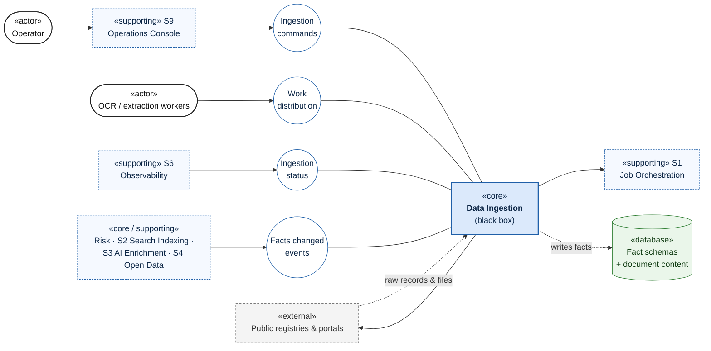

# Viešpirkiai — Target Architecture (Upgrade)

> **Status:** Phase 3, step 1: functional decomposition from the use-case perspective.
> **Inputs:** [`architecture-current.md`](architecture-current.md) (as-is) and [`architecture-review.md`](architecture-review.md) (pain points).
> **Scope of this step:** *what* the system does, grouped into functional components with clear data ownership. *How* each component is deployed (processes, containers, hosts) is decided in a later step. A functional component is a unit of responsibility, not necessarily a separate service.

Notation is the same as in `architecture-current.md`:

| Notation | Meaning |
|---|---|
| **Solid arrow** | Dependency (A uses B) |
| **Dotted arrow** | Data flow (data moves from A to B) |
| Circle | Provided interface (lollipop) |
| `«core»` | Main functional component |
| `«supporting»` | Supporting or secondary functional component |

---

## 1. Core functional components

The system has **five core functional components** around **one shared database**:

| # | Component | Purpose (one sentence) | Primary actors |
|---|---|---|---|
| 1 | **Data Ingestion** | Brings public data from upstream sources into the Viešpirkiai database as normalised, linked and versioned facts. | Upstream registries & portals, OCR / extraction workers, operator |
| 2 | **Query Service** | The single read path to Viešpirkiai data: entity lookups, search, relationships, documents and risk results behind stable query contracts. | Frontend, MCP, Procurement Risk Service |
| 3 | **Procurement Risk Service** | Evaluates procurements against risk indicators and records explainable risk decisions. | Analysts (through Frontend and MCP), operator |
| 4 | **Frontend** | Publishes the data as a searchable public website. | Citizens, journalists, researchers, NGOs |
| 5 | **MCP** | Gives LLM agents structured, read-only access to the data through tools. | AI agents / MCP clients |

### 1.1 Core functional component diagram

### 1.2 Core components: use cases and data ownership

| Component | Key use cases | Depends on | Writes (owns) | Current code |
|---|---|---|---|---|
| **Data Ingestion** | Discover new records · import and refresh incrementally · backfill history · acquire and process documents (download, extract, OCR) · link entities and reference data · detect and version changes (contract edits, legislation editions, court decision updates) | Upstream sources, S1 Job Orchestration | **Fact schemas**, including document content (see §2) | `tasks/*`, `modules/<source>/*`, `modules/failai/`, `modules/documents/`, `runner/` |
| **Query Service** | Look up an entity by identifier · search and facet (contracts, procurements, organisations, documents) · traverse relationships · read document content · read risk results · provide bulk analytical reads · run bounded ad-hoc SQL for analysts | Database (read-only role), S2 search projections, S3 enrichment store | **Nothing.** Read-only by definition. | Scattered: SQL in 21 `src/pages`, `src/lib/*`, `modules/*/search*.js`, `modules/rysiai/`, `modules/mcp/tools/`, `modules/mcp/analyst/` |
| **Procurement Risk Service** | Run evaluation for all procurements or a subset · evaluate each deployed indicator · record explainable decisions · re-evaluate after "facts changed" | **Query Service** (analytical reads), S1 | **`risk` schema** only | `services/procurement-risk/`, `modules/risk/` |
| **Frontend** | Search · entity pages (buyer, supplier, person, contract, procurement, legal act, court decision) · relationship graph · statistics · shareable pages (OpenGraph) | **Query Service** | **Nothing.** | `src/` |
| **MCP** | List tools · search and fetch entities · read contract changes · describe schema · run analyst SQL (optional) | **Query Service** | **Nothing.** Tool-call audit goes to S6 Observability. | `modules/mcp/`, `src/pages/mcp.astro`, `src/lib/mcp.ts` |

**Ownership rules (target)**
1. **One writer per schema.** Data Ingestion owns the facts; the Risk Service owns `risk`.
2. **One read path.** Frontend, MCP and the Risk Service never query the database directly. They go through the Query Service. This is the boundary that removes SQL from pages and tools (review P5).
3. Today both rules are broken:
   - SQL is spread across pages, MCP tools and risk indicators.
   - The Frontend writes OCR results and creates tables at runtime.
   - MCP writes tool-call logs.
   - Every process can import any module.

### 1.3 Query Service

The Query Service turns the database schema into a **published query contract**. Consumers depend on named queries with typed results, never on table layouts. A schema change then touches one component instead of dozens of call sites.

| Query family | Consumers | Notes |
|---|---|---|
| **Entity queries**: get procurement, contract, organisation, person, document, legal act, court case by identifier | Frontend, MCP | Includes change history of the entity |
| **Search & facets**: full-text and filtered search, suggestions, facet counts | Frontend, MCP | Uses S2 search projections; PostgreSQL fallback lives here, not in consumers |
| **Relationship queries**: organisation–person–contract graph traversal | Frontend, MCP, Risk | Graph *building* belongs to Data Ingestion; graph *reading* belongs here |
| **Document content**: extracted text, OCR result, file reference | Frontend, MCP | Replaces direct sidecar reads and the sidecar HTTP API |
| **Risk results**: indicator results and decisions per procurement or organisation | Frontend, MCP | Reads the `risk` schema |
| **Analytical reads**: set-based, streamed reads over large fact sets | Risk Service, S4 Open Data | Versioned read views, not per-row API calls, so batch jobs stay efficient |
| **Ad-hoc SQL** (bounded): read-only, time-limited, restricted to analyst views | MCP | Enforcement by database role and views, not only by SQL parsing (review P3) |

A functional component is not necessarily a network service. The Query Service may start as an in-process library with a read-only connection pool and versioned SQL views. Its value is the contract and the boundary, not the deployment.

---

## 2. Data Ingestion — the abstraction

### 2.1 Why one component

Today ingestion is not one thing. It is **30+ source modules**, each re-implementing its own discovery, fetching, parsing, queues, reservation cleanup and persistence (review P5, P6).

From the rest of the system's point of view, all of it has **one responsibility and one output**: *keep the fact schemas complete, correct and current*. Treating it as a single black box, with a stable external contract and freely decomposable internals, gives:

- **Consumers** (Query Service, Risk, Search Indexing, Open Data) depend only on the *facts* and on *"facts changed"* notifications, never on how a source is scraped.
- **New sources** plug into a shared pipeline instead of copying a whole module.
- **Internal redesign** (queues, scheduler, document processing) doesn't ripple outside.

### 2.2 External contract (black-box view)

| Interface | Direction | Purpose |
|---|---|---|
| **Writes facts** | Output → database | The only output that matters to consumers: canonical, linked, versioned facts plus document content |
| **Facts changed events** | Provided | "Entity X of type T changed in ingestion run R", emitted **after commit**. It is a hint; consumers re-read through the Query Service. Replaces today's `*.changed` NATS subjects. |
| **Ingestion status** | Provided | Per source: last successful sync, lag, error rate, backlog, record counts. Feeds S6 and `/statistika`. |
| **Ingestion commands** | Provided | Run, backfill, re-process, pause or resume a source; requeue a record. Replaces ad-hoc `npm run` scripts. |
| **Work distribution** | Provided | Checkout and submit for external OCR and extraction workers. Moves out of the Frontend. |
| Upstream sources, S1 | Required | Everything the black box needs from outside |

### 2.3 Contract guarantees

These invariants are what "writes facts" *means*. Every internal design decision must preserve them.

| # | Guarantee | Why it matters | Today |
|---|---|---|---|
| G1 | **Single writer**: only Data Ingestion writes fact schemas | Clear ownership; safe schema evolution | ❌ multiple writers |
| G2 | **Canonical model**: facts use normalised entities (procurement, contract, organisation, person, document, legal act, court case), not source-specific shapes | Consumers stay stable when a source changes format | ⚠️ partly: many source-shaped tables |
| G3 | **Provenance**: every fact records source system, source record id, source URL, retrieval time, ingestion run | Transparency, auditability, debugging | ⚠️ inconsistent |
| G4 | **Idempotency**: re-ingesting a source record never duplicates or corrupts facts | Safe retries, backfills and re-processing | ⚠️ per module |
| G5 | **Versioned changes**: changes in source records become recorded versions, not silent overwrites | Contract edits, legislation editions and court updates are product features | ✅ for some sources |
| G6 | **Reprocessability**: raw payloads and files are retained, so parsing and normalisation can be re-run without re-scraping | Sources disappear or block access; parsers improve | ✅ sidecars, file store (not backed up) |
| G7 | **Commit, then notify**: events and notifications are sent only after facts are committed | No consumer reads uncommitted state | ✅ documented NATS rule |
| G8 | **Observable freshness**: every source reports sync status and lag | Operators and users know how current the data is | ⚠️ partial |

### 2.4 Internal view (to be decomposed in a later step)

Every source goes through the same stages. Only the source-specific stages are implemented per source; the rest are shared.

```mermaid
flowchart LR
    classDef specific fill: #dbe9fb, stroke: #1f5fa8, color: #0b2545
    classDef shared fill: #f5f9ff, stroke: #1f5fa8, stroke-dasharray: 3 2, color: #0b2545
    d["1 · Discover<br/>what is new or changed"]:::specific
    f["2 · Fetch<br/>via Source Gateway"]:::shared
    r["3 · Retain raw<br/>payload · file"]:::shared
    p["4 · Parse & extract<br/>structure · text · OCR"]:::specific
    n["5 · Normalise<br/>to canonical model"]:::specific
    l["6 · Link & enrich<br/>reference data · entity resolution"]:::shared
    w["7 · Persist<br/>upsert · version · provenance"]:::shared
    e["8 · Notify<br/>facts changed"]:::shared
    d -.-> f -.-> r -.-> p -.-> n -.-> l -.-> w -.-> e
```

Solid blue: source-specific stage, implemented by each connector. Dashed: shared stage, implemented once.

**Source connector types.** Grouping sources by *how* they are acquired keeps the number of connector patterns small:

| Connector type | Examples today |
|---|---|
| Bulk dataset (CSV / XLSX / JSON dump) | JAR CSV, VPT XLSX reports, address register, Sodra, Regitra |
| Change feed | data.gov.lt ADP `:changes` datasets |
| Crawler / scraper | CVP IS contracts and procurements, CVPP, LITEKO, KOTIS, PINREG, ES investicijos |
| API adapter | e-TAR, e-Seimas (stateless adapter), TED |
| Document pipeline (source-agnostic) | Any fact that references a file: download → store → extract → OCR |

**Internal sub-components** (candidates for the detailed decomposition):

| # | Sub-component | Responsibility | Current code | Previously listed as |
|---|---|---|---|---|
| I1 | **Source Connectors** | Source-specific discover, parse and normalise, one per source | `modules/<source>/*` | — |
| I2 | **Source Gateway** | Outbound access: proxies, Tor, per-source rate limits, request logging, adapters | `utils/scrapeFetch.js`, `modules/scrapeProxies/`, `modules/proxy/`, eTarSeimasScraper | S2 |
| I3 | **Raw Payload Store** | Retain raw API and HTML payloads for audit and re-processing | sidecar SQLite (`eTar`, `eSeimas`, `liteko2`, `failaiInfo`) | — |
| I4 | **File & Document Pipeline** | Download, content-addressed storage, extraction, OCR work distribution, file gateway | `modules/failai/`, `modules/documents/`, `tasks/dokNuskaitytojai.js`, goViesdeze, OCR endpoints | S3, S4 |
| I5 | **Canonical Model & Normalisation** | Shared entity definitions and mapping helpers | `upsert*.js`, per-module mapping code | — |
| I6 | **Reference Data** | CPV, legal forms, addresses and geocoding, classifiers | `modules/bvpz/`, `modules/geografija/`, `liteko2/klasifikatoriai.js` | S14 |
| I7 | **Entity Resolution** | Match organisations and persons across sources; build relationship edges | `modules/juridiniai/`, `modules/rysiai/` (building), `rastiPareiskejuKodus.js` | S15 |
| I8 | **Fact Persistence & Versioning** | Idempotent upserts, change detection and diffs, provenance, notifications | `sutartys` change tracking, `teisekura` editions, `utils/taskSignals.js` | — |
| I9 | **Ingestion Control** | Per-source schedules, backfills, commands, status and freshness | `tasks/*.js` definitions, `npm run` scripts | — |

---

## 3. Supporting (secondary) functional components

These do not deliver end-user value on their own, but the core components can't function reliably without them. Components absorbed into Data Ingestion (Source Gateway, File Acquisition, Document Processing, Reference Data, Entity Resolution) are listed in §2.4.

| # | Component | Responsibility | Serves | Exists today? | Current code / gap |
|---|---|---|---|---|---|
| **S1** | **Job Orchestration** | Scheduling (cron and continuous), durable work queues, retries and back-off, reservation expiry, concurrency limits, wake-up signals | Data Ingestion, Risk, S2, S3, S4 | ✅ Home-grown | `runner/`, `tasks/`, per-domain `SKIP LOCKED` queues, NATS |
| **S2** | **Search Indexing** | Build derived search projections (Quickwit full-text, Typesense suggestions and organisations) from facts on "facts changed"; rebuild and drift detection | Query Service | ✅ Partial | `quickwit/`, `modules/*/quickwitProcessIndexQueue.js`, `modules/juridiniai/typesense*`, `modules/searchSuggestion/` |
| **S3** | **AI Enrichment** | LLM-generated descriptions, embeddings; owns its own enrichment store (does **not** write facts); cost, rate, prompt and model versioning | Query Service | ✅ Experimental | `modules/openrouter/`, `modules/vector/`, `scripts/aprasyti*.js` |
| **S4** | **Open Data Publishing** | Publish curated datasets to the open-data API (Spinta / viesStalcius) and bulk exports; reads through the Query Service | Open-data consumers | ✅ Scattered | `modules/spinta/`, `modules/*/pushToSpinta.js`, `export:*` scripts, export WebSocket |
| **S5** | **Identity & Access** | API keys for machine clients, worker registry, MCP client identification, rate limiting and abuse protection, analyst role policy | Frontend, MCP, Data Ingestion (workers) | ⚠️ Partial | `auth.raktai`, `modules/failai/auth.js`, `src/lib/botChallenge.ts`; **no rate limiting, no key rotation** |
| **S6** | **Observability & Statistics** | Metrics, logs (SQL, scrape, MCP tool calls), ingestion status, job health, alerting, public statistics | Operator, Frontend (`/statistika`) | ⚠️ Partial | `modules/statistika/`, `/metrics`, SQL and scrape log ingest; **no taskRunner health, no alerting** |
| **S7** | **Schema & Data Governance** | Versioned migrations, schema documentation, table ownership map, data-quality checks, reconciliation of derived stores | All core components | ⚠️ Fragmented | `migrations/` (incomplete), `postgres/dumpSchema.js`, schema scripts; **no migration runner** |
| **S8** | **Backup & Recovery** | PostgreSQL backups with point-in-time recovery, raw payload and document-store backups, file archive backup, **tested restore** | Whole system | ❌ Mostly missing | Only `modules/s3backup/` (raw files) |
| **S9** | **Operations Console** | Issue ingestion commands; manage runtime configuration kept as data (proxies, workers, storage boxes, API keys, info banner, task toggles) | Operator | ❌ Missing | pgAdmin, raw SQL, `npm run` scripts |
| **S10** | **Configuration & Secrets** | One source of truth for configuration, secret storage and rotation, per-environment settings | All components | ⚠️ Sprawl | `config.js`, `.env`, `utils/config*.js`, `ENV.md` |

### 3.1 Full functional component diagram

```mermaid
flowchart TB
  classDef actor fill:#ffffff,stroke:#222,stroke-width:1.5px,color:#111
  classDef core fill:#dbe9fb,stroke:#1f5fa8,stroke-width:2px,color:#0b2545
  classDef sup fill:#f5f9ff,stroke:#1f5fa8,stroke-dasharray:3 2,color:#0b2545
  classDef missing fill:#fff4f4,stroke:#c62828,stroke-dasharray:3 2,color:#5a1010
  classDef store fill:#eaf6ea,stroke:#2e7d32,color:#123d14
  classDef ext fill:#f4f4f4,stroke:#777,stroke-dasharray:4 3,color:#333

  subgraph L1["Actors"]
    citizen(["«actor»<br/>Citizen / journalist"]):::actor
    agent(["«actor»<br/>AI agent"]):::actor
    odc(["«actor»<br/>Open-data consumer"]):::actor
    op(["«actor»<br/>Operator"]):::actor
  end

  subgraph L2["Consumers"]
    fe["«core»<br/><b>Frontend</b>"]:::core
    mcp["«core»<br/><b>MCP</b>"]:::core
    risk["«core»<br/><b>Procurement Risk Service</b>"]:::core
    s4["«supporting» S4<br/>Open Data Publishing"]:::sup
  end

  subgraph L3["Read path & derived data"]
    qs["«core»<br/><b>Query Service</b>"]:::core
    s2["«supporting» S2<br/>Search Indexing"]:::sup
    s3["«supporting» S3<br/>AI Enrichment"]:::sup
  end

  subgraph L4["«database» Viešpirkiai data"]
    facts[("Fact schemas<br/>+ document content")]:::store
    riskdb[("risk schema")]:::store
    search[("Search projections<br/>Quickwit · Typesense")]:::store
    enrich[("Enrichment store<br/>descriptions · embeddings")]:::store
    ctrl[("Control schemas<br/>infra · auth · jobs")]:::store
  end

  subgraph L5["Ingestion"]
    ing["«core»<br/><b>Data Ingestion</b>"]:::core
    s1["«supporting» S1<br/>Job Orchestration"]:::sup
  end

  subgraph L6["Platform & operations (cross-cutting)"]
    s9["«missing» S9<br/>Operations Console"]:::missing
    s5["«supporting» S5<br/>Identity & Access"]:::sup
    s6["«supporting» S6<br/>Observability & Statistics"]:::sup
    s7["«supporting» S7<br/>Schema & Data Governance"]:::sup
    s8["«missing» S8<br/>Backup & Recovery"]:::missing
    s10["«supporting» S10<br/>Configuration & Secrets"]:::sup
  end

  workers(["«actor»<br/>OCR / extraction workers"]):::actor
  src["«external»<br/>Public registries & portals"]:::ext
  llm["«external»<br/>LLM & embedding providers"]:::ext

  %% ── Actors ──
  citizen --> fe
  agent --> mcp
  odc --> s4
  op --> s9
  workers --> ing

  %% ── Read path (dependencies) ──
  fe --> qs
  mcp --> qs
  risk --> qs
  s4 --> qs
  qs --> facts
  qs --> riskdb
  qs --> search
  qs --> enrich

  %% ── Derived data ──
  s2 --> facts
  s3 --> qs
  s3 --> llm

  %% ── Ingestion & jobs ──
  ing --> src
  ing --> s1
  risk --> s1
  s9 --> ing

  %% ── Writes into owned stores (data flows) ──
  ing -.->|"writes facts"| facts
  ing -.->|"facts changed"| s2
  risk -.->|"writes decisions"| riskdb
  s2 -.->|"projections"| search
  s3 -.->|"descriptions · embeddings"| enrich
  s1 -.->|"job state"| ctrl

  %% ── Platform ──
  s9 --> ctrl
  s5 -.->|"keys · clients"| ctrl
  s7 -.->|"migrations"| facts
  s8 -.->|"backups"| L4
```

This diagram shows **dependencies** and **writes into owned stores**. Platform components (S5–S10) are cross-cutting; only their data-store edges are drawn, to keep the diagram readable.

---

## 4. Classification rules

These rules decide where new functionality belongs, so that agentic development places code consistently (review P5, P8).

1. **Does it bring data from outside into the database** (including files, OCR, reference data, entity linking)? → **Data Ingestion.** It is the only component that writes facts.
2. **Does it read Viešpirkiai data for someone else?** → it is a query in the **Query Service**. No other component issues read SQL against fact or `risk` schemas. The only exceptions are S2 projection builders and S7 governance tooling.
3. **Does it show data to humans?** → **Frontend**, using only the Query Service.
4. **Does it expose data to AI agents?** → **MCP**, using only the Query Service.
5. **Does it compute a judgement about procurements** (score, flag, indicator)? → **Procurement Risk Service.** It reads through the Query Service and writes only to `risk`.
6. **Does it turn existing data into another shape** (index, embedding, export)? → **S2, S3 or S4**, each writing only to its own store.
7. **Does it keep the system running, safe or recoverable?** → **Platform, S5–S10.**
8. **Is it a one-off or operator script?** → an ingestion command issued through S9, or S7 governance tooling. **Never** a self-executing file inside a library module.

---

## 5. Current-to-target mapping of notable misplacements

| Today | Problem | Target owner |
|---|---|---|
| SQL in 21 `src/pages`, query code in `src/lib`, separate queries in MCP tools | No single read path; the same logic is written several times | **Query Service** |
| Risk indicators query `ppa."ataskaitos"` and views directly | Risk Service coupled to table layouts | **Query Service** (analytical reads) |
| OCR checkout/submit endpoints inside the Frontend | Public web app writes to the database and sidecars | **Data Ingestion** (I4, work distribution interface) |
| `downloadProxyInformation` inside the Frontend | Internal file lookup on the public surface | **Data Ingestion** (I4 file gateway) |
| Sidecar HTTP read API inside the Frontend | Direct access to raw stores | **Query Service** (document content) |
| Per-source queues, reservation cleaners and change signals re-implemented in each module | Duplicated ingestion infrastructure | **Data Ingestion** shared stages (I8, I9) + S1 |
| LLM description generation writing next to import logic | Enrichment mixed with ingestion; writes facts | **S3 AI Enrichment** (own store) |
| `export:*`, `push:*` scripts inside source modules | Distribution mixed with ingestion | **S4 Open Data Publishing** |
| MCP tool-call logging to the database and Quickwit | Consumer writes data | **S6 Observability** |
| Info banner table created and edited through the Frontend | Runtime DDL, no admin UI | **S9 Operations Console**, S7 migrations |
| `modules/risk` run manually via `npm run risk:run` | Core component without scheduling | **Procurement Risk Service**, scheduled through S1, triggered by "facts changed" |
| 115 self-executing scripts and 87 `process.exit` calls in `modules/` | CLI entry points inside library code | Ingestion commands via **S9** / **S7** tooling |

---

## 6. Next steps (later phases)

1. **Decompose Data Ingestion:** connector contract, shared pipeline stages, canonical model, versioning and provenance model.
2. **Define the Query Service contract:** query catalogue, result types, analytical read views, caching.
3. **Logical architecture:** interfaces and events between all components, and allowed dependencies.
4. **Module structure:** map components to a repository layout with enforced import boundaries.
5. **Deployment architecture:** process, container and host placement (review P4, P12).
6. **Migration roadmap:** ordered by risk. S8 Backup & Recovery and S7 migrations come first.
